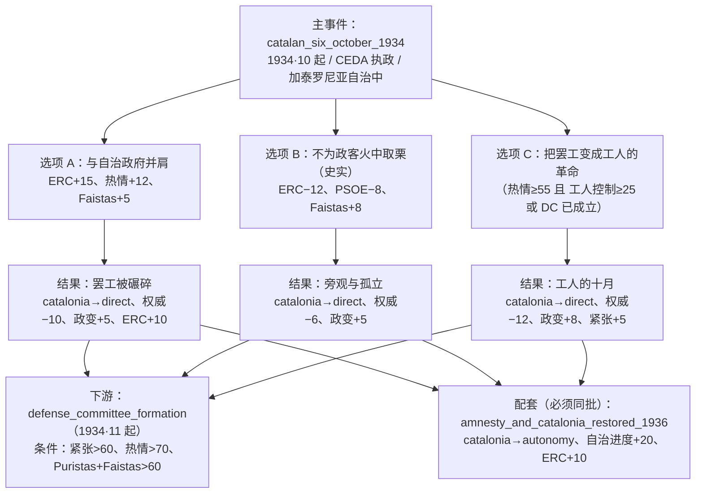

# Fets del sis d'Octubre（1934·10·6 加泰罗尼亚"国家"宣告）事件设计 v1

> 状态：**设计稿，未实现**。对应 `docs/event-backlog-1931-1939.md` §3.1 候选 `catalan_six_october_1934`（史实，成本 M），本稿把该条目展开成可直接实现的设计。
> 结论先行：这是一个**节点事件链**（主事件 + 3 个结果叶子），不新增任何 `GameState` 字段；它同时是「黑色两年」缺失的加泰罗尼亚拼图、`defense_committee_formation`（1934·11）的因、以及 1936 年 `olimpiada_popular` 的前置条件来源——**因此必须与 §8 的 1936 恢复自治事件同批上线**。

---

## 1. 定位

| 维度 | 设计 |
| --- | --- |
| 事件类型 | 一次性政治事件链（`inline.root` + 3 × `inline.leaf`），非日志 |
| 玩家角色 | CNT-FAI 全国委员会：**面对别人（ERC／孔帕尼斯）宣布的独立，我们怎么办** |
| 核心张力 | 反法西斯团结（与资产阶级共和派并肩）↔ 阶级独立（不为政客火中取栗）↔ 把别人的起义变成自己的革命 |
| 史实锚点 | 1934·10·6 晚，加泰罗尼亚自治政府主席孔帕尼斯宣布"加泰罗尼亚国"，约十小时后被巴泰特将军的军队以炮击解决；自治法令中止，全体委员被捕 |
| 系统功能 | 让 `regionalStatuses.catalonia` 第一次有**降级**（`autonomy → direct`）的内容来源；给 `regional_autonomy_progress`、`coupProgress`、`armyLoyalty`、`ERC/PSOE` 关系提供节点；为 1934·11 的防御委员会事件铺垫 tension／fervor |
| 成本 | M（主事件 + 3 个结果节点 + 强制配套 §8；无新字段、无新结局） |

### 1.1 为什么不做成日志

| 备选 | 否决理由 |
| --- | --- |
| 日志「加泰罗尼亚问题」 | 十月六日只有十小时，是**节点**不是多月目标；跨月的部分（1934·10 中止 → 1936·2 恢复）由 §8 的恢复事件承担，比再加一本日志更省字段且叙事更准 |
| 并入 `journal_regional_issues`（地区问题） | 该日志的进度是**全国** `regional_autonomy_progress`，没有地区维度；硬塞会把"加泰罗尼亚"与"巴斯克/加利西亚"混成一个标量（这正是 `docs/工会与生产控制系统设计.md` 批评过的"一个字段装三种语义"） |
| 复用 `asturias_revolution` 链 | 那条链的门槛（UHP 完成、革命热情 > 80、Faistas+Puristas > 80）是 CNT–PSOE 联盟路线专属；而十月六日的触发点是 **CEDA 入阁**，与 CNT 是否走成工人联盟无关。两者是同一波革命浪潮的两个独立入口 |

---

## 2. 历史依据

- 1934·10·4：勒鲁改组内阁，**三名 CEDA 部长入阁**——这是社会党与工人联盟发动十月总罢工的直接导火索（本设计的政治前提 `rulingCoalition === 'ceda_radical'` 即指此状态）。
- 1934·10·5–6：加泰罗尼亚的**工人联盟（Alianza Obrera）**号召总罢工；**CNT 没有加入这场运动**——它既未参加加泰罗尼亚的工人联盟（该联盟由 BOC／USC 等主导），也没有号召自己的会员为自治政府上街。检索到的原文表述：「En definitiva, la CNT no participó en el movimiento catalanista, ni en la huelga general promovida desde la Alianza Obrera…」（[CORE 论文](https://core.ac.uk/download/441032341.pdf)，检索确认片段）。
- 1934·10·6 晚约 20:00：孔帕尼斯在自治政府阳台上宣布**"加泰罗尼亚国"**（作为"西班牙联邦共和国"内的国家），接管加泰罗尼亚的公共秩序与通讯，并期待 CNT 与工人组织响应。
- 当晚：第 4 师师长**多梅内克·巴泰特（Domènec Batet）**宣布战争状态，军队（含炮兵）攻击自治政府宫与市政厅；战斗持续到 10·7 清晨，官方死亡人数约 **46 人**（巴塞罗那为主）。孔帕尼斯与全体委员投降被捕，内政委员登卡斯（Dencàs，Estat Català）经下水道逃往法国。
- 后果：**自治法令中止**、议会解散、加泰罗尼亚由总督（governor-general）直接管辖；孔帕尼斯等人于 1935 年被宪法保障法庭判处 **30 年**徒刑；阿斯图里亚斯的矿工起义同时被佛朗哥指挥的部队血腥镇压。
- 1936·2·16：人民阵线赢得大选 → 2·21 大赦 → **1936·3·1 孔帕尼斯返回巴塞罗那、自治恢复**（[NYT 1936 报道](https://www.nytimes.com/1936/02/27/archives/catalan-regime-revived-in-spain-madrid-decree-restores-the-regional.html)）。

**其他参考（检索确认存在，未逐篇全文核对）**：[Wikipedia · Events of 6 October 1934](https://en.wikipedia.org/wiki/Events_of_6_October_1934)、[France 24 · Catalans' last brush with statehood: 10 bloody hours in 1934](https://www.france24.com/en/20171011-catalans-last-brush-with-statehood-10-bloody-hours-1934)、[El Punt Avui · Noranta anys dels Fets d'Octubre](https://eleccions.elpuntavui.cat/opinio/article/8-articles/2462450-noranta-anys-dels-fets-d-octubre.html)、[Gencat · 委员被判 30 年](https://dixit.gencat.cat/web/.content/home/04recursos/02publicacions/02publicacions_de_bsf/11serveis_socials/llegat-consellers-drets-socials-generalitat-republicana/El-llegat-dels-consellers-de-drets-socials-de-la-Generalitat-republicana-electronic.pdf)。

---

## 3. 触发设计

### 3.1 主事件 `catalan_six_october_1934`

```ts
meta: { category: 'politics', flow: 'inline.root', series: ['catalonia', 'october_1934'], tags: ['politics'] }
date: { year: 1934, month: 10 }          // 仅 Historical 难度按日期精确调度

condition: (state) =>
  isAtOrAfter(state, 1934, 10)                              // 非历史难度：首次满足即触发
  && state.scenario !== '1936'                              // 1936 剧本跳过 1934
  && state.civilWarStatus === 'not_started'                 // 和平期事件
  && state.rulingCoalition === 'ceda_radical'               // CEDA 入阁 = 十月起义的政治前提
  && state.regionalStatuses?.catalonia === 'autonomy'       // 自治法令生效中，才有"自治政府 vs 马德里"
```

说明：

- **不设 `stats.tension` 门槛**。史实触发点是"右翼入阁"而非社会紧张度；且 `asturias_revolution` 在非历史难度已经吃掉了 tension>60／fervor>50／UHP 三重门，若再加一道，走不成工人联盟路线的玩家将永远看不到"黑色两年"最关键的这一个月。
- **一次性**由 `eventHistory` 保证（backlog 约束 #2），无需新字段。
- **与 `asturias_revolution` 不互斥**：两者都锚在 1934·10、都以 `ceda_radical` 为前提，可以同月先后触发（同一次革命浪潮的南北两端）。`activeWar === 'asturias_war'` 时本事件照常排队，并在选项 A 上给一条**联动加成**（见 §5.4）。

### 3.2 难度 / 剧本矩阵

| 难度 / 剧本 | 触发方式 | 备注 |
| --- | --- | --- |
| Historical | 1934·10 月份结算时精确触发（条件仍需成立） | 与史实月份一致 |
| Normal / Easy / Hard | `condition` 首次满足的月份 | 最迟受"CEDA–激进党下台"限制：`nombela_scandal`（1935·11）击穿该联盟后本事件永久失效，这是一道与阿斯图里亚斯链同款的软时限 |
| Sandbox | 同非历史；无专用调试开关（复用 `SANDBOX_EDIT` 改 `rulingCoalition` 即可测试） | 成就照常不授予 |
| 1931 剧本 | 加泰罗尼亚开局为 `direct`，需 1932·9 的 `catalonia_autonomy_1932`（要求政府为共和-社会党内阁）先升到 `autonomy` | 若 1931 年组阁走了别的路径，本事件自然不触发——这正是"自治法没通过就没有自治政府可保卫"的因果 |
| 1933 剧本 | 开局即 `autonomy` + `ceda_radical` | 1934·10 直接可触发（最快路径） |
| 1936 剧本 | 不触发 | `scenario` 门控 + 内战进行中 |

---

## 4. 演出文本草案

### 4.1 主事件

**中文（草案）**

> 十月的马德里把三个 CEDA 部长请进了内阁，全国的工人用总罢工回答。而在巴塞罗那，回答的人不是我们：十月六日晚八点，加泰罗尼亚自治政府主席孔帕尼斯站在自治政府宫的阳台上，宣布成立"西班牙联邦共和国之下的加泰罗尼亚国"，并接管了本地的公共秩序与通讯。他派人来问我们是否响应。街上的工人正等着一个信号——任何一个信号。
>
> 孔帕尼斯不是我们的朋友：是他签下了驱逐工会的布告，是他的警察在 1933 年把罢工者关进监狱。可现在，第 4 师的巴泰特将军正在把大炮推上蒙锥克，而马德里已经宣布这是叛乱。我们只有几个小时来决定：这到底是资产阶级政客的火中取栗，还是反法西斯战线在加泰罗尼亚的第一道街垒？

**English (draft)**

> October has brought three CEDA ministers into the cabinet in Madrid, and the workers of Spain have answered with a general strike. In Barcelona the answer did not come from us. At eight in the evening of the sixth, Lluís Companys stepped onto the balcony of the Generalitat and proclaimed the Catalan State within the Spanish Federal Republic, taking over public order and communications. He has sent word asking whether we will answer. The workers in the streets are waiting for a signal — any signal.
>
> Companys is no friend of ours: his signature is on the orders that drove our unions out, his police filled the prisons with strikers in 1933. But General Batet of the 4th Division is already hauling guns up Montjuïc, and Madrid calls this rebellion. We have hours, not days, to decide whether this is a bourgeois politician pulling chestnuts from the fire — or the first barricade of the anti-fascist front in Catalonia.

### 4.2 三个选项

| # | 选项（中） | 选项（英） | 路线 |
| --- | --- | --- | --- |
| A | **与自治政府并肩：下令总罢工，把工人送上街头** | Stand with the Generalitat: call the general strike | 反法西斯团结／联合阵线 |
| B | **不为资产阶级政客火中取栗：我们不上街**（史实 CNT 立场） | Not a single man for a politician's adventure | 阶级独立／保存力量 |
| C | **两条路都拒绝：把这场罢工变成工人的革命**（门槛选项） | Neither Madrid nor the Generalitat: turn the strike into our own revolution | 第三条路／社会革命 |

---

## 5. 选项机制与平衡

### 5.1 效果总表

**设计原则**：**选项 = 决策的即时政治后果**（关系、派系、阶级、热情、紧张、资源）；**结果叶子 = 史实结算**（自治中止、共和权威、军队、政变进度）。这样每一步的归属都单一，不会出现"同一个后果在两个节点各写一次"。

| 字段 | A 并肩 | B 不参与（史实） | C 工人革命 |
| --- | --- | --- | --- |
| `partyRelations.ERC` | **+15** | **−12** | **−20** |
| `partyRelations.PSOE` | +4 | **−8** | −10 |
| `factions.Faistas` 影响 | +5 | **+8** | **+10** |
| `factions.Puristas` 影响 | — | +5 | +5 |
| `factions.Treintistas` 异议 | +5 | — | — |
| `factions.Cenetistas` 异议 | — | +5 | +8 |
| `classes.Obreros` → `CNT_FAI` | +3 | +4 | **+6** |
| `stats.revolutionaryFervor` | +12 | +4 | **+18** |
| `stats.tension` | +10 | +3 | **+18** |
| `stats.workerControl` | — | +5 | **+15** |
| `resources` | −1 | — | −2 |
| 额外（门槛达成时） | `activeWar === 'asturias_war'` → 热情 +5、Faistas +3（南北同时起火） | — | `isOrganizationEstablished('DC')` → `adjustCntMilitiaManpower(state, +8000)` |

### 5.2 三个结果叶子

三者共享"自治中止"的骨架，差异体现为**谁付出了代价、共和国权威与军队受到多大冲击**：

| 叶子事件 | 触发 | 效果 |
| --- | --- | --- |
| `catalan_october_strike_crushed`（A） | A 的 `currentEvent` | `regionalStatuses.catalonia = 'direct'`；`regional_autonomy_progress −15`；`republicanAuthority −10`；`armyLoyalty −5`；`coupProgress +5`；`armaments −1`（武器被收缴）；`ERC +10`（共同受难的记忆＝1936 年人民阵线的信任基础）；`Treintistas 异议 +5`（"为资产阶级火中取栗"的清算） |
| `catalan_october_abstention`（B） | B 的 `currentEvent` | `catalonia = 'direct'`；`regional_autonomy_progress −15`；`republicanAuthority −6`；`armyLoyalty −5`；`coupProgress +5`；`workerControl +3`（组织未被摧毁） |
| `catalan_october_workers_defeat`（C） | C 的 `currentEvent` | `catalonia = 'direct'`；`regional_autonomy_progress −15`；`republicanAuthority −12`；`armyLoyalty −6`；`coupProgress +8`；`Faistas 异议 +5`（街垒上的伤亡）；`tension +5`（把 1934·11 的防御委员会事件推向门槛） |

每个叶子只保留 **1 个"继续"选项**（`effect: () => ({})`，与 `asturias_war_failed` 同款），不再做第二层分支——十小时的结局没有第二种收尾。

### 5.3 数值量级对照（防超模）

| 参照 | 数值 |
| --- | --- |
| `casas_viejas`（1933 农村血案） | PSOE/IR −15~−25、紧张度 + |
| `elections_1933_results` | `CNT 工会占比 −10`、改革倒退（土地 −20） |
| `nombela_scandal` | PSOE/IR +15、击穿执政联盟 |
| `presidential_election_chain` | `coupProgress +5 / +10 / +25` |
| `propaganda_by_deed`（刺杀） | `coupProgress ∓10~20`、`armaments ±` |
| **本设计** | 关系 ±8~20、热情 +4~18、紧张 +3~18、`coupProgress +5~8`、`armyLoyalty −5~6`、`workerControl +3~15` |

单看每个数字都在既有区间内；三者合计的"十月冲击"（一个剧本最多结算一次）为：`regional_autonomy_progress −15`、`republicanAuthority −6~12`、`armyLoyalty −5~6`、`coupProgress +5~8`。**注意 `workerControl` 在 1936·7 之前有 40 的上限且每月 −1 自然衰减**（`rules/controlObrero.ts`），所以 C 的 +15 是"可被消耗的政治资本"，不是永久加成。

### 5.4 条件选项 C 的门槛

C 是唯一有硬门槛的选项，灰显文案要写清缺什么（house 规则：`unavailableSubtitle` + `unavailableSubtitleZh`）：

```ts
condition: (state) =>
  state.stats.revolutionaryFervor >= 55 &&
  (state.stats.workerControl >= 25 || isOrganizationEstablished(state, 'DC'))
```

- 表达的历史逻辑：**没有组织与斗志，就没有"第三条路"**——只能选 A（跟着别人上街）或 B（旁观）。
- 1933 剧本开局热情仅 10，正常玩法下 C 通常在 1934 年内**不可用**（这也符合史实：1934 年 10 月的 CNT 刚从 1933 年 12 月起义的镇压中恢复，没有能力独立行动）；而 1931 剧本若把热情／工人控制养起来，C 就会亮起——这是本设计里最主要的架空入口。
- `isOrganizationEstablished(state, 'DC')` 是 `organizations.ts` 的既有判定（防御委员会），1934·11 起才可能成立（见 §7.4），因此它主要服务**非历史难度下事件延后到 1935 年**的存档与沙盒测试。

---

## 6. 链结构



---

## 7. 与既有内容的耦合与风险

### 7.1 ⚠️ `olimpiada_popular` 会被本事件连锁封锁（必须处理）

`olimpiada_popular` 的硬门槛之一是 `regionalStatuses.catalonia === 'autonomy'`（`src/game/events/olimpiada_popular.ts:14`）。本事件把加泰罗尼亚打成 `direct`，**如果没有任何事件把它恢复**，那么从此以后：

- 1936 年 6–8 月的 Olimpíada Popular 事件永不触发；
- 成就 `A_OLIMPIADA` 在 1931／1933 剧本中变成不可达（1936 剧本开局即 `autonomy`，不受影响）。

**处理方式（二选一，推荐前者）**：

1. **同批实现 `amnesty_and_catalonia_restored_1936`**（backlog §3.6，成本 S）：1936·2 大赦 → `catalonia = 'autonomy'`、`regional_autonomy_progress +20`、`ERC +10`。这样自治的升降形成闭环，`olimpiada_popular` 的因果链反而更完整（人民阵线胜选 → 恢复自治 → 才有巴塞罗那办赛）。
2. 兜底补丁：在 `elections_1936_results` 的人民阵线分支里附加 `catalonia = 'autonomy'`。缺点是自治恢复变成大选的附带效果，叙事上不如 §3.6。

> 本设计按方案 1 编写；**若只上线本事件而不上线 §3.6，视为未完成**。

### 7.2 `mayDays.ts` 的反向门控

`rules/mayDays.ts:29` 在 `catalonia === 'independent'` 时**跳过五月危机**。本设计的 A/B/C 三支都只把加泰罗尼亚打到 `direct`，**不写 `independent`**，因此不会碰到这条耦合。若采纳 §9 的架空独立分支，必须显式接受"该局没有五月危机"。

### 7.3 成就 `A_CATALONIA`（向加泰罗尼亚致敬）

条件是 `catalonia === 'independent'` **且** `cataloniaControl ∈ {cnt_fai, committee}`（`achievements.tsx:143-147`）。`committee` 当前只在战时由 `catalonia_defense` 写入，因此：

- **本事件（A/B/C）不解锁该成就**，也不要为了解锁它把 `independent` 硬塞进 1934 年；
- `regionalStatuses.catalonia = 'independent'` 至今全仓库无人写入，这个死状态仍应由 backlog §5.1（1936 战时独立路线）负责修复——本设计只在 §9 提供一个**可选的高门槛提前入口**。

### 7.4 防御委员会（1934·11）的因

`defense_committee_formation` 的条件是 `year > 1934 || (1934 && month >= 11)`、`tension > 60`、`fervor > 70`、`cntStance !== 'govern'`、`Faistas+Puristas > 60`。「没有准备，就没有革命」这句引文正是十月失败后的自我批评——本事件的三条支线都提供 tension／fervor（C 最多：+18/+18，再加叶子的 tension +5），让这个事件在 1934·11 之后真正有机会触发。

**设计取舍**：不给"直接成立 DC"的捷径，也不提前 DC 的时间窗（那是另一条链的门槛，改动会连带影响 1936 开局的民兵池）。仅选项 C 在 `DC` 已成立时给出 `adjustCntMilitiaManpower(state, +8000)`——既尊重 `adjustCntMilitiaManpower` 要求 DC 处于 active 的实现约束（`organizations.ts:757-781`），也避免绕过组织建设直接变出民兵。

### 7.5 《地区问题》日志

该日志的进度就是 `regional_autonomy_progress`，而审计已知它几乎不可达（唯一写入是拉蒙·佛朗哥路线的 +15/+10）。本事件再给 **−15**，会进一步压低它的完成率。

**处理方式**：−15 保留（自治被中止本来就该是重击），但 §3.6 的恢复事件返还 **+20**；如果玩家在 1936 年之前就完成了该日志，则不受影响（日志完成状态不再重算）。这一点在实现时要写进注释，避免后来者把它当 bug。

### 7.6 与 `asturias_revolution` 同月

| 情形 | 行为 |
| --- | --- |
| 阿斯图里亚斯战争未发生（大多数存档） | 本事件独立叙事：加泰罗尼亚是十月浪潮里唯一"由别人点火"的一端 |
| `activeWar === 'asturias_war'` | 事件照常在月结排队（地图战期间事件看板不可见，玩家回到标准视图的当月即可读到，backlog 约束 #7）；选项 A 追加 `热情 +5`、`Faistas +3`，文案追加一句"北方的矿井已经在燃烧" |

---

## 8. 必备配套：`amnesty_and_catalonia_restored_1936` 契约

| 项 | 约定 |
| --- | --- |
| 触发 | `date: { year: 1936, month: 2 }` + `condition: isAtOrAfter(1936, 2) && state.regionalStatuses.catalonia === 'direct'`（1936·3·1 的史实恢复日可放宽到 2–3 月窗口） |
| 效果 | `regionalStatuses.catalonia = 'autonomy'`、`regional_autonomy_progress +20`、`partyRelations.ERC +10`、`stats.republicanAuthority +5` |
| 选项 | 组织迎接孔帕尼斯的群众游行（CNT 支持+）／冷眼旁观"资产阶级的赦免"（Faistas+、ERC−）／要求全面特赦政治犯（热情+、政府关系−）——详见 backlog §3.6 |
| 依赖 | 必须排在 `elections_1936_results` 之后（同月或次月），否则人民阵线尚未胜选就恢复自治，因果颠倒 |
| 门控 | 只在 `catalonia === 'direct'` 时触发（没被中止就无需恢复） |

---

## 9. 可选架空分支：1934 年的加泰罗尼亚自由公社（成本 L，**建议 v1 不做**）

若你希望本事件也能修 `A_CATALONIA`／给 `mayDays` 门控一次真实生效的机会，可加第四个结果叶子：

```ts
// 门槛：C 的选项 + 组织与武装基础
condition: isOrganizationEstablished(state, 'DC')
        && state.stats.workerControl >= 40
        && state.stats.revolutionaryFervor >= 80
        && state.factions.Faistas.influence > Math.max(Cenetistas, Puristas, Treintistas)
```

- 效果：`regionalStatuses.catalonia = 'independent'`、`cataloniaControl = 'cnt_fai'`、`ERC −30`、`republicanAuthority −20`、`coupProgress +10`，并解锁成就 `A_CATALONIA`（因为 `cnt_fai` 与 `independent` 同时成立）。
- 需要一并接受：① 该局**不会再有五月危机**（`mayDays.ts:29`）；② 与马德里撕破脸对内战开局的地图/资源影响目前**没有任何规则承接**（`regionalStatuses` 不改变省份归属、不产生军队、不产生外交承认——见 `docs/游戏设计文档.md` §地区状态说明），所以它现在是"政治姿态 + 成就"，不是"新国家"。
- 若要做成真正的独立建国（新阵营、新经济、新结局），成本升到 L+，建议单独立项。

---

## 10. 实现清单（待批准后执行）

| # | 文件 | 改动 |
| --- | --- | --- |
| 1 | `src/game/events/catalan_six_october_1934.ts`（新增） | 主事件 + 3 个结果叶子（同文件导出 4 个 `GameEvent`，与 `asturias_revolution.ts` 同款组织方式） |
| 2 | `src/game/events/index.ts` | 4 个事件全部 import 并加入 `INITIAL_EVENTS`（backlog 约束 #8：`RESTORABLE_EVENTS` 靠 `...INITIAL_EVENTS` 展开；叶子事件无 `condition`，不会被调度器自动排队） |
| 3 | `src/game/events/amnesty_catalonia_1936.ts`（新增） | §8 的配套事件，同步注册 |
| 4 | 无需改动的部分 | **不新增字段**、不动 `mayDays`／`achievements`／`journal`／`types.ts`（除可选 §9 外的全部效果都落在既有字段上） |
| 5 | 验证 | ① `node node_modules/typescript/bin/tsc --noEmit`；② 无头探针：三个选项分别跑通"选项 → `currentEvent` 叶子 → 状态写入"，并断言 `catalonia` 在 1936·2 恢复事件后回到 `autonomy`；③ 断言 `olimpiada_popular` 在"1933 剧本 + 本事件 + §8"的模拟序列里仍能触发 |
| 6 | 文档 | `docs/游戏设计文档.md` 事件章节补一行；`docs/event-backlog-1931-1939.md` §3.1 标记为已实现；`game-story-routes.md` / `.mmd` 补链 |

---

## 11. 待你拍板的决策点

1. **选项 C 的门槛**：`热情 ≥ 55 且（工人控制 ≥ 25 或 DC 已成立）`——是否过松／过紧？（我倾向保持"1933 剧本正常玩法下不可用"，让 A/B 成为主路径。）
2. **`coupProgress` 给多少**：本设计合计 +5~8。十月事件在史实上是政变政治的重要加速器，如果你希望它在游戏里更重，可以提到 +10~15（但会明显加快内战到来）。
3. **`armyLoyalty` 的方向**：本设计取 **−5**（军队自视为共和国仲裁者、对文官政府信任下降）。若你认为"军队替共和国平叛"应记作忠诚上升，改为 +3 也可以，请指定。
4. **是否保留 `regional_autonomy_progress −15`**：它会让《地区问题》日志更难完成（该日志已完成率本就极低）。可选方案：减到 −10，或改由 `republicanAuthority` 独自承担惩罚。
5. **§9 架空独立分支**：v1 不做（推荐）／做成高门槛第四叶子／做成完整独立建国（L+）。
6. **§8 配套事件**：确认同批实现（推荐）／先用兜底补丁（大选结果里恢复自治）。
7. **文案基调**：现在的主事件文案把孔帕尼斯写成"不是我们的朋友，但街垒是真的"。若你希望更冷（纯阶级立场）或更暖（反法西斯团结优先），我按你的基调重写中英文本。
