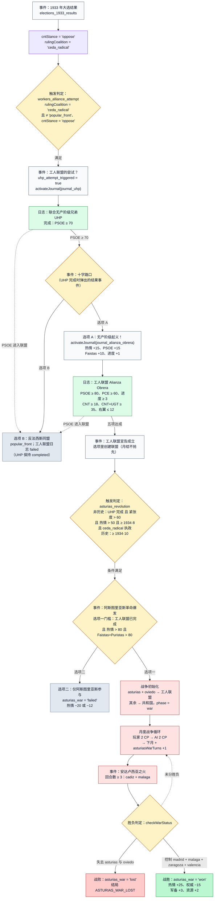

# 工人联盟（Alianza Obrera）→ 阿斯图里亚斯战争：完整事件链详解

> 本文按源码实际判定整理，而不是按历史叙述整理。所有阈值、日期与状态字段都标注了出处；流程图见 [`asturias-war-chain.svg`](asturias-war-chain.svg)（矢量图）与 [`asturias-war-chain.mmd`](asturias-war-chain.mmd)（Mermaid 源码，可直接贴到 GitHub / Mermaid Live 编辑）。

**一句话概括**：这条链把「1933 年大选后 CNT 退回反对派」变成一次政治准备（UHP 日志 → 十字路口 → 工人联盟日志），再把政治准备兑现成一场**独立于西班牙内战的局部地图战争**——玩家扮演工人联盟自治政府，用阿斯图里亚斯的矿工纵队对抗马德里政府军；打赢只是回到主线，打输则**直接以 `ASTURIAS_WAR_LOST` 结束整局游戏**。

---

## 0. 这条链在哪里、能不能进

| 剧本 | 起始时间 | `cntStance` | `rulingCoalition` | 能否进入本链 |
| --- | --- | --- | --- | --- |
| 1931 · 共和国诞生 | 1931·4 | `oppose` | `provisional_government` | ✅ 1933·11 大选结算出 `ceda_radical` 后的**首次月结**进入 |
| 1933 · 黑色两年 | 1933·11 | `oppose` | `ceda_radical` | ✅ 首次月结（1933·12）进入（最快路径） |
| 1936 · 内战开局 | 1936·7 | `cooperate` | `popular_front` | ❌ `workers_alliance_attempt` 要求 `cntStance === 'oppose'` **且 `rulingCoalition === 'ceda_radical'`**；1936 开局两条都不满足，且 PSOE 已在人民阵线中，两本日志都会立刻 `failed` |

> ⚠️ **排队时机的一处细节**：开局事件筛选跑在「开局前模板」上（`scenarios/index.ts` 中 `PRE_START_STATE` 的 `rulingCoalition` 为 `null`），所以**即使 1933 剧本开局就已经是 CEDA–激进党政府**，`workers_alliance_attempt` 也不会出现在开局待办里，而是在**第一次月结**时按真实状态（`ceda_radical` ✅）排队。玩家因此晚一个月（1933·12）看到这个事件——对这条链的节奏无实质影响，但如果需要它开局即出现，得让开局筛选改用初始化后的状态，或在 `condition` 里保留一条针对 1933 剧本的退路。

出处：[`src/game/utils/coalition.ts:329-345`](../../src/game/utils/coalition.ts)（起始联盟与立场）、[`src/game/events/workers_alliance_attempt.ts:13-19`](../../src/game/events/workers_alliance_attempt.ts)。

同一局内这条链**只有一次机会**：只要 `wars.asturias_war` 不再是 `not_started`（`ongoing` / `won` / `lost` / `failed` 四者之一），`asturias_revolution` 就永久不会再次排队（[`src/game/events/asturias_revolution.ts:51-53`](../../src/game/events/asturias_revolution.ts)）。

---

## 1. 前置状态：1933 年大选结算

`elections_1933_results`（1931 剧本于 1933·11 排队）会一次性写下本链需要的全部前置状态（[`src/game/events/elections_1933.ts:190-216`](../../src/game/events/elections_1933.ts)）：

- `cntStance = 'oppose'`：CNT 被赶出政府，退回反对派；
- `rulingCoalition = 'ceda_radical'`：CEDA–激进党「黑色两年」政府上台；
- 工会占比向量额外承受一次 `CNT −10`（转入未组织者），这是 1931 剧本里工人联盟后期卡壳的主要来源。

---

## 2. 第一环：`workers_alliance_attempt`（工人联盟的尝试？）

**触发条件**（`condition`，无 `date`，因此历史与非历史难度都只看条件）：

| 条件 | 说明 |
| --- | --- |
| `rulingCoalition === 'ceda_radical'` | **必须是 CEDA–激进党「黑色两年」政府**——1933·11 上台的右翼共和政府才是这条链的历史起点 |
| `rulingCoalition !== 'popular_front'` | 人民阵线政府下 CNT 的合作路线才是主线，此时不再尝试工人联盟 |
| `cntStance === 'oppose'` | CNT 必须仍在反对派立场（参政即失去独立尝试的资格） |
| `!uhp_attempt_triggered` | 这条链一局只有一次 |

代码（[`src/game/events/workers_alliance_attempt.ts:14-25`](../../src/game/events/workers_alliance_attempt.ts)）：

```ts
condition: (state) => {
  if (state.uhp_attempt_triggered) return false;
  const isCedaRadicalGovernment = state.rulingCoalition === 'ceda_radical';
  const isNotPopularFront = state.rulingCoalition !== 'popular_front';
  return isCedaRadicalGovernment && isNotPopularFront && state.cntStance === 'oppose';
}
```

**旧的日期门槛 `year > 1933 || (year === 1933 && month >= 11)` 已删除**：它只保证"1933 年 11 月之后"，但 1935·11 `nombela_scandal` 之后的看守政府、以及 1931 剧本中尚未改选的 `provisional_government` 都会被它放过。改成执政联盟判定后，条件与历史锚点（1933·11 右翼上台 → 1934·10 阿斯图里亚斯）严格对齐，也自动排除了人民阵线时期。

**事件本体**只有一个选项（玩家无法拒绝）：启动工人团结的尝试，`Uníos Hermanos Proletarios!`，效果是

```ts
uhp_attempt_triggered: true,
...activateJournal(state, 'journal_uhp')   // 把 UHP 日志从 inactive 写成 active
```

即：**真正发生的事是「UHP 日志被开启」，而且就在玩家点下这个选项的当下**——按「事件—日志—事件」契约（设计文档 §6.1），日志的激活只由它的开始事件负责，不再等月结、也不再依赖 `uhp_journal_activated` 这类标志位（[`src/game/events/workers_alliance_attempt.ts`](../../src/game/events/workers_alliance_attempt.ts)、[`src/game/rules/journalEvents.ts`](../../src/game/rules/journalEvents.ts)）。

---

## 3. 第二环：日志「联合无产阶级兄弟 UHP」

| 项目 | 值 | 出处 |
| --- | --- | --- |
| 开始事件 | `workers_alliance_attempt`（选项效果调用 `activateJournal(state, 'journal_uhp')`） | [`src/game/events/workers_alliance_attempt.ts`](../../src/game/events/workers_alliance_attempt.ts) |
| 进度字段 | `partyRelations.PSOE`（0–70 显示） | [`src/game/journal/uhp.ts:17-19`](../../src/game/journal/uhp.ts) |
| 完成 | `PSOE 关系 ≥ 70` → 管线在同一次月结里弹出**结果事件**「十字路口」 | 同上（`completionEventId`） |
| 失败 | PSOE 加入 `republican_socialist` 或 `popular_front` 联盟 | 同上 `:26-30` |

三个剧本的 `partyRelations.PSOE` 初始值都是 **60**（[`src/game/parties.ts:60-63`](../../src/game/parties.ts)），所以 UHP 需要把关系推高 10 点。可用的主要来源：

- **Valeriano Orobón（顾问）**：「改善与 UGT 关系」→ `PSOE +5 × (1 − Cenetistas 异议/100)`，冷却 6 个月（[`src/game/advisors/orobon_fernandez.ts:12-35`](../../src/game/advisors/orobon_fernandez.ts)）；
- Mariano Rodríguez 顾问行动：`PSOE +5`、`PCE +5`（[`src/game/advisors/mariano_rodriguez.ts:53-56`](../../src/game/advisors/mariano_rodriguez.ts)）；
- 事件侧：`nazi_power_1933` 的 `PSOE +5`、`ley_defensa_republica` 的 `+6 / +14`、`ley_orden_publico` 的 `+6 / +8`、`nombela_scandal` 的 `PSOE +15`（1935·11）；
- 反向：`casas_viejas` 系列、`huelga_telefonica_1931`、`jurados_mixtos` 会扣 `PSOE`，走这条路时**不要**踩这些选项。

> ⚠️ 顾问行动共享同一个全局冷却 `advisorActionTimer`（每次行动后置 6），所以「3 次工人联盟推动」与「拉高 PSOE 关系」是在抢同一个资源。

---

## 4. 第三环：事件「十字路口：无产阶级起义还是反法西斯同盟？」

**触发**：它是 **UHP 日志的结果事件**（`journal_uhp.completionEventId`），由月结管线在 UHP 完成的那一刻自动排队；事件自身的 `condition` 只是兜底：`UHP 已完成 且 尚未选择 且 year ≥ 1934`（[`src/game/events/crossroads_uprising_alliance.ts`](../../src/game/events/crossroads_uprising_alliance.ts)）。

> 顺序变更说明：旧实现里十字路口靠 `uhp_attempt_triggered + year ≥ 1934` 触发，会在 UHP **完成之前**就弹出，并且由它的 `PSOE +15` 把 UHP 推过 70——那是"事件在前、日志在后"。现在改成"UHP 完成 → 弹出事件 → 事件开启下一本日志"，与「事件激活日志 / 日志完成弹出事件」契约一致。

这是整条链**唯一一次不可逆分岔**：

| 选项 | 完整效果（代码） |
| --- | --- |
| **A · 无产阶级起义！** | `activateJournal(state, 'journal_alianza_obrera')` → **开启工人联盟日志**<br>`革命热情 +15`（上限 100）<br>`PSOE 关系 +15`<br>`workersAllianceProgress +1`（上限 3，**等于一格进度**）<br>`Faistas 影响 +10`<br>`crossroads_choice = 'uprising'` |
| **B · 反法西斯同盟（人民阵线）** | 组建 `popular_front` 联盟<br>`Faistas 影响 +5`、`cntStance = 'cooperate'`<br>**工人联盟日志置为 `failed`**（UHP 此时已完成，按"完成态不可逆"不会被降级） |

选 B 等于亲手关掉整条链：工人联盟永远不会成立，阿斯图里亚斯革命只能以「仅阿斯图里亚斯同志参与」收场（见 §8）。选 B 之后游戏转入 1936 大选与人民阵线主线。

> 选项 A 就是工人联盟日志的**开始事件**：唯独它能把该日志从 `inactive` 写成 `active`，同时给的 `+1` 进度与 `PSOE +15` 都当场可见——不存在"进度被静默记录"的窗口。
>
> **为什么是 `+1` 而不是 `+2`**：`workersAllianceProgress` 同时就是完成条件②里的 `actionCount`（[`alianza_obrera.ts:50`](../../src/game/journal/alianza_obrera.ts)），所以 `+2` 意味着"十字路口 + 任意一位顾问点一次"就能凑满 3 格，进度条会给玩家一种"已经准备就绪"的错觉；`+1` 则把 3 格拆成"十字路口 1 格 + 两次顾问行动"，让"工人阶级的联合"必须真的花时间经营。代价是整条链**整体后移约半年**（见 §15 的实测节奏）。
>
> 代价：既然十字路口现在排在 UHP **完成之后**，`PSOE` 必须先自行爬到 70（顾问、`nazi_power_1933`、`ley_defensa_republica` 等），A 的 `+15` 只能把 70 推到 85（正好满足工人联盟日志的 `PSOE ≥ 80`）。旧顺序里"靠 A 一口气补到 70"的捷径不再存在。

---

## 5. 第四环：日志「工人联盟 Alianza Obrera」

**激活前提**：只能由**十字路口选项 A**（`activateJournal(state, 'journal_alianza_obrera')`）开启；`checkStatus` 不再自行激活，旧的 `alliance_obrera_activated` 标志已删除（旧档由 `saveMigrations.ts` 的 `migrateJournalEventContract` 补开）。

**完成条件（六项全部为硬条件，缺一不可）**（[`src/game/journal/alianza_obrera.ts:40-68`](../../src/game/journal/alianza_obrera.ts)）：

| # | 条件 | 代码 | 备注 |
| --- | --- | --- | --- |
| ① | PSOE 关系 ≥ 80 | `state.partyRelations.PSOE >= 80` | 初始 60，路线 A 已给 +15 |
| ② | **PCE 关系 ≥ 60** | `state.partyRelations.PCE >= 60` | 初始 50；**UHP 只是 CNT–UGT 两家，工人联盟是 CNT–PSOE–PCE 的广泛左翼联盟**，所以共产党必须真的在联盟里 |
| ③ | 推动进度 ≥ 3 | `state.workersAllianceProgress >= 3` | 上限 3；十字路口 A 给 1 格，其余靠顾问行动 |
| ④ | CNT 工会占比 ≥ 18 | `share.CNT >= 18` | 零和向量，8 项和恒为 100 |
| ⑤ | CNT + UGT ≥ 35 | `share.CNT + share.UGT >= 35` | 两大工会的合计规模，是「工人阶级足够强大」的代理指标 |
| ⑥ | 右翼工会 ≤ 12 | `getRightShare(share) = CNCA + CONS <= 12` | 通常不是瓶颈 |

> ②是**新增**的门槛。它和①一起把"工人联盟"和 UHP 区分开：UHP 是 CNT 与 UGT/PSOE 的两家默契（只看 PSOE 关系），工人联盟则要求 PCE 也进场。PCE 的主要来源：Mariano Rodríguez「务实妥协」（`PCE +5` / 同时 `PSOE +5`）、`choosing_our_enemies` 选项 1（`PCE +10`，代价 `coupProgress +20`）与选项 3（`PCE +8` / `PSOE +8`）、`inter_party_relationships` 选项 4（`PCE +6 × 异议系数`）、`international_contacts` 的 `PCE +5`、1931 剧本的 `nazi_power_1933`（`PCE +8`）。**注意 `founding_of_poum` 会倒扣 `PCE −10 / −5`**（POUM 成立约在 1935 年），若把 PCE 卡在 60 上下，这个事件可以把它推回门槛以下。
>
> PCE 初始 50：**只靠顾问积累时它不会成为瓶颈**（Mariano 两次 = `PCE 60`），但若玩家改用"卡牌推 PSOE、顾问全留给联盟"的路线，就必须另外安排 PCE 来源（详见 §15）。

**失败条件**：PSOE 加入 `republican_socialist` 或 `popular_front` 联盟 → 日志 `failed`（这也是走路线 B 之后的即时结果）。

**进度（③）的三个来源**：

| 来源 | 增量 | 解锁前提 | 出处 |
| --- | --- | --- | --- |
| 十字路口选 A | `+1` | 该事件（UHP 完成时弹出） | `crossroads_uprising_alliance.ts` |
| Orobón 顾问「推动工人联盟」 | `+1` | **工人联盟日志已开启**（`isAlianzaObreraJournalActive`） | `orobon_fernandez.ts` |
| Segundo Blanco 顾问「推动工人联盟」 | `+1` | 同上 | `segundo_blanco.ts` |

因此**最短路径是 A（1 格）+ 两次顾问行动（各 1 格）= 3**；两位顾问共享同一个 6 个月全局冷却，所以这两次之间至少要隔 6 个月。

**完成效果**：完成时**只**排队结果事件 `workers_alliance_formation`（`completionEventId`）；**「成立非执政工人联盟」这一动作写在成立事件的选项里**（`formCoalition(state, 'workers_alliance')`）——按契约"需要玩家确认的状态转换由事件选项执行，月结不抢先执行同一效果"（见 `rules/phaseOrchestrator.ts` 的注释）。

### 5.0 顾问行动的实际数值与代价

「推动工人联盟」在 Orobón 与 Segundo Blanco 身上是**同一份实现**：

- **效果只有两项**：`advisorActionTimer = 6` 与 `workersAllianceProgress + 1`。**不再改动阶级支持度**，也没有 `+2 × (1 − Cenetistas 异议/100)` 那部分；
- **解锁前提是工人联盟日志已经开启**（判定走 `isAlianzaObreraJournalActive`，定义在 `src/game/journal/alianza_obrera.ts`）——也就是必须先完成 UHP、再在十字路口选 A；未满足时按钮显示「需要先开启「工人联盟」日志（完成 UHP 日志，并在十字路口选择「无产阶级起义」）。」；
- **每次消耗 1 点行动点**（`AdvisorPanel.tsx:53-67` 在效果外统一扣 `actionsLeft - 1`），并把**全局**顾问冷却 `advisorActionTimer` 置为 6 —— 所有顾问的所有行动共享这一个计时器，所以「推 UHP 关系」和「推工人联盟进度」在抢同一个额度；
- 两人副标题统一为「只有团结一致的工人阶级，才能粉碎反动派的阴谋。」；顾问面板只渲染 `subtitle`、没有数值预览，所以界面上看不到「+1 进度」这个数字，只能靠工人联盟日志的进度条读数。

> ⚠️ **为什么门槛必须是"日志已开启"而不是"UHP 已完成"**：日志面板只在 `status === 'active'` 时渲染进度条（`JournalPanel.tsx:175`）。UHP 完成与十字路口 A 之间存在一个可以由玩家拖长的窗口（事件排在待办里不点），若此时开放该行动，进度又会被**静默记录**——那正是「没选进度却自动成立」的旧 bug。改成"日志已开启"后，能点的那一刻进度条必然已经在屏幕上。
>
> 最快的合法路径因此是：**PSOE 先爬到 70 → UHP 完成 → 弹出十字路口并选 A（进度 +1、PSOE 85）→ 任意一位顾问点两次「推动工人联盟」（+1 / +1，中间隔 6 个月）= 3**。两个进度来源的先后可以互换，但不能在日志开启之前预先垫付。

### 5.1 各剧本的工会占比可达性（真正的瓶颈）

工会占比是一个**零和向量**（`CNT / UGT / UR / ELA / CNCA / CONS / other / unorganized`，八项和恒为 100，未组织者下限 15），且未成立的组织会被强制归零（[`src/game/unions.ts:40-46, 80-89, 96-147`](../../src/game/unions.ts)）。

| 剧本 | 起点占比 | 条件③④⑤的实际余量 |
| --- | --- | --- |
| 1933 | `CNT 26 / UGT 10 / CNCA 6 / CONS 0` | ③ 26 ✅　④ 36 vs 35（**仅 1 点余量**）　⑤ 6 ✅。任何让 CNT/UGT 缩水或让 CNCA/CONS 增长的动作都会把工人联盟卡死 |
| 1931 | `CNT 10 / UGT 18 / CNCA 5 / CONS 0` | 1933 大选再砍 `CNT −10`；若中途没有额外增长，CNT 会掉到 0 附近，必须靠卡牌重新拉回 18，同时保证 CNT+UGT ≥ 35 |

把 CNT 拉回来的主要手段：`syndicate_expansion`（+2 / 对 CNCA +1）、`fijl`（+2）、`mujeres_libres`（+2/+1）、Segundo Blanco「推行民众通识教育」（`CNT +4`、革命热情 +6）、Joan Peiró（+5）、Juan López Sánchez（+6）、Pedro Vallina（+4）。

---

## 6. 第五环：`workers_alliance_formation`（工人联盟宣告成立）

- `condition: () => false`——它不由月度调度触发，而是由日志的 `completionEventId: 'workers_alliance_formation'` 在完成的那次月结里被管线自动推入待办事件（同一回合的事件阶段即可读到，`rules/journalEvents.ts`）；
- 只有一个选项「工人联盟万岁！联合无产阶级兄弟！」，**它的效果就是成立联盟**（`formCoalition(state, 'workers_alliance')`）——按契约"需要玩家确认的状态转换由事件选项执行，月结不抢先"，所以日志的 `checkStatus` 只负责把状态改成 `completed` 并排入这条事件；
- 成立的联盟 `workers_alliance`：成员 `PSOE / CNT_FAI / PCE / POUM`，解体阈值 `cohesion < 10`（[`src/game/coalitions.ts:48-54`](../../src/game/coalitions.ts)）。

到这里，政治准备全部完成，只剩等待革命窗口。

---

## 7. 第六环：`asturias_revolution`（阿斯图里亚斯革命爆发）

**触发矩阵**（[`src/game/events/asturias_revolution.ts:51-69`](../../src/game/events/asturias_revolution.ts)）：

| 难度 | 条件 |
| --- | --- |
| **historical** | 只看日期：`year > 1934` 或 `year === 1934 && month >= 10` |
| **normal / easy / hard / sandbox** | ① `journal_uhp` 已完成　② `stats.tension > 60`　③ `stats.revolutionaryFervor > 50`　④ 时间 ≥ 1934·8　⑤ `rulingCoalition === 'ceda_radical'` |

**共同阻断条件**：`civilWarStatus === 'ongoing'`、已有 `activeWar`，或 `wars.asturias_war` 已非 `not_started`。

**沙盒调试直通车**：沙盒菜单勾选「下月强行触发阿斯图里亚斯革命」（`forceAsturiasRevolutionNextMonth`），下个月度回合会无视全部条件把事件压入队列（[`src/components/SandboxMenu.tsx:533-553`](../../src/components/SandboxMenu.tsx)、[`src/game/rules/monthlyPipeline.ts:112-120`](../../src/game/rules/monthlyPipeline.ts)）。

### 7.1 非历史难度的两个隐藏门槛

1. **`stats.tension` 与 `stats.revolutionaryFervor` 在三个剧本里都从 `tension 34 / fervor 10` 起跳**（[`src/game/scenarios/base.ts:125-131`](../../src/game/scenarios/base.ts)）。也就是说：光让事件出现就要攒 `+26 紧张度` 和 `+40 革命热情`，而选项一还要把热情推到 **> 80**。
2. **`ceda_radical` 必须在台上**。1935·11 的 `nombela_scandal` 三种处理方式都会击穿该执政联盟，随后政府危机 → 解散议会 → 1936 提前大选。若在非历史难度下让这一切先发生，**阿斯图里亚斯革命将再也无法触发**（历史难度只卡日期，不受此影响；沙盒可强推）。

---

## 8. 第七环：两个选项

| 选项 | 门槛 | 结果 |
| --- | --- | --- |
| **一 · CNT 将全力加入革命！** | `journal_alianza_obrera` 已完成 **且** `革命热情 > 80` **且** `Faistas + Puristas 影响和 > 80`（三项缺一即灰显并给出提示） | 进入 §9 的地图战争 |
| **二 · 仅阿斯图里亚斯的同志们参与** | 无门槛 | `wars.asturias_war = 'failed'`、`activeWar = null`，并以 `currentEvent` 立刻弹出后续事件「阿斯图里亚斯战争失败」（`asturias_war_failed`，`inline.leaf`） |

「阿斯图里亚斯战争失败」的两个选项只影响革命热情：**悲痛哀悼 `−20`** 或 **公开谴责、誓言复仇 `−12`**（[`src/game/events/asturias_revolution.ts:17-46`](../../src/game/events/asturias_revolution.ts)）。

> ❗ `failed` 与 `lost` 是两回事：`checkEndings` 只把 **`lost`** 判成失败结局。选项二不会导致游戏结束，只是白掉一次机会和一大堆革命热情。

---

## 9. 战争初始化（选项一）

[`src/game/events/asturias_revolution.ts:86-207`](../../src/game/events/asturias_revolution.ts) 一次性重写地图：

**省份**

- `asturias`、`oviedo` → `WORKERS_ALLIANCE`（工人联盟自治政府）；
- 其余所有省份 → `REPUBLICAN`；葡萄牙各省被显式强制回 `PORTUGAL`（不会因为「其余省份」而变成共和国）；
- `phase = 'war'`、`currentView = 'map'`、`mapCurrentPlayer = WORKERS_ALLIANCE`、`asturiasWarTurns = 0`、`wars.asturias_war = 'ongoing'`、`activeWar = 'asturias_war'`。

**兵力**

| 阵营 | 部队 | 部署 | 编制 | 士气 / 军事化 |
| --- | --- | --- | --- | --- |
| 工人联盟 | `asturias_alliance_infantry` | Asturias | 步兵 3,000 | 95 / 50 |
| 工人联盟 | `asturias_miners_1` | Asturias | 步兵 5,000 + 炮兵 1,000 | 95 / 50 |
| 工人联盟 | `asturias_miners_2` | Oviedo | 步兵 2,500 + 炮兵 500 | 90 / 45 |
| 共和国 | `gov_army_1` | León | 步兵 4,000 + 炮兵 1,000 | 75 / 60 |
| 共和国 | `gov_army_2` | Santander | 步兵 2,500 + 炮兵 500 | 70 / 55 |
| 共和国 | `gov_army_3` | Lugo | 步兵 2,500 + 炮兵 500 | 70 / 50 |
| 共和国 | 常备军 8 个师（`SPANISH_ARMY_FORMATIONS`） | 马德里、巴塞罗那、瓦伦西亚、塞维利亚、萨拉戈萨、得土安、潘普洛纳、布尔戈斯 | 合计约 25,000 人，含 1,500 坦克 | 55–85 / 20–65 |

出处：[`src/map/map_constants.ts:455-465`](../../src/map/map_constants.ts)。

**战争资源**（人力 / 工业 / 补给 / 指挥点 / 坦克储备）

| 阵营 | 开局 | 每月变化 |
| --- | --- | --- |
| 工人联盟 | 12000 / 60 / 6000 / 2 / 0 | 人力 +500、补给 +250 + 2×Σ工业、工业 +⌊(50+Σ工业)×0.2⌋（上限 250） |
| 共和国 | 15000 / 100 / 8000 / 2 / 10 | 同上，且**额外 +1 坦克储备** |

---

## 10. 战争循环（`phase = war`）

1. **玩家回合**：`WORKERS_ALLIANCE` 每月 2 点指挥点，**每次移动消耗 1 点**，每支部队每月 `movesLeft = 2`；可执行移动/进攻、增援（REINFORCE）、合并、拆分、解散、建造建筑。
2. **结束回合**：点「结束工人联盟回合」→ `checkWarStatus` → **共和国 AI 回合**（AI 同样 2 点指挥点，`executeAiTurn` → `calculateAiMoves`）→ `checkWarStatus`（[`src/game/reducers/mapReducer.ts:13-29`](../../src/game/reducers/mapReducer.ts)）。AI 的攻击阈值随难度变化：easy 1.8（几乎只打必胜仗）、normal 1.1、hard 0.85。
3. **退出地图**：AI 回合结束后按钮变成「退出地图，进入事件阶段」（5 秒倒计时自动推进）→ `NEXT_PHASE` → 推进到下个月，跑完整月度管线（经济、政策、组织、政党维持、事件排队），并执行 `asturiasWarTurns + 1`（[`src/game/rules/monthlyPipeline.ts:29-76`](../../src/game/rules/monthlyPipeline.ts)）。
4. **战斗结算**（[`src/game/GameContext.tsx:106-369`](../../src/game/GameContext.tsx)）关键修正：
   - 地形：山地 攻×0.70 / 守×1.20；城市 攻×0.80 / 守×1.15；森林 攻×0.90 / 守×1.10；平原 坦克×1.35；
   - 战斗力 = 兵种基础分 × (1+士气/100) × (1+军事化/100) × (骰点+3) × 地形系数，守方再乘要塞系数 `1 + 0.10 × 要塞等级`；
   - 损耗：攻方损失 ≈ 守方战力 ×0.08，守方损失 ≈ 攻方战力 ×0.11，炮兵比例可最多减免 25%；
   - 守方全灭或主动退却后，攻方占领该省（`province.owner` 变为攻方阵营）。
5. **补员提醒**：`asturias` / `oviedo` 开局**没有 `buildings`**，而工人联盟**没有任何可用的民兵池**（民兵池只挂在共和国/国民军/防御委员会上）。所以想补充新部队，必须先花 **120 补给 + 80 工业**建造兵营，再用阵营人力池征募；不想造兵营就只能用 REINFORCE 补员（不需要建筑，最多恢复各类缺额的 50%）。

---

## 11. 「安达卢西亚之火」：唯一的中途增援

| 项目 | 内容 |
| --- | --- |
| 条件 | `activeWar === 'asturias_war'` 且 `asturiasWarTurns >= 3` 且 `isAndalusiaFireTriggered` 为假 |
| 效果 | `cadiz`、`malaga` 划归工人联盟；各增 1 支 2,000 人步兵（士气 90 / 军事化 40）；革命热情 +10 |
| 选项 | 只有一个（「迎接南方的革命同志，开辟第二战场！」） |

出处：[`src/game/events/andalusia_fire.ts`](../../src/game/events/andalusia_fire.ts)。

因为 `asturiasWarTurns` 是在**每次月份推进时** +1（事件把它初始化为 0），所以实机上它出现在**第 4 个战争月**的开头。它还顺手把「马拉加」这一项胜利条件直接送上门——这也是胜利四省里唯一不用打的。

---

## 12. 胜负判定与结局

`checkWarStatus` 在**每次战斗后、每次 AI 回合后、每次回合结束**时被调用（[`src/game/GameContext.tsx:371-444`](../../src/game/GameContext.tsx)）：

| 判定 | 条件 | 结果 |
| --- | --- | --- |
| **战败** | 同时失去 `asturias` **与** `oviedo` | `wars.asturias_war = 'lost'`、`activeWar = null`、`currentView = 'standard'`、`phase = 'action'` → `checkEndings` 立即命中 **`ASTURIAS_WAR_LOST`「阿斯图里亚斯工人的挽歌」**，`isGameOver = true` |
| **战胜** | 同时控制 `madrid` + `malaga` + `zaragoza` + `valencia` | `wars.asturias_war = 'won'`，弹出「工人联盟自治政府胜利！」：**革命热情 +25、共和国权威 −15、军备 +3、资源 +2**，回到常规政治游戏 |
| **继续** | 其他情况 | 保持 `ongoing`，进入下一月 |

`ASTURIAS_WAR_LOST` 在 `checkEndings` 的短路顺序中排第 2（仅次于「大清洗」），**优先于所有内战结局**（[`src/game/endings.ts:97-131`](../../src/game/endings.ts)）。

> 只丢失两省中的一省不会结束战争，但会立刻陷入「必须反攻回来」的被动局面——因为只有两省全丢才判负，反过来说只要保住任意一省，战争就还在继续。

---

## 13. 战后状态（战胜分支）

- `wars.asturias_war = 'won'`、`activeWar = null`，`calculateMonthlyMapStage` 的 `isWartime` 变回 false，地图资源停止增长；
- **已占省份归属保留**：马德里、萨拉戈萨、瓦伦西亚等地会永久挂在 `WORKERS_ALLIANCE` 名下，共和国不会收回，也没有任何收尾事件处理这份「红色自治区」；
- 主线继续：内战、1936 大选、结局判定都照常进行，只是地图上多了一个红色阵营。

---

## 14. 岔路与失败路径清单

| # | 岔路 | 触发点 | 后果 |
| --- | --- | --- | --- |
| 1 | PSOE 加入政党联盟 | UHP 或工人联盟日志的 `checkStatus` | 日志 `failed`，工人联盟不成立，战争不可达 |
| 2 | 十字路口选 B（人民阵线） | `crossroads_uprising_alliance` | 两本日志一并 `failed`，转 1936 大选主线 |
| 3 | 六项条件长期不达标 | 工人联盟日志 | 停在 `active`；1939 年后落入「寂静的共和」或「丧钟为谁而鸣」 |
| 4 | CEDA–激进党下台（1935·11 起） | `nombela_scandal` → 政府危机 → 提前大选 | 非历史难度下阿斯图里亚斯革命的条件永久失效 |
| 5 | 选项二「仅阿斯图里亚斯同志参与」 | `asturias_revolution` | `asturias_war = 'failed'`，革命热情 −20 或 −12，**无结局、不结束游戏** |
| 6 | 内战先爆发 | `civilWarStatus = 'ongoing'` 或已有 `activeWar` | 阿斯图里亚斯革命不再排队（`asturias_war` 仍是 `not_started`，但事件永远不会来） |
| 7 | 地图战失守两省 | `checkWarStatus` | **整局结束**：`ASTURIAS_WAR_LOST` |

---

## 15. 实操路线与实测节奏（1933 剧本）

下面三张表由探针在真实 reducer 上跑出（`createScenarioState('1933','normal','zh')` + 逐月 `NEXT_PHASE`，顾问行动只受 6 个月全局冷却限制，未结算与联盟无关的组织成立事件）：

### 路线 1 · 只用顾问行动（PSOE 靠「务实妥协」两次推到 70）

| 时间 | 动作 |
| --- | --- |
| 1933·11 | 顾问·务实妥协（`PSOE 65 / PCE 55`） |
| 1933·12 | `workers_alliance_attempt` 排队并被点掉 → **UHP 日志开启**（PSOE 60/70） |
| 1934·05 | 顾问·务实妥协（`PSOE 70 / PCE 60`）→ UHP 完成 |
| 1934·06 | 自动弹出 `crossroads_uprising_alliance` → **选 A**：热情 +15、PSOE +15（→85）、进度 **1/3**、Faistas +10，并**开启工人联盟日志** |
| 1934·11 | 顾问·推动工人联盟 → 进度 2/3 |
| 1935·05 | 顾问·推动工人联盟 → 进度 3/3 |
| 1935·06 | 月结完成 → 排入成立事件 → **在事件里确认成立联盟** → 工人联盟成立 |

**结论：这条最省心的路线把联盟拖到 1935·06，已经越过 1934·10 的历史窗口**（非历史难度下 `asturias_revolution` 的窗口是 1934·8–1935·11，勉强还在；历史难度固定 1934·10 爆发，则必然错过"CNT 全力加入"的选项一）。

### 路线 2 · 顾问 + 一张 `PSOE +5 / PCE +10` 的卡

| 时间 | 动作 |
| --- | --- |
| 1933·11 | 顾问·务实妥协（`PSOE 65 / PCE 55`） |
| 1933·12 | 事件点掉（UHP 开启）+ 卡牌（`PSOE 70 / PCE 65`）→ UHP 当月完成 |
| 1934·01 | 十字路口选 A → 进度 1/3 |
| 1934·05 / 1934·11 | 两次「推动工人联盟」→ 2/3、3/3 |
| 1934·12 | **工人联盟成立** |

**仍然晚于 1934·10 两个月**——因为 PSOE 线吃掉的那次顾问行动把第一次「推动工人联盟」推到了 1934·05。

### 路线 3 · 卡牌承担 PSOE 线，顾问行动全部留给联盟（最快路径）

| 时间 | 动作 |
| --- | --- |
| 1933·11 | `choosing_our_enemies` 选项 1（极右翼：`PSOE +5 / PCE +10`，代价 `coupProgress +20`）＋ `inter_party_relationships` 选项 3（动用 UGT 人脉：`PSOE +7 × 异议系数 ≈ +6.3`）→ `PSOE 71.3 / PCE 60`，**一次顾问行动都没用** |
| 1933·12 | 事件点掉 → UHP 当月完成（十字路口次月弹出） |
| 1934·01 | 十字路口选 A → 进度 1/3；**同月**即可用空闲的顾问计时器点第一次「推动工人联盟」→ 2/3 |
| 1934·07 | 第二次「推动工人联盟」→ 3/3 |
| 1934·08 | 月结完成 → 成立事件 → **工人联盟成立** |

**结论：只有这条路能在 1934·10 之前把联盟做实**（1934·08），也就是历史难度下唯一能选到「CNT 将全力加入革命！」的节奏。代价很明确：1933·11 就要花两张卡与 2 点资源，其中选项 1 还送 `coupProgress +20`；且 PCE 必须同步照顾（选项 3 只给 `PCE +8`，落在 58 会卡在②上）。

**通用换算式**（`t0` = UHP 完成月）：

- 十字路口在 `t0 + 1` 弹出（UHP 完成的月结排队）；
- 顾问计时器**空闲**时，联盟成立 ≈ `t0 + 8`；被 PSOE 线占用时 ≈ `t0 + 12`；
- 因此在 1933 剧本里，**能不能赶上 1934·10，取决于 PSOE 的 10 点关系是"用卡牌买"还是"用顾问行动换"**——这是 `+1` 进度带来的新张力。

> 对照：改回 `+2` 时，路线 1 是 1934·12、路线 2 是 1934·06，即"只用顾问"也能在 1934 年内落地。`+1` 在每条路线上都后移了 6 个月左右。

### 其余步骤（三种路线共用）

| 时间 | 动作 |
| --- | --- |
| 全程 | **守住工会占比**：CNT ≥ 18、CNT+UGT ≥ 35（1933 剧本只有 1 点余量）、右翼 ≤ 12 |
| 1934·8 起 | 把 `tension` 推过 60、`revolutionaryFervor` 推过 80（FAI 组织每月 +1，事件与卡牌补齐） |
| 条件齐备的当月 | 工人联盟日志完成 → 排入成立事件 → **在事件里确认成立联盟** → 阿斯图里亚斯革命爆发 → **选「CNT 将全力加入革命！」** |
| 战争第 1–3 月 | 保住 Asturias 与 Oviedo；用 REINFORCE 补员，考虑先造兵营 |
| 战争第 4 月起 | 「安达卢西亚之火」白送 Cádiz + Málaga（胜利四省之一） |
| 之后 | 目标：Madrid + Zaragoza + Valencia；注意只有两省全丢才判负 |
| 结局 | 控制四省 → 胜利事件（热情 +25、权威 −15、军备 +3、资源 +2）；两省全丢 → `ASTURIAS_WAR_LOST` 结束本局 |

> 1931 剧本路径相同，但要多做两件事：先把 1933 大选造成的 `CNT −10` 补回来，再把 `PSOE` 从 60 一路推到 80（`nazi_power_1933` 在这里可用，`PSOE +5 / PCE +8`）。

---

## 16. 实现索引

| 内容 | 文件 |
| --- | --- |
| 事件：工人联盟的尝试 / 十字路口 / 宣告成立 | [`src/game/events/workers_alliance_attempt.ts`](../../src/game/events/workers_alliance_attempt.ts)、[`crossroads_uprising_alliance.ts`](../../src/game/events/crossroads_uprising_alliance.ts)、[`workers_alliance_formation.ts`](../../src/game/events/workers_alliance_formation.ts) |
| 事件：阿斯图里亚斯革命爆发 / 战争失败 / 胜利 | [`src/game/events/asturias_revolution.ts`](../../src/game/events/asturias_revolution.ts)、[`src/game/GameContext.tsx:408-430`](../../src/game/GameContext.tsx) |
| 事件：安达卢西亚之火 | [`src/game/events/andalusia_fire.ts`](../../src/game/events/andalusia_fire.ts) |
| 日志：UHP / 工人联盟 | [`src/game/journal/uhp.ts`](../../src/game/journal/uhp.ts)、[`src/game/journal/alianza_obrera.ts`](../../src/game/journal/alianza_obrera.ts) |
| 顾问：Orobón / Segundo Blanco | [`src/game/advisors/orobon_fernandez.ts`](../../src/game/advisors/orobon_fernandez.ts)、[`src/game/advisors/segundo_blanco.ts`](../../src/game/advisors/segundo_blanco.ts) |
| 战争胜负判定 / 战斗结算 | [`src/game/GameContext.tsx:106-444`](../../src/game/GameContext.tsx) |
| 地图回合与 AI 调度 | [`src/game/reducers/mapReducer.ts:13-29`](../../src/game/reducers/mapReducer.ts)、[`src/map/lib/gameAi.ts`](../../src/map/lib/gameAi.ts) |
| 月度推进、`asturiasWarTurns`、战时收入 | [`src/game/rules/monthlyPipeline.ts:29-76, 112-120`](../../src/game/rules/monthlyPipeline.ts) |
| 阵营与可进入性 | [`src/map/rules/factions.ts`](../../src/map/rules/factions.ts) |
| 结局判定 | [`src/game/endings.ts:63-68, 97-131`](../../src/game/endings.ts) |
| 事件注册表 | [`src/game/events/index.ts:85-166`](../../src/game/registries/scheduledEventRegistry.ts) |

---

## 17. 边界情况与设计怪癖（实测整理）

1. **Oviedo 没有出边邻接**：`PROVINCE_ADJACENCY` 里 `asturias` 含 `oviedo`，但**没有 `oviedo` 键**（[`src/map/map_constants.ts:374-423`](../../src/map/map_constants.ts)）。结果是：驻守奥维耶多的 `asturias_miners_2` 一步也走不动，奥维耶多也只能从阿斯图里亚斯方向被进攻——它实际上是一个「单向堡垒」。
2. ~~**工人联盟可以走出西班牙**~~（**已修复**）：`canEnterMapProvince` 现在把西班牙阵营定义为「内战三方 + `WORKERS_ALLIANCE`」，外国非交战国（葡萄牙、英国、安道尔、中立）对任何一方都不开放。此前 `WORKERS_ALLIANCE` 不在内战阵营列表里，导致 `!isCivilWarFaction(faction)` 恒真，玩家回合可以走进葡萄牙、直布罗陀、安道尔等未设防省份并直接占领（[`src/map/rules/factions.ts`](../../src/map/rules/factions.ts)）。
3. **战胜后不归还省份**：没有任何收尾事件把工人联盟占领的省份交还共和国，红色自治区会一直留在地图上。
4. **`failed` ≠ `lost`**：只有 `lost` 触发结局；选项二的 `failed` 只是叙事与革命热情惩罚。
5. **开局无法直接征募**：`asturias` / `oviedo` 没有 `buildings`，工人联盟也没有民兵池，征募需要先造兵营（120 补给 / 80 工业）；每月工业只增长 `⌊(50 + 70 + 10) × 0.2⌋ = 26`，所以第一月末才有能力开工。
6. **与 [`game-story-routes.md`](game-story-routes.md) 第 65 行的描述不一致**：该文写作「PSOE 关系 ≥ 80、**工人控制 ≥ 55** 后完成 `journal_alianza_obrera`」，但代码里 `journal_alianza_obrera.checkStatus` **完全不读取工人控制**，真正判定的是 `workersAllianceProgress ≥ 3` 与三项工会占比（CNT ≥ 18、CNT+UGT ≥ 35、右翼 ≤ 12）。以代码为准，本文已按代码校正。
7. **非历史难度的隐形时限**：对 `ceda_radical` 执政的依赖意味着 1935·11 的 `nombela_scandal` 实际上是本链在非历史难度下的一道软时限；想要稳妥通关，应在 1935 年内完成阿斯图里亚斯革命，或直接使用历史难度（只卡 1934·10 的日期）。

---

## 18. 流程图

- 矢量流程图（可直接缩放/打印）：[`asturias-war-chain.svg`](asturias-war-chain.svg)
- Mermaid 源码：[`asturias-war-chain.mmd`](asturias-war-chain.mmd)
- 生成脚本：**已不在当前仓库中**（原 `tools/generate_asturias_war_flowchart.mjs` 随工具目录一起删除）；上面两张是本节的成品，重新生成需另写脚本。


