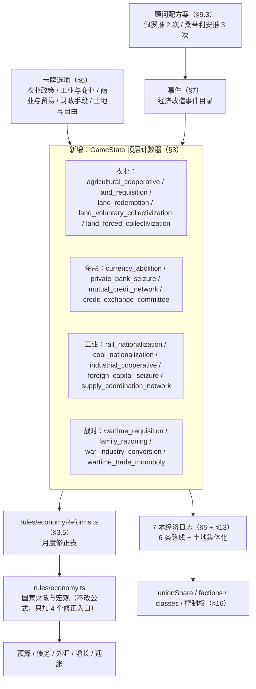

# 《自由未烬》经济改造方案：生产关系的六条路线

> 本文是[游戏设计文档](../游戏设计文档.md) §15「经济系统」的扩展设计。
> 读者：项目开发者、内容设计者及参与开发的 AI。
> 本文只写**设计定稿**，不写实现代码；所有字段名、id、条件、效果都以可直接落笔为 `src/` 文件为准。
> 与源码冲突时以源码为准：本文已经把 2026-09 的源码逐条核对过，核对中发现的草案与实现落差记录在 §12。

---

## 0. 一页速览

### 0.1 这份方案要解决什么

现有的国家经济（`src/game/rules/economy.ts`）已经是一套完整的**财政—宏观模型**：五种税、税基、征收效率、现金／债务／欠款融资瀑布、增长／通胀／失业惯性。它回答的是"共和国这个国家机器怎么运转"。

它没有回答的是另一半问题：**生产资料归谁、运动怎么在工厂和农村里真正掌权。** 目前只有三个字段在表达这件事：

| 现有字段 | 含义 | 问题 |
| --- | --- | --- |
| `stats.workerControl`（0–100） | 工人对生产资料的实际控制程度 | 只是一根进度条，没有任何"结构"：铁路和纺织厂一样、合作社和国有化一样 |
| `domesticPolicy.land_law`（0–3） | 土地法等级 | 是议会法律，走法律立场矩阵，不能表达"工会自己在村里干了什么" |
| `domesticPolicy.land_reform_progress`（0–100） | 土地改革进度 | 只有一条，自愿合作社与强制集体化挤在同一个数字里 |

本方案新增 **18 个 `GameState` 顶层计数器**（农业 5、金融 4、工业 5、战时 4）与 **7 条日志**（6 条经济路线 + 1 条土地集体化），把"经济改造"从一根进度条变成六条可选路线，并为每条路线配套卡牌选项、结果事件与月度效果。

> 计数器数量在本文档内是一致的：**18 个计数上限常量**（§3.3 的 `ECONOMY_REFORM_CAPS`）。农业 5（`agricultural_cooperative`、`land_requisition`、`land_redemption`、`land_voluntary_collectivization`、`land_forced_collectivization`）、金融 4（`currency_abolition`、`private_bank_seizure`、`mutual_credit_network`、`credit_exchange_committee`）、工业 5（`rail_nationalization`、`coal_nationalization`、`industrial_cooperative`、`foreign_capital_seizure`、`supply_coordination_network`）、战时 4（`wartime_requisition`、`family_rationing`、`war_industry_conversion`、`wartime_trade_monopoly`）。

### 0.2 三条不变量（先立规矩）

**不变量一：不新增任何资源收益通道。**
运动的资源收入（会费＋群众募捐）由 `rules/income.ts` 唯一表达，本方案**逐字不改**：

```ts
resources = INCOME_RULES.baseResources + floor(CNT 工会占比 / 20)   // = 1 + floor(占比/20)，上限 5
```

经济改造**不得**在卡牌选项里直接 `resources: state.resources + 3` 当作产业红利，也不新增"改造指数"这类第二条腿（第 1 版的"指数 ÷ 4 加到月资源"已按用户要求删除）。经济路线的回报走三条既有通道：一次性收益（选项里的资源／军备／预算）、`unionShare`（间接抬高上式）、以及下面不变量二的宏观修正。叙事上也更正确：CNT 的钱来自组织起来的工人，而不是来自它接管了多少工厂。

**不变量二：经济改造不建立第二套宏观模型。**
不在 `economy.ts` 里加第二组增长／通胀公式。改造通过三条既有通道影响国家经济：

1. **月度修正** → 以 `PolicyModifier` 同构的小型修正表（`economyReforms.ts`）给出 `growthGraph`、`inflationGraph`、`foreignExchangeGraph`、`budgetGraph` 四个方向的增量，外加一个消费税税基乘数（§3.5）；
2. **法律等级** → 铁路国有化到顶时把 `union_status` 推一级；战时统筹路线完成时允许把 `public_order_law` 推到 2 级「共和国防卫法」（只在结果事件的选项里，需要玩家确认）；
3. **外交与关系** → 外资没收改 `relations.uk / usa / france`，战时外贸垄断改 `relations.ussr / uk` 与一次性外汇收入。

**不变量三：控制权只有一张饼（或两张）。**
"谁掌握生产资料"不允许同时由 `stats.workerControl` 一根标尺和 §16 的土地／工业饼状图两套数据表达。饼状图落地时，`workerControl` 必须改为派生值或删除（§16.2）。在定案之前，本方案的所有阈值奖励**不写 `workerControl`**（§3.7 的说明）。

### 0.3 六条路线总表

| # | 路线 | 日志 id | 触发 | 完成条件（摘要） | 结果事件 |
| --- | --- | --- | --- | --- | --- |
| 1 | 温和工团 | `journal_economy_syndicalist` | CNT 三大「批准建立全国产业联合会」 | 土地改革日志完成 + PRRevS 成立 + 控制权达标 + 铁路 ≥3 + 煤炭 ≥2 | `economy_syndicalist_victory` |
| 2 | 自由公社 | `journal_economy_free_commune` | 开局即激活（自动） | 土地改革日志完成 + 土地集体化日志完成 + 控制权达标 + 废除货币 ≥3 + 铁路 ≥3 + 煤炭 ≥2 | `economy_free_commune_victory` |
| 3 | 自治合作社 | `journal_economy_cooperative` | 事件「合作社之路」（佩罗推 2 次，或事件板调度） | 农业合作社 ≥5 + 土地改革日志完成 + 地方互助信贷 ≥5 + 工业合作社 ≥5 | `economy_cooperative_victory` |
| 4 | 有机工团 | `journal_economy_organic` | 事件「革命之后」（桑蒂利安推 3 次，或土地集体化完成后调度） | 土地集体化日志完成 + 废除货币 ≥3 + 私营银行没收 ≥1 + 信用与兑换委员会 ≥1 + 外资没收 ≥3 + 物资调控网络 ≥3 | `economy_organic_victory` |
| 5 | 战时统筹 | `journal_economy_war_effort` | 战时经济路线抉择（**唯一选项，同时开两条**） | 私营银行没收 ≥1 + 战时农业强制征发 ≥1 + 家庭口粮本 ≥1 + 战时外贸垄断 ≥2 | `economy_war_effort_victory` |
| 6 | 革命军事化 | `journal_economy_revolutionary_war` | 同上（同一次点击） | 家庭口粮本 ≥1 + 军工紧急转产 ≥3 + 外资没收 ≥3 | `economy_revolutionary_war_victory` |

**路线可以共存**（依用户决定）：六条日志各自独立开启、独立结算，一局可以同时推进多条，也可以全部完成。因此：

- 每条路线的完成奖励都是**"运动能力"而非"国家数值核弹"**：一次性的工会占比与阶层支持，加上一条**每月 ≤0.5 点**的持续产出（宏观修正），**没有月度资源收益**（不变量一）；
- 路线之间**共享稀缺资源**（AP、时间、控制权标尺），所以"全都要"在时间上天然吃亏（§9.1 的 AP 预算）；
- **只有战时两条路线硬互斥**：抉择事件一次同时开启两条，谁先完成谁关掉对方（§5.7⑤）；
- **平时四条路线永不失败**（用户定稿）：条件没满足就停在 `active`，随时可以回来继续推；代价写在各自的 `activeEffect` 持续项上（§5.7②）。

**关于路线与结局的关系（重要约束）**：经济路线的结果事件是**运动内部的里程碑**，不直接改写 `endings.ts` 的结局判定。结局仍由战争胜负、CNT 立场与政治路线决定（设计文档 §8）。经济路线可以做的是为既有结局提供更具体的叙事与成就条件，但**不得**新增"通关结局"或让某条经济路线成为胜利的唯一条件。

### 0.4 与现有系统的关系（谁读谁）



> 注意图里**没有** `rules/income.ts` 这条边：经济改造不产出月度资源（§0.2 不变量一），运动资源仍只由工会占比决定。

---

## 1. 设计原则

**P1 经济改造是"结构"，不是"数值"。**
每加一级都要改变一件事物的归属：谁拥有铁路、谁发工资、谁决定种什么。凡是只有数字没有归属变化的条目（例如"重工业产出 +5%"）不进本系统。

**P2 三档速度：项目 → 阶梯 → 门槛。**
- **项目（[0,1]）**：一次性决定。`private_bank_seizure`、`credit_exchange_committee`、`wartime_requisition`、`family_rationing`。做完就不可逆，代价与叙事都集中在"做不做"。
- **阶梯（[0,n]）**：可以反复投，但有上限。`rail_nationalization [0,3]`、`coal_nationalization [0,2]`、`currency_abolition [0,3]`、`war_industry_conversion [0,3]`、`wartime_trade_monopoly [0,2]`、`supply_coordination_network [0,3]`、`mutual_credit_network [0,5]`、`industrial_cooperative [0,5]`、`foreign_capital_seizure [0,5]`。
- **流水账（[0,∞)）**：农业五项。可以无限加，每次 +1，UI 显示纯数字，**不设档位名**（§3.2）。
- **门槛**：路线的完成条件永远读计数器，不读 AP、不读月份。

**P3 三条路线读同一根控制权标尺（当前是 `stats.workerControl`，未来是两张饼）。**
`stats.workerControl` 的**月度漂移已经由 `rules/controlObrero.ts` 定义**：

| 规则 | 值 | 出处 |
| --- | --- | --- |
| 1936 年 7 月前上限 | 40 | `CONTROL_OBRERO_PRE_WAR_CAP = 40` |
| 缺制度支撑时每月衰减 | −1 | `CONTROL_OBRERO_DECAY = 1`，制度支撑 = `union_status ≥ 2` 或 `land_reform_progress ≥ 30` |
| 停衰减阈值 | `land_reform_progress ≥ 30` | `CONTROL_OBRERO_LAND_REFORM_SUPPORT = 30` |

**这条是实现本方案时最容易翻车的地方**：只要路线门槛写成"工人控制 > 60"，它在 1936·7 之前就**物理上不可能完成**。这不是 bug，是设计——内战前工人控制被国家机器压着。因此：

- 温和工团／自由公社两条路线的控制权门槛，设计预期是**战争期间达成**；
- 该门槛最终怎么写，取决于 §16 的饼状图定案：若采纳饼状图，门槛应写成"**土地控制（或工业控制）中工会份额 ≥ N**"，而不是一个含糊的总分；
- **在定案之前，本方案不为经济改造配任何 `workerControl` 收益**（§3.7 的留空说明）。过渡期这个门槛靠既有来源凑（土改日志 +10、农业政策 +6、军事化抉择 +3、加泰罗尼亚防御 +10 等）。如果 §16 决定**不**做饼状图，就必须回头把一次性 `workerControl` 收益补回 §3.7 表——否则自由公社路线会在战时卡在 55 左右。

**P4 数字必须能被 `effectPreview` 讲出来。**
所有新字段进 `TOP_LEVEL_FIELDS`（§8.2），所有新选项带 `effectPreview`。玩家点一个选项之前必须能看见"铁路国有化 2 → 3"这一行。禁止只写进 `subtitle` 的隐藏数值。

**P5 路线的失败与代价必须能叙事。**
平时四条路线永不失败（用户定稿），所以它们的**持续代价**必须写死在 `activeEffect` 里（§5.7②）——否则就是无风险红利。战时两条路线的失败只有一种原因：对方先完成。`failureCondition` 写成一句具体的历史事实，不写"条件不足"。

**P6 一次只碰一个子系统。**
本方案横跨数据层、规则层、日志层、卡牌层、界面层。任何一期改动都不得同时修改两个子系统的既有逻辑（例如"顺手把 `union_status` 的月度效果也改了"）。§11 的五期切分就是为了让每一期都能单独跑通 `npm run verify:phase5`。

---

## 2. 与既有系统的边界（先划清，再动手）

| 系统 | 本方案怎么处理 | 明确不做什么 |
| --- | --- | --- |
| `rules/economy.ts` | 只在 `calculateMonthlyEconomy` 里增加 4 个可选修正入口（`growthGraph / inflationGraph / foreignExchangeGraph / budgetGraph`），保持"单一计算来源" | 不改税基、税率、征收效率、融资瀑布的任何公式 |
| `domesticPolicy` 法律体系 | 不改。经济改造**不进** `LawId`、不进法律立场矩阵、不进议会流程 | 不让 16 个政治主体对"煤炭国有化 2 级"表态 |
| `policyDefinitions.ts` | 只在需要时由经济改造**推**法律一级（铁路 → `union_status`、战时统筹 → `public_order_law`） | 不新增法律 |
| `stats.workerControl` | 经 `rules/controlObrero.ts` 的既有写入路径（`Math.min(100, x + n)`）修改 | 不改上限、不改衰减、不绕过 helper |
| `unionShare` | 用 `adjustUnionShare(state, 'CNT', n)`（零和，`utils/zeroSumShare`） | 不直接写 `state.unionShare.CNT` |
| `classes` | 用 `adjustClassSupport` | 不手改支持矩阵 |
| `factions` | 用 `adjustFactionInfluence` / `adjustFactionDissent(s)` | 不深拷贝 factions 改 dissent |
| 地图军需 | 战时经济改造给 `mapResources` 一个一次性注入（军工转产） | 不建第二套战争经济 |
| 顾问 | 经济改造在第 2 期加入顾问选项（§9.3） | 第 1 期不动顾问文件 |

---

## 3. 数据模型：18 个顶层计数器

### 3.1 落点选择与理由

用户已定：**像 `ateneos_established`（自由雅典学苑数）、`commercialized_propaganda`（媒体计时器）那样，作为 `GameState` 顶层计数器，选项加点数。**

这与仓库既有习惯一致（`ateneos_established: number`、`commercialized_propaganda: number`、`prrevsConstructionLevel: number` 都是同类）。好处：

- `effectPreview` 的 `TOP_LEVEL_FIELDS` 是**扁平字典**，顶层字段加一行就能预览；嵌套对象要写新分支；
- 项目里的所有 helper（`clampPercent`、`Math.min(MAX, x + n)`）都按扁平值写；
- 旧存档兼容只需要一个 `migrateEconomyReformV3` 逐字段补默认值（§10.2）。

代价是 `GameState` 顶层再加 18 个字段。用注释块把它们归到「// Economy Reform（经济改造）」一节，并在 `types.ts` 里按"农业→金融→工业→战时"分组。

### 3.2 完整字段表

上限写法：`[0,n]` = 有明确上限的阶梯（用 `advanceEconomyCounter` 夹紧）；**`[0,∞)` = 无上限**，由玩家每次选项 +1，节奏由卡牌冷却与 AP 控制（见本节末的设计说明）；"项目" = 一次性布尔语义的 `0/1` 计数器（沿用仓库习惯用 `number`，便于预览与存档合并）。

#### 农业 Agriculture

| 字段 | 区间 | 中文名 | English |
| --- | --- | --- | --- |
| `agricultural_cooperative` | **`[0,∞)`** | 农业合作社 | Agricultural cooperatives |
| `land_requisition` | **`[0,∞)`** | 农村土地征用 | Rural land requisition |
| `land_redemption` | **`[0,∞)`** | 农村土地赎买 | Rural land redemption |
| `land_voluntary_collectivization` | **`[0,∞)`** | 自愿集体化 | Voluntary collectivization |
| `land_forced_collectivization` | **`[0,∞)`** | 强制集体化 | Forced collectivization |

**这五个字段没有档位名、没有上限。** 它们不是"文明升级树"，而是**一本流水账**：征用了多少次、赎买了多少次。UI 显示为纯数字（"土地征用：4"），不显示"乡镇推进"这类阶段名。路线完成条件只读阈值（例如"农业合作社 ≥ 5"），超过阈值之后继续加点只换来土地改革进度与阶层反应——这是有意允许的"继续加码"。

**设计说明**：征用（不给钱，得罪所有有产者）与赎买（给钱，吃预算）**是两条互相拉扯的路径**，但**不互斥**——玩家可以征用大庄园、赎买中农，这正是 1936 年加泰罗尼亚与阿拉贡的真实做法。二者都推 `domesticPolicy.land_reform_progress`，但成本结构完全不同：

| 路径（每次 +1） | 成本 | 阶层反应 | 土地改革进度 |
| --- | --- | --- | --- |
| `land_requisition` | 1 军备 | Braceros→CNT +6，Labradores→CNT −4，Latifundistas→CNT −8 | +8 |
| `land_redemption` | 预算 −3.0M（走国库现金） | Labradores→CNT +5，Braceros→CNT +2，Latifundistas→CNT −2 | +5 |
| `land_voluntary_collectivization` | 1 资源 | Braceros→CNT +5，Labradores→CNT −1 | +4 |
| `land_forced_collectivization` | 1 资源 + 1 军备 | Braceros→CNT +8，Labradores→CNT −8，Clero→CNT −4，Faistas 异议 +4 | +10 |

`land_law` 的法律等级**不被这些计数器改写**：法律是共和国的，计数器是运动的。两者都进 `land_reform_progress`，这就是"运动走在地下、法律走在议会"的双轨。

> **无上限字段的节奏控制**：没有上限，不等于可以一个月刷满。唯一入口是卡牌选项，而卡牌受冷却约束——「农业政策」是 6 月冷却，「土地与自由」加计时器后是 3 月冷却。所以"土地征用 10 次"至少是 10 次实质选项、10 点 AP、横跨 30 个月以上。**上限由 AP 与冷却承担，不由字段承担**；这也意味着 §3.3 的 `advanceEconomyCounter` 必须允许"无上限"这一档（见那里的类型定义）。

#### 金融 Finance

| 字段 | 区间 | 中文名 | English | 说明 |
| --- | --- | --- | --- | --- |
| `currency_abolition` | 0–3 | 废除货币 | Abolition of money | 3 级即"完成"，触发 `currency_abolished` 事件 |
| `private_bank_seizure` | 0–1 | 没收私营银行储蓄 | Seizure of private bank deposits | 项目 |
| `mutual_credit_network` | 0–5 | 地方互助信贷 | Local mutual credit | 与农业合作社同梯度的农村金融骨干 |
| `credit_exchange_committee` | 0–1 | 信用与兑换委员会 | Credit and Exchange Committee | 项目，地区间清算与外汇兑换 |

> 「外资没收」（`foreign_capital_seizure`）虽然也是金融行为，但它的对象是**工业资产**（电力、电话、矿业），因此只登记在下面的工业组，不重复计数。

**`currency_abolition` 的三级语义**（草案只给了区间，这里定稿）：

| 级 | 中文 | English | 效果 |
| --- | --- | --- | --- |
| 0 | 比塞塔流通 | Peseta in circulation | — |
| 1 | 地方代用券 | Local scrip | 集体农庄与工厂内部以券代薪。`inflationGraph +0.15`（发行混乱） |
| 2 | 工会工资券 | Union wage vouchers | 工资由工会以券发放，配给体系成网。`inflationGraph +0.25`，`family_rationing` 与 `supply_coordination_network` 的月度收益 +50% |
| 3 | 货币废除 | Money abolished | 触发 `currency_abolished` 事件；此后 `tax_consumption` 的税基按 `0.6` 计（**这是设计上最痛的一刀**：废掉货币就等于废掉消费税），`growthGraph −0.4`，但 `revolutionaryFervor +10`、`unemployment −2` |

> **为什么废除货币要砍消费税税基**：`calculateMonthlyEconomy` 里消费税税基是 `8 × O × E × P`，是财政收入的大头之一（默认 8% 税率）。如果废除货币只有好处，那它就是免费红利。砍掉 40% 消费税基，就把"废除货币"变成一次真正的历史抉择：你在用共和国的财政能力，换运动的彻底性。这条修正写进 `economyReforms.ts`，不动 `economy.ts` 的公式（`consumptionTaxBaseFactor` 作为新的可选乘数传入）。

#### 工业 Industry

| 字段 | 区间 | 中文名 | English | 说明 |
| --- | --- | --- | --- | --- |
| `rail_nationalization` | 0–3 | 铁路系统国有化 | Nationalization of the railways | 3 级完成，推 `union_status` 一级 |
| `coal_nationalization` | 0–2 | 煤炭国有化 | Nationalization of the coal mines | 2 级完成。阿斯图里亚斯与里奥廷托是主战场 |
| `industrial_cooperative` | 0–5 | 工业合作社 | Industrial cooperatives | 与农业合作社对称的工业骨干 |
| `foreign_capital_seizure` | 0–5 | 外资没收 | Seizure of foreign capital | 电力、电话、矿业；改 `relations` |
| `supply_coordination_network` | 0–3 | 工团物资调控网络 | Syndicalist supply coordination network | 跨区调运、配给、统计；有机工团与战时统筹共用 |

**注意"铁路委员会 / 煤炭委员会"与"国有化"的区别**（草案把两者写成"任意一个完成即可"，这里定稿口径）：

- 草案的"铁路国有化"= `rail_nationalization ≥ 3`（国家接管）；
- 草案的"铁路委员会"= **工人委员会接管**，本方案不新增字段，而是定义为 `rail_nationalization = 2 且 dc_established`（防御委员会成立）——即"铁路由工会委员会实际管理，但名义上尚未国有化"。这是一个**判定函数**，不是字段：

```ts
// src/game/rules/economyReforms.ts
export const isRailUnderWorkersControl = (state: GameState): boolean =>
  state.rail_nationalization >= 2 && isOrganizationEstablished(state, 'DC');

export const isCoalUnderWorkersControl = (state: GameState): boolean =>
  state.coal_nationalization >= 1 && isOrganizationEstablished(state, 'DC');
```

温和工团路线因此读 `railCompleted || railUnderWorkers`，与草案"任意一个完成"完全对应，且不需要两套计数器。

#### 战时 Wartime

| 字段 | 区间 | 中文名 | English | 说明 |
| --- | --- | --- | --- | --- |
| `wartime_requisition` | 0–1 | 战时农业强制征发 | Wartime agricultural requisition | 项目。征发口粮与饲料，代价是雇农与自耕农的支持 |
| `family_rationing` | 0–1 | 家庭口粮本配给制 | Family ration books | 项目。城市配给，代价是行政成本与黑市 |
| `war_industry_conversion` | 0–3 | 军工紧急转产改组 | Emergency war industry conversion | 3 级完成，注入地图军需 |
| `wartime_trade_monopoly` | 0–2 | 战时外贸垄断 | Wartime foreign trade monopoly | 2 级完成，改关税与国际关系 |

### 3.3 类型定义（直接落笔用）

在 `src/game/types.ts` 的 `GameState` 中，**紧接 `military_spending: number;` 之后**插入：

```ts
  // ---- Economy Reform（经济改造）----
  // 全局计数器：每条路线读它们，每个卡牌选项给它们加点。
  // 有上限的用 ECONOMY_REFORM_CAPS 夹紧，农业五项无上限（见 docs/经济改造方案.md §3.2）。
  agricultural_cooperative: number;          // 农业合作社 [0,∞)
  land_requisition: number;                  // 农村土地征用 [0,∞)
  land_redemption: number;                   // 农村土地赎买 [0,∞)
  land_voluntary_collectivization: number;   // 自愿集体化 [0,∞)
  land_forced_collectivization: number;      // 强制集体化 [0,∞)
  currency_abolition: number;                // 废除货币 [0,3]
  private_bank_seizure: number;              // 没收私营银行储蓄 [0,1]
  mutual_credit_network: number;             // 地方互助信贷 [0,5]
  credit_exchange_committee: number;         // 信用与兑换委员会 [0,1]
  rail_nationalization: number;              // 铁路系统国有化 [0,3]
  coal_nationalization: number;              // 煤炭国有化 [0,2]
  industrial_cooperative: number;            // 工业合作社 [0,5]
  foreign_capital_seizure: number;           // 外资没收 [0,5]
  supply_coordination_network: number;       // 工团物资调控网络 [0,3]
  wartime_requisition: number;               // 战时农业强制征发 [0,1]
  family_rationing: number;                  // 家庭口粮本配给制 [0,1]
  war_industry_conversion: number;           // 军工紧急转产改组 [0,3]
  wartime_trade_monopoly: number;            // 战时外贸垄断 [0,2]
```

**上限常量**放在 `src/game/rules/economyReforms.ts`。**农业五项不在表内**——它们没有上限：

```ts
/** 有上限的计数器。农业五项（agricultural_cooperative 等）刻意不在此表：无上限。 */
export const ECONOMY_REFORM_CAPS = {
  currency_abolition: 3,
  private_bank_seizure: 1,
  mutual_credit_network: 5,
  credit_exchange_committee: 1,
  rail_nationalization: 3,
  coal_nationalization: 2,
  industrial_cooperative: 5,
  foreign_capital_seizure: 5,
  supply_coordination_network: 3,
  wartime_requisition: 1,
  family_rationing: 1,
  war_industry_conversion: 3,
  wartime_trade_monopoly: 2,
} as const;

type CappedCounter = keyof typeof ECONOMY_REFORM_CAPS;

/**
 * 唯一写入口。有上限的计数器夹紧到 [0, cap]；无上限的农业计数器只保证非负。
 * 返回值一定是 Partial<GameState>，可以直接 spread 进选项效果。
 */
export const advanceEconomyCounter = (
  state: GameState,
  key: CappedCounter | 'agricultural_cooperative' | 'land_requisition' | 'land_redemption'
    | 'land_voluntary_collectivization' | 'land_forced_collectivization',
  delta: number,
): Partial<GameState> => {
  const current = Number.isFinite(state[key]) ? state[key] : 0;
  const cap = (ECONOMY_REFORM_CAPS as Partial<Record<string, number>>)[key];
  const next = cap === undefined ? Math.max(0, current + delta) : Math.max(0, Math.min(cap, current + delta));
  return { [key]: next } as Partial<GameState>;
};
```

> **为什么要有 `advanceEconomyCounter`**：18 个计数器 × 至少 30 个选项，如果每个选项都手写 `Math.min(5, state.x + 1)`，只要一个人写错一个上限，就会出现"地方互助信贷 6/5"；反过来，农业五项如果被顺手加上 `Math.min(5, ...)`，就违反了本节的设计。helper 把"哪些有上限、上限是多少"收敛到一处，也让"选项加点"在代码审查里一眼可读。
>
> 类型上刻意用联合类型而不是 `keyof GameState`：这样给一个非经济字段加点会在编译期报错。

### 3.4 月度收益通道：`rules/income.ts` **不改**

**本方案不新增任何月度资源收益通道。** `calculateMonthlyIncome` 保持现状：

```ts
resources: INCOME_RULES.baseResources + Math.floor(getUnionShare(state).CNT / INCOME_RULES.unionShareBand)
// = 1 + floor(CNT 工会占比 / 20)，上限 1 + floor(85/20) = 5
```

经济改造**不产生额外的月度资源**。它的收益只走三条通道：

1. **一次性**：选项效果里的资源、军备、预算、议会现金（例如赎买吃预算、没收银行存款进国库）；
2. **比率**：经济改造改 `unionShare`（CNT 占比），从而间接抬高上面的月资源——这是唯一一条"经济改造养运动"的路径，而且它走的是既有公式；
3. **宏观**：`economyReforms.ts` 的 4 个修正入口（§3.5）。

> 早先版本曾设计过"经济改造指数 ÷ 4 加到月资源"的第二条腿，**已删除**。删除后的后果要认下来：走完六条路线的玩家，其运动资源收入只比现状高一点点（取决于 CNT 占比能推到多高），**经济路线的回报以"能力"（工人控制／土地控制／工业控制、阶层支持、外交筹码、法律等级）而不是"月收入"的形式支付**。这实际上更符合设计文档 §0.2 "七组不能混用的数据"——生产关系不自动换算成运动资源。

### 3.5 月度修正通道：`rules/economyReforms.ts`

新增文件，导出**纯函数**，由 `monthlyPipeline` 调用、由 `effectPreview` 读取：

```ts
export interface EconomyReformGraphs {
  growthGraph: number;          // 加到 targetGrowth
  inflationGraph: number;       // 加到 targetInflation
  foreignExchangeGraph: number; // 加到每月 tradeFxYield
  budgetGraph: number;          // 直接加到国库现金（月度，正负皆可）
  consumptionTaxBaseFactor: number; // 消费税税基乘数（废除货币 = 0.6）
}

export const EMPTY_ECONOMY_REFORM_GRAPHS: EconomyReformGraphs = {
  growthGraph: 0, inflationGraph: 0, foreignExchangeGraph: 0, budgetGraph: 0, consumptionTaxBaseFactor: 1,
};

export const calculateEconomyReformGraphs = (state: GameState): EconomyReformGraphs => { /* §3.6 表 */ };
```

`economy.ts` 的改动**只有 4 行**（保持单一来源）：

```ts
export const calculateMonthlyEconomy = (state: GameState): EconomyBreakdown => {
  const reformGraphs = calculateEconomyReformGraphs(state);   // 新增
  // ...
  const consumption = ECONOMIC_RULES.incomeWeights.consumption * output * employment * purchasingPower
    * reformGraphs.consumptionTaxBaseFactor;                   // 新增
  // ...
  const targetGrowth = clamp(/* 既有公式 */ + reformGraphs.growthGraph, minGrowth, maxGrowth);          // 新增
  const targetInflation = clamp(/* 既有公式 */ + reformGraphs.inflationGraph, /* bounds */);             // 新增
  const tradeFxYield = /* 既有公式 */ + reformGraphs.foreignExchangeGraph;                              // 新增
  const nextBudget = /* 既有落点 */ + reformGraphs.budgetGraph;                                        // 新增
```

> **循环依赖警告**：`economy.ts` → `economyReforms.ts` → 读 `state` 只有单向。`economyReforms.ts` **不得** import `economy.ts`（否则 `calculateMonthlyEconomy` 与 `calculateEconomyReformGraphs` 互相引用）。如果将来需要读宏观值，用参数传入而不是 import。

### 3.6 月度修正总表（设计数值）

正数 = 对共和国经济有利，负数 = 代价。

| 条目 | growthGraph | inflationGraph | fxGraph | budgetGraph | 说明 |
| --- | ---: | ---: | ---: | ---: | --- |
| `agricultural_cooperative` × n | +0.05n | 0 | 0 | 0 | 农村供应稳定 |
| `land_requisition` × n | −0.04n | +0.03n | 0 | 0 | 有产者信心下降 |
| `land_redemption` × n | +0.03n | +0.02n | 0 | −0.15n | 赎买直接吃国库 |
| `land_voluntary_collectivization` × n | +0.04n | 0 | 0 | 0 | — |
| `land_forced_collectivization` × n | −0.06n | +0.04n | 0 | 0 | 生产混乱＋反抗 |
| `currency_abolition` = 1/2/3 | 0 / −0.1 / −0.4 | +0.15 / +0.25 / +0.35 | 0 | 0 | 货币混乱；3 级另设 `consumptionTaxBaseFactor = 0.6` |
| `private_bank_seizure` = 1 | −0.3 | +0.5 | 0 | +8.0（一次性，见 §7.4） | 一次性没收存款进国库；此后信心暴跌 |
| `mutual_credit_network` × n | +0.03n | −0.02n | 0 | 0 | 农村信贷替代高利贷 |
| `credit_exchange_committee` = 1 | +0.05 | −0.05 | +1.2 | 0 | 地区清算与外汇兑换 |
| `rail_nationalization` × n | +0.06n | 0 | 0 | +0.1n | 运输恢复直接产生现金流 |
| `coal_nationalization` × n | +0.08n | 0 | 0 | +0.12n | 能源是战时命脉 |
| `industrial_cooperative` × n | +0.05n | 0 | 0 | 0 | — |
| `foreign_capital_seizure` × n | +0.05n | +0.02n | −0.4n | +0.2n | 接管外资企业产生现金流，但外汇与外交受损 |
| `supply_coordination_network` × n | +0.04n | −0.03n | 0 | 0 | 调运效率 |
| `wartime_requisition` = 1 | +0.05 | +0.1 | 0 | +0.4 | 战时粮食集中 |
| `family_rationing` = 1 | 0 | −0.15 | 0 | −0.2 | 配给压住城市物价，行政成本上升 |
| `war_industry_conversion` × n | +0.1n | +0.05n | 0 | 0 | 转产推高产出（军品计入 GDP 口径） |
| `wartime_trade_monopoly` × n | +0.05n | +0.08n | +1.0n | 0 | 垄断外贸换汇，物价代价 |

**战时额外规则**：`state.civilWarStatus === 'ongoing'` 时，上表所有 `growthGraph` 正值 **×1.5**（战时经济改造的边际收益更高），负值不变——这是给"战时路线"的专属甜头。

### 3.7 阈值奖励汇总表

只在**表内阈值**写入一次性奖励（达到即发，不重复），避免玩家为了同一份奖励反复刷同一选项。达到阈值之后的继续加码只拿"每次选项自带"的那部分（土地改革进度、阶层反应、月度修正）。

> **`workerControl` 一列暂时留空。** 用户已决定可能把"工人控制程度"这根单一标尺改成**土地控制饼状图 + 工业控制饼状图**（见 §16 的待定项）。在饼状图落地之前，本节的所有"控制权"类奖励都**只写 `unionShare` 与阶层支持**，不写 `workerControl`；饼状图方案确定后再按 §16.2 的映射补齐。这样做的代价是：在过渡期，"工人控制 > 60"这类路线门槛仍然靠既有的土地改革日志（+10）、农业政策选项（+6）、军事化抉择（+3）等旧来源凑——**这正是§16 需要尽快定案的原因**。

| 计数器达到 | unionShare (CNT) | 阶层反应 | 其他 |
| --- | ---: | --- | --- |
| `agricultural_cooperative` 3 | +2 | Braceros→CNT +4 | — |
| `agricultural_cooperative` 5 | +3 | Braceros→CNT +5，Labradores→CNT +3 | — |
| `land_requisition` 3 | 0 | Latifundistas→CNT −10 | — |
| `land_redemption` 3 | 0 | Labradores→CNT +6 | 预算 −3.0M（一次性） |
| `land_voluntary_collectivization` 3 | +1 | — | Faistas 影响 +4 |
| `land_forced_collectivization` 3 | +2 | Labradores→CNT −8 | Faistas 异议 +6 |
| `currency_abolition` 2 | 0 | — | — |
| `currency_abolition` 3 | 0 | — | 革命热情 +10，失业 −2，`consumptionTaxBaseFactor = 0.6`（见 §3.2） |
| `private_bank_seizure` 1 | 0 | PequenaBurguesia→CNT −3 | 预算 +8.0M，通胀 +0.5，银行家恐慌事件 |
| `credit_exchange_committee` 1 | +1 | — | 外汇 +1.2/月 |
| `rail_nationalization` 3 | +2 | — | `union_status` 推一级 |
| `coal_nationalization` 2 | +3 | Braceros→CNT +5 | — |
| `industrial_cooperative` 3 | +2 | Obreros→CNT +5 | — |
| `industrial_cooperative` 5 | +2 | Obreros→CNT +5 | — |
| `foreign_capital_seizure` 3 | 0 | — | `relations.uk −8`、`relations.usa −8`、`relations.france −4` |
| `supply_coordination_network` 3 | +1 | — | — |
| `wartime_requisition` 1 | 0 | Braceros→CNT +5，Labradores→CNT −8 | — |
| `family_rationing` 1 | 0 | PequenaBurguesia→CNT −3 | — |
| `war_industry_conversion` 3 | +2 | — | 地图军需注入（见 §6.3） |
| `wartime_trade_monopoly` 2 | 0 | — | `relations.ussr +8`、`relations.uk −6`、外汇 +1.0/月 |

**为什么把一次性的 `workerControl` 奖励撤掉不会让路线变得没有回报**：路线的回报本来就不该只体现在一根进度条上。土地控制/工业控制（§16）、阶层支持矩阵、外交关系、法律等级（`union_status`、`public_order_law`）、地图军需、以及每月的宏观修正，都是实打实的收益。把"控制权"从一根标尺换成两张饼状图之后，本表的 `unionShare` 与阶层支持列就是"改制之后仍然成立"的那部分。

---

## 4. 月度管线接入点

### 4.1 管线顺序（本方案只在第 4a 与第 5／7 步落钩子）

`rules/phaseOrchestrator.ts` 的月度分支现在按这个顺序跑：

```
1  推进年月 / 手牌入弃牌堆
2  CNT 资源与军备收入（calculateMonthlyIncome）      ← 本方案**不动**（§3.4）
3  激活达到时间条件的战时组织
4  国民经济结算（calculateMonthlyPipeline）
     4a calculateMonthlyEconomy                      ← 本方案改这里（§3.5，只加 4 个修正入口）
     4b calculateMonthlyPolicyEffects
     4c calculateEconomicPoliticalFeedback
     4d applyMonthlyOrganizationEffects
     4e applyControlObreroDrift                      ← 若采纳饼状图，这里改为改两张饼（§16）
5  活跃日志 activeEffect + 完成/失败检查               ← 本方案在这里加 7 本日志
6  政治维护（投票率、政党支持、联盟、五月压力）
7  事件筛选（calculateMonthlyEventQueue）             ← 本方案在这里加两条强制入队（§4.3）
8  冷却递减、清手牌
9  紧张度、政变、结局、成就
```

### 4.2 日志效果（第 5 步）

六条经济路线日志的 `activeEffect` 全部**只做小额持续效果**（≤1 点/月的 stat 或 ≤0.15 的预算），并且必须满足两个条件：

1. **只在 `active` 时生效**（既有契约，管线已保证）；
2. **不得写 `resources` / `armaments`**——月度资源归 `income.ts` 管，避免双写（§0.2 不变量一）。

实例（自由公社路线）：

```ts
activeEffect: {
  description: 'Land held in common keeps the countryside quiet and the columns fed.',
  descriptionZh: '土地归公让乡村安静下来，也让纵队有饭吃。',
  apply: (state) => ({
    stats: {
      ...state.stats,
      revolutionaryFervor: Math.min(100, state.stats.revolutionaryFervor + 0.5),
    },
    classes: adjustClassSupport(state.classes, 'Braceros', 'CNT_FAI', 2 / 12),
  }),
},
```

### 4.3 强制入队规则（第 7 步）

两处 `forceXxx` 规则，照着 `forceAsturiasRevolutionNextMonth` 的既有写法：

```ts
// ① 自由公社路线：开局自带（草案「任一开局均自带此日志」）
//    放在 calculateMonthlyEventQueue 的开头：日志仍是 inactive 且月份还停在开局月时，
//    把开始事件推到队首。玩家在第一个事件阶段就能看到"土地与自由"已经挂在日志栏上。
if ((nextState.journal?.journal_economy_free_commune?.status ?? 'inactive') === 'inactive'
  && nextState.year === 1931 && nextState.month === 4
  && !previousState.eventHistory?.resolved.includes('economy_free_commune_start')) {
  const startEvent = SCHEDULED_EVENT_REGISTRY.find(e => e.id === 'economy_free_commune_start');
  if (startEvent) pendingEvents = [startEvent, ...pendingEvents];
}
```

```ts
// ② 战时两条路线：战时权力安排落定后的下一个月入队
//    条件与 isMilitarizationCrossroadsDue 同构（可复用它的守卫思路）。
export const isWartimeEconomyRouteDue = (state: GameState): boolean => Boolean(
  state.wartimePowerArrangement
  && monthIndex(state) > monthIndex(state.wartimePowerArrangement.formedAt)
  && !state.eventHistory?.resolved.includes('economy_wartime_route_choice'),
);
```

> **为什么不写在 `onComplete` 里手动改 `pendingEvents`**：设计文档 §6.3 第 3 条明令"内容层不得手改 `pendingEvents`"。开始事件的入队属于**编排层**（`calculateMonthlyEventQueue`），与 `forceAsturiasRevolutionNextMonth` 同级，是合法位置。

### 4.4 事件—日志—事件契约的遵守清单

六条路线**全部**按已迁移的 UHP／工人联盟契约实现（对照 `journal/popular_army.ts` 这份现成范本）：

| 要求 | 做法 |
| --- | --- |
| 触发条件写在**开始事件**的 `condition` | 六个 `*_start` / `*_choice` 事件的 `condition` |
| 激活只由开始事件调用 `activateJournal()` | 选项效果里 `...activateJournal(state, 'journal_economy_xxx')` |
| `checkStatus` 不得返回 `active` | 全部首行写 `if (entryState.status !== 'active') return null;` |
| 数值效果归日志 | `onComplete` / `onFail`；结果事件只叙事 |
| 结果事件注册进 `RESTORABLE_EVENT_REGISTRY` | `events/economy/index.ts` 整个模块用 `eventDefinitionsFrom()` 注入 |
| 结果事件不重复入队 | 由 `queueJournalOutcomeEvent` 保证（已排队／正在展示／已处理过都不再推） |
| 进度显示走 `getProgress` | 每条日志都实现，**不写 `entryState.progress`**（该字段是死字段，见设计文档 §6.4①） |

---

## 5. 六条经济路线日志（完整定义）

统一命名：`src/game/journal/economy_*.ts`，全部在 `journal/index.ts` 的 `JOURNAL_ENTRIES` 注册（注册后 `scenarios/base.ts` 会自动为它们建 `inactive` 初始状态，无需改 base）。

### 5.1 温和工团路线

| 项 | 内容 |
| --- | --- |
| id | `journal_economy_syndicalist` |
| 中文名 | 温和工团路线 |
| English | The Syndicalist Road |
| 开始事件 | 无独立事件：`cnt_third_congress_2` 选项 A「批准建立全国产业联合会（历史路线）」的效果里加一行 `...activateJournal(state, 'journal_economy_syndicalist')` |
| 完成条件 | `journal_land_reform.status === 'completed'` **且** `PRRevS` 组织已成立 **且** 土地控制／工业控制达标（§16，过渡期读 `stats.workerControl > 60`）**且**（`rail_nationalization ≥ 3` 或 `isRailUnderWorkersControl`）**且**（`coal_nationalization ≥ 2` 或 `isCoalUnderWorkersControl`） |
| 进度条 | `getProgress` 取五个条件的最小百分比（对照 `popular_army.ts` 的 `Math.min` 写法） |
| 失败条件 | **无**（用户定稿）。本日志永不失败：条件没满足就停在 `active`，玩家随时可以回来继续推 |
| 结果事件 | `economy_syndicalist_victory`（工团主义的胜利？） |
| 完成奖励 | 见下 |
| 持续效果 | 无 |

完成奖励（`onComplete`）：

```ts
onComplete: (state) => ({
  stats: { ...state.stats, bureaucratization: Math.min(100, state.stats.bureaucratization + 5) },
  factions: adjustFactionInfluence(state.factions, 'Treintistas', 10),
  ...applyUnionShareDelta(state, { CNT: 3, UGT: -1, unorganized: -2 }),
  domesticPolicy: { ...state.domesticPolicy, union_status: clampLawLevel('union_status', Math.max(state.domesticPolicy.union_status, 3)) },
})
```

叙事定位：**这是一条"用国家形式完成工会接管"的路线**。代价写在持续面上——`union_status` 到 3（集体谈判）意味着运动被制度承认，`bureaucratization` 上涨，纯粹派不满。奖励应偏"制度效率"：预算、外汇、法律推进，而不是革命热情。

### 5.2 自由公社路线

| 项 | 内容 |
| --- | --- |
| id | `journal_economy_free_commune` |
| 中文名 | 自由公社路线 |
| English | The Free Commune |
| 开始事件 | `economy_free_commune_start`（**开局自动入队**，见 §4.3①；事件只有一个确认选项，效果是 `activateJournal` + 一段叙述，玩家无需做选择） |
| 完成条件 | `journal_land_reform.completed` **且** `journal_land_collectivization.completed` **且** 土地控制／工业控制达标（§16，过渡期读 `stats.workerControl > 60`）**且** `currency_abolition ≥ 3` **且** `rail_nationalization ≥ 3` **且** `coal_nationalization ≥ 2` |
| 失败条件 | **无**（用户定稿）。**但有持续代价**：见下 |
| 结果事件 | `economy_free_commune_victory`（土地与自由！） |
| 持续效果 | `activeEffect`：革命热情 +0.5/月，Braceros→CNT +2/12；**同时** `republicanAuthority −0.3/月`（共和国权威在自由公社里被掏空） |

```ts
activeEffect: {
  description: 'The communes answer to no ministry. Authority drains from Madrid as the countryside answers only to its own assemblies.',
  descriptionZh: '公社不听命于任何部。乡村只对自己的大会负责，马德里的权威随之流失。',
  apply: (state) => ({
    stats: {
      ...state.stats,
      revolutionaryFervor: Math.min(100, state.stats.revolutionaryFervor + 0.5),
      republicanAuthority: Math.max(0, state.stats.republicanAuthority - 0.3),
    },
    classes: adjustClassSupport(state.classes, 'Braceros', 'CNT_FAI', 2 / 12),
  }),
},
```

### 5.3 自治合作社路线

| 项 | 内容 |
| --- | --- |
| id | `journal_economy_cooperative` |
| 中文名 | 自治合作社路线 |
| English | The Cooperative Road |
| 开始事件 | `economy_cooperative_path`（合作社之路）。**两个触发入口**：① 霍安·佩罗的「推动合作社方案」顾问行动推满 **2 次**（§9.3）；② 事件板普通调度（条件：`agricultural_cooperative ≥ 1` 且 `land_redemption ≥ 1` 且 `journal_land_collectivization` **未完成**）。两条路都只负责把 `journal_economy_cooperative` 置为 `active` |
| 完成条件 | `agricultural_cooperative ≥ 5` **且** `journal_land_reform.completed` **且** `mutual_credit_network ≥ 5` **且** `industrial_cooperative ≥ 5` |
| 失败条件 | **无**（用户定稿）。强制集体化不再判定失败——它与合作社路线的关系改为**互斥进度**：`journal_land_collectivization` 一旦完成，本路线的"自愿合作"叙事就失去物质基础，`getProgress` 按 0 计（见下方说明） |
| 结果事件 | `economy_cooperative_victory`（互助、合作、自由） |
| 持续效果 | `activeEffect`：`budgetGraph −0.1`（合作社保育支出），`PequenaBurguesia→CNT +2/12`，`Labradores→CNT +2/12` |

这条路线**没有失败，但有隐含的竞争关系**：土地集体化（另一本日志）走的是"把地并入集体"的路线，而合作社路线走的是"农户自愿入社 + 信贷互助"。因此：

```ts
getProgress: (state) => {
  // 集体化一旦落地，自愿合作的经济基础就没了：进度显示归零，路线停在 active。
  // 这不是失败——玩家仍可回头把 cooperative 计数器推到 5，但必须先面对"已经集体化了"这个事实。
  if (state.journal?.journal_land_collectivization?.status === 'completed') return 0;
  return Math.min(
    ((state.agricultural_cooperative ?? 0) / 5) * 100,
    ((state.mutual_credit_network ?? 0) / 5) * 100,
    ((state.industrial_cooperative ?? 0) / 5) * 100,
    state.journal?.journal_land_reform?.status === 'completed' ? 100 : ((state.domesticPolicy.land_reform_progress ?? 0) / 100) * 100,
  );
},
```

**这条路线的设计重点是中农与小资产阶级**：它是唯一一条把 `PequenaBurguesia` 与 `Labradores` 拉向 CNT 的经济路线，代价是"慢"——`mutual_credit_network` 与 `agricultural_cooperative` 都要到 5，合计至少 10 次选项。

### 5.4 有机工团路线

| 项 | 内容 |
| --- | --- |
| id | `journal_economy_organic` |
| 中文名 | 有机工团路线 |
| English | The Organic Syndicalist Road |
| 开始事件 | `economy_after_the_revolution`（革命之后）。**两个触发入口**：① 迭戈·阿巴德·德·桑蒂利安的「推动有机工团方案」顾问行动推满 **3 次**（§9.3）；② 日志完成侧联动——土地集体化日志完成时若 `economy.organicPushes ≥ 3`，同一回合入队。两条路都只负责激活日志 |
| 完成条件 | `journal_land_collectivization.completed` **且** `currency_abolition ≥ 3` **且** `private_bank_seizure ≥ 1` **且** `credit_exchange_committee ≥ 1` **且** `foreign_capital_seizure ≥ 3` **且** `supply_coordination_network ≥ 3` |
| 失败条件 | **无**（用户定稿）。原设计的"英法关系双低于 20 即失败"已删除——外交环境恶劣时路线只是**更慢**（`foreignExchangeGraph −0.5` 的持续代价照付），不会突然作废 |
| 结果事件 | `economy_organic_victory`（伊比利亚，新时代的摇篮） |
| 持续效果 | `activeEffect`：`foreignExchangeGraph −0.5`，`revolutionaryFervor +0.3/月`，`Intelectuales→CNT +1/12` |

"有机"的含义：**没有货币、没有银行、没有外资，只有工团之间的实物与信用网络**。它是六条里国际代价最大的一条（`foreign_capital_seizure` + `currency_abolition` 同时打满），也是唯一一条直接把"外汇"变成负月度流的路线——这正是设计意图：自给自足是要付账的。

### 5.5 战时统筹路线

| 项 | 内容 |
| --- | --- |
| id | `journal_economy_war_effort` |
| 中文名 | （战时）战时统筹路线 |
| English | Wartime Coordination |
| 开始事件 | `economy_wartime_route_choice`（战时经济路线抉择，见 §7.3）。**该事件只有一个选项，一次同时激活本日志与「革命军事化」日志**；条件：`isWartimeEconomyRouteDue(state)`（§4.3②） |
| 完成条件 | `private_bank_seizure ≥ 1` **且** `wartime_requisition ≥ 1` **且** `family_rationing ≥ 1` **且** `wartime_trade_monopoly ≥ 2` |
| 失败条件 | **对方向前完成即失败**：`journal_economy_revolutionary_war.status === 'completed'` → 本日志立即 `failed`，失败事件 `economy_war_effort_conceded`（叙事：运动选择了把一切压给前线，统筹委员会被并入军事机构） |
| 结果事件 | `economy_war_effort_victory`（团结一致！众志筹城！） |
| 完成奖励 | `republicanAuthority +6`、`PequenaBurguesia→CNT −3`（配给与征发让人不满，但国家重新有了执行力）；结果事件的选项提供 `public_order_law → 2`「共和国防卫法」的确认转换 |
| 持续效果 | `activeEffect`：`budgetGraph +0.3`，`unemployment −0.1/月`（配给与征发把劳动力压回生产），`PequenaBurguesia→CNT −1/12` |

```ts
failureConditionZh: '革命军事化路线先完成',
checkStatus: (state, entryState) => {
  if (entryState.status !== 'active') return null;
  // 两条战时日志谁先完成谁关掉对方（本方案唯一的硬互斥）。
  if (state.journal?.journal_economy_revolutionary_war?.status === 'completed') return 'failed';
  if (/* 四个完成条件 */) return 'completed';
  return null;
},
```

> **为什么不再判定三方开战**：五月事件走向三方内战（`state.iberianDefense` 成立）之后，CNT 已经脱离共和国。这在设计上确实是"战时统筹"的终结，但它同时也会终结革命军事化路线，而后者按草案不该因此失败。为避免一条判定同时误伤两条日志，本方案把"脱离共和国"交给**上层**处理：三方内战时两条战时经济日志都保留在 `active`（它们的经济计数器继续有效，只是地图上不再是共和国在打仗）。若后续确认要在三方内战里关掉它们，应作为一个独立的、作用于两条日志的规则写入 §4.3，而不是塞进单条日志的 `checkStatus`。

### 5.6 革命军事化路线

| 项 | 内容 |
| --- | --- |
| id | `journal_economy_revolutionary_war` |
| 中文名 | （战时）革命军事化路线 |
| English | Revolutionary Militarization |
| 开始事件 | 同 `economy_wartime_route_choice`（**同一个选项同时激活两条日志**） |
| 完成条件 | `family_rationing ≥ 1` **且** `war_industry_conversion ≥ 3` **且** `foreign_capital_seizure ≥ 3` |
| 失败条件 | **对方向前完成即失败**：`journal_economy_war_effort.status === 'completed'` → 本日志立即 `failed`，失败事件 `economy_revolutionary_war_conceded`（叙事：运动选择了工会统筹，军事机构让出了对生产的直接支配） |
| 结果事件 | `economy_revolutionary_war_victory`（一切为了革命！） |
| 持续效果 | `activeEffect`：`Faistas` 异议 −0.5/月，`PCE` 关系 +1/月，`republicanAuthority −0.4/月` |

### 5.7 六条路线的共同条款

**① 失败只出现在战时两条路线，且只由对方完成触发。** 平时四条路线（温和工团／自由公社／自治合作社／有机工团）**永不失败**，条件没满足就停在 `active`，玩家随时可以回来继续推。因此：

- 这四条路线**没有 `failureEventId`**（写了也不会触发，反而误导读者）；
- 它们也**没有二次惩罚**：不存在"路线没走成所以工人控制 −20"这种设计；
- 战时两条路线各自的 `failureEventId`（`economy_war_effort_conceded` / `economy_revolutionary_war_conceded`）只叙事，`onFail` 返回空补丁 `{}`。

**② "永不失败"的代价必须写在持续面上。** 一条不能失败的路线如果也没有代价，就是免费红利。四条平时路线的代价分别是：

| 路线 | 持续代价 |
| --- | --- |
| 温和工团 | `bureaucratization` 上行；`union_status` 走高会引发纯粹派异议 |
| 自由公社 | `republicanAuthority −0.3/月`（马德里权威流失） |
| 自治合作社 | `budgetGraph −0.1/月`（合作社保育与信贷补贴），进度慢 |
| 有机工团 | `foreignExchangeGraph −0.5/月`（自给自足要付外汇代价） |

**③ 结果事件的选项只做"需要玩家确认的动作"。** 参照工人联盟的成立事件：数值（工会占比、阶层支持、法律等级、热情）在 `onComplete` 里立即合并，结果事件只承担叙事与**一个需要确认的状态转换**——例如温和工团路线的结果事件里由玩家确认"是否把产业联合会正式改称全国产业工会"，该动作写进事件选项。

**④ 结果事件 id 命名统一**：`economy_<路线>_victory` / `economy_<路线>_conceded`。

**⑤ 互斥只存在于战时两条路线**，实现方式是 `checkStatus` 读对方日志的 `status`，不做字段锁。平时四条路线可以共存——但它们共享同一个 AP 池与同一根控制权标尺（§16），"全都要"在时间上吃亏。

---

## 6. 卡牌与选项（完整设计）

### 6.1 新增／改动的卡牌总表

| 卡牌 | 类型 | 状态 | 门槛 | 冷却 | 文件 |
| --- | --- | --- | --- | --- | --- |
| 工业与商业 | Government | **新增** | `cntStance === 'govern'` 且 `ministers.industry === 'CNT'` | `industry_policy_timer`（新计时器，6） | `government_affairs/industry_policy.ts` |
| 商业与贸易 | Government | **新增** | `cntStance === 'govern'` 且（`ministers.estado === 'CNT'` 或 `ministers.finance === 'CNT'`） | `trade_policy_timer`（新计时器，6） | `government_affairs/trade_policy.ts` |
| 财政手段 | Government | **新增**（与既有「财政政策」并列，不是替换） | `cntStance === 'govern'` 且 `ministers.finance === 'CNT'` | `fiscal_measures_timer`（新计时器，6） | `government_affairs/fiscal_measures.ts` |
| 农业政策 | Government | **扩写** | 不变 | `agricultural_policy_timer` | `government_affairs/agricultural_policy.ts` |
| 土地与自由 | Action | **扩写** | 不变 | 无独立计时器 | `action_affairs/land_and_freedom.ts` |

**关于「财政手段」与「财政政策」的分工**（这是本方案最容易做重的地方，必须写清）：

| | 财政政策 `fiscal_policy` | 财政手段 `fiscal_measures`（新） |
| --- | --- | --- |
| 主题 | 税率：所得税组 / 关税消费税组 | **货币与金融的所有权**：废钞、没收银行、互助信贷、兑换委员会 |
| 结构 | `fiscal_policy.tsx` 自定义 UI，草案式税率审议，结束审议才写税率并进冷却 | 普通菜单式卡牌，每个选项是一次性项目／阶梯 |
| 冷却 | `fiscal_policy_timer`（6） | `fiscal_measures_timer`（6） |
| 重叠处理 | 两者都要求掌财政部；**两者互不修改对方的计时器**，因此一个月只能打一张（AP 只有 2 点，实际是玩家自己的取舍） | 同左 |

新增计时器需要在 4 个地方登记（缺一处就是"冷却永不到 0"的经典 bug）：

1. `types.ts` 的 `GameState`：`industry_policy_timer / trade_policy_timer / fiscal_measures_timer: number;`
2. `scenarios/base.ts` 的 `PRE_START_STATE`：三个都 `0`
3. `rules/phaseOrchestrator.ts` 的月度递减列表：三行 `Math.max(0, state.xxx_timer - 1)`
4. `effectPreview.ts` 的 `TOP_LEVEL_FIELDS`：三行（`reverseTone: true`）

### 6.2 工业与商业（`government_affairs/industry_policy.ts`）

```
id: 'industry_policy'
title: 'Industry and Commerce' / '工业与商业'
type: 'Government'
cost: 1
condition: cntStance === 'govern' && ministers.industry === 'CNT' && industry_policy_timer <= 0
```

事件 `industry_policy_event` 的选项（全部为**实质性选项**，均设 `industry_policy_timer: 6` 并 `currentEvent: null`）：

| # | 选项 | 条件 | 效果 |
| --- | --- | --- | --- |
| 1 | 推进铁路系统国有化 | `rail_nationalization < 3`，资源 ≥ 2 | 资源 −2；`advanceEconomyCounter('rail_nationalization', +1)`；铁路 3 时追加：`union_status` 推一级、`unionShare CNT +2`；Obreros→CNT +3 |
| 2 | 接管煤矿 | `coal_nationalization < 2`，资源 ≥ 2，`isOrganizationEstablished('CNT')` | 资源 −2；`advanceEconomyCounter('coal_nationalization', +1)`；Braceros→CNT +5；煤炭 2 时 `unionShare CNT +3`；国有化 3 级的控制权收益见 §3.7（**当前不写 `workerControl`**，等 §16 饼状图定案） |
| 3 | 扶植工业合作社 | `industrial_cooperative < 5`，资源 ≥ 1 | 资源 −1；`advanceEconomyCounter('industrial_cooperative', +1)`；Obreros→CNT +2；3 级与 5 级各触发一次档位奖励（§3.7） |
| 4 | 没收外资企业 | `foreign_capital_seizure < 5`，`relations.uk ≥ 20` 或 `relations.france ≥ 20` | `advanceEconomyCounter('foreign_capital_seizure', +1)`；`relations.uk −4`、`relations.usa −4`、`relations.france −2`；3 级时追加 §3.7 的档位奖励 |
| 5 | 建立工团物资调控网络 | `supply_coordination_network < 3`，资源 ≥ 1，`industrial_cooperative ≥ 1` | 资源 −1；`advanceEconomyCounter('supply_coordination_network', +1)`；Treintistas 影响 +3，Cenetistas 影响 +3 |
| 6 | 搁置工业改造 | 无条件 | `industry_policy_timer: 6`，无其他变化（合法的"这半年不折腾"选择） |

选项 1 与 2 的**不可用提示**必须写清"铁路/煤炭已到顶"与"资源不足"两种不同原因（`unavailableSubtitle` 每个选项只能给一个函数，用三元在函数里分支）。

### 6.3 商业与贸易（`government_affairs/trade_policy.ts`）

```
id: 'trade_policy'
title: 'Commerce and Trade' / '商业与贸易'
type: 'Government'
cost: 1
condition: cntStance === 'govern' && (ministers.estado === 'CNT' || ministers.finance === 'CNT') && trade_policy_timer <= 0
```

| # | 选项 | 条件 | 效果 |
| --- | --- | --- | --- |
| 1 | 实行战时外贸垄断 | `wartime_trade_monopoly < 2` **且** `civilWarStatus === 'ongoing'` | `advanceEconomyCounter('wartime_trade_monopoly', +1)`；`relations.ussr +8`（苏联是唯一愿意做垄断贸易的大买家）；`relations.uk −6`；`foreign_exchange +8`（一次性）；2 级时外汇 +1.0/月（写进 `economyReforms.ts`）。**注意**：与既有「外交政策」卡不冲突，但会互相影响国际关系读数 |
| 2 | 签订煤炭换粮食协定 | `coal_nationalization ≥ 1`，`relations.france ≥ 30` | `relations.france +5`，`foreign_exchange +4`，预算 −1.0M（运费与预付款） |
| 3 | 收紧关税以保护民族工业 | `tax_tariff < 40` | 走既有税制：`tax_tariff +3`；`relations.uk −3`、`relations.france −2`；Treintistas 异议 +3 |
| 4 | 维持自由贸易 | 无条件 | `trade_policy_timer: 6`，无其他变化 |

**注**：选项 3 直接改现行税率而不是草案流程。这是刻意的——「商业与贸易」是行政措施，「财政政策」是立法审议；三条税率的即时调整在国际谈判场景里是常见的行政权。如果设计上不接受，把选项 3 删掉即可，不影响其他条目。

### 6.4 财政手段（`government_affairs/fiscal_measures.ts`）

```
id: 'fiscal_measures'
title: 'Fiscal Instruments' / '财政手段'
type: 'Government'
cost: 1
condition: cntStance === 'govern' && ministers.finance === 'CNT' && fiscal_measures_timer <= 0
```

| # | 选项 | 条件 | 效果 |
| --- | --- | --- | --- |
| 1 | 废除货币（推进一级） | `currency_abolition < 3`，资源 ≥ 1 | 资源 −1；`advanceEconomyCounter('currency_abolition', +1)`；1 级：Faistas 影响 +5、PequenaBurguesia→CNT −3；2 级：Puristas 异议 −5；**3 级：触发事件 `currency_abolished`**（不是直接结算，见 §7.5），并把该选项从菜单隐藏 |
| 2 | 没收私营银行储蓄 | `private_bank_seizure < 1` | `advanceEconomyCounter('private_bank_seizure', +1)`；预算 +8.0M；通胀 +0.5；`relations.uk −5`、`relations.usa −5`；`PequenaBurguesia→CNT −3`；**触发事件 `bankers_panic`**（§7.4） |
| 3 | 建立地方互助信贷网络 | `mutual_credit_network < 5`，资源 ≥ 1 | 资源 −1；`advanceEconomyCounter('mutual_credit_network', +1)`；Labradores→CNT +3、Braceros→CNT +2；5 级时 `unionShare CNT +2` |
| 4 | 成立信用与兑换委员会 | `credit_exchange_committee < 1`，`mutual_credit_network ≥ 3` | `advanceEconomyCounter('credit_exchange_committee', +1)`；`unionShare CNT +1`；`foreign_exchange +1.2/月`；`partyRelations.PSOE +3`（清算委员会需要 PSOE 的市政配合） |
| 5 | 维持现行金融体制 | 无条件 | `fiscal_measures_timer: 6`，无其他变化 |

**关于选项 1 的"上限三次、大于等于三次触发废除货币事件"**：草案写"大于等于三次时触发"，本方案落为 **3 级 = 完成 = 触发一次事件**（`advanceEconomyCounter` 会把第 4 次夹回 3，因此不存在"第四次"）。事件 `currency_abolished` 的选项负责需要玩家确认的转换（例如确认"工资改由工会发放"），数值归属仍在菜单选项里，避免双写。

### 6.5 农业政策扩写（`government_affairs/agricultural_policy.ts`）

现有 3 个选项保留不动，**新增 5 个**（战时 2 个 + 平时 3 个）：

| # | 选项 | 条件 | 效果 |
| --- | --- | --- | --- |
| 4 | 组织农业合作社 | `agricultural_cooperative < 5`，资源 ≥ 1 | 资源 −1；`advanceEconomyCounter('agricultural_cooperative', +1)`；Braceros→CNT +2、Labradores→CNT +1；3 级与 5 级档位奖励 |
| 5 | 以赎买方式取得土地 | `land_redemption < 5`，预算 ≥ 3.0 | 预算 −3.0M；`advanceEconomyCounter('land_redemption', +1)`；`land_reform_progress +5`；Labradores→CNT +5；Latifundistas→CNT −2 |
| 6 | 推行自愿集体化 | `land_voluntary_collectivization < 5`，资源 ≥ 1 | 资源 −1；`advanceEconomyCounter('land_voluntary_collectivization', +1)`；`land_reform_progress +4`；Braceros→CNT +5；Faistas 影响 +2 |
| 7 | **战时**：实行农业强制征发 | `wartime_requisition < 1` **且** `civilWarStatus === 'ongoing'` | `advanceEconomyCounter('wartime_requisition', +1)`；`wartimePowerArrangement` 存在时 CNT 承诺度 +5（`adjustMemberContribution`）；Braceros→CNT +5、Labradores→CNT −8 |
| 8 | **战时**：推行家庭口粮本配给 | `family_rationing < 1` **且** `civilWarStatus === 'ongoing'` | `advanceEconomyCounter('family_rationing', +1)`；PequenaBurguesia→CNT −3；地图军需 +120 补给（一次性，走 `mapResources` 注入） |

### 6.6 土地与自由扩写（`action_affairs/land_and_freedom.ts`）

现有事件 `land_and_freedom_event` 的 3 个选项保留，**新增 2 个**（草案的"农村土地征用"与"强制集体化"）：

| # | 选项 | 条件 | 效果 |
| --- | --- | --- | --- |
| 4 | 武装征用大庄园 | `land_requisition < 5` 且 `armaments ≥ 1` | 军备 −1；`advanceEconomyCounter('land_requisition', +1)`；`land_reform_progress +8`；Braceros→CNT +6、Labradores→CNT −4、Latifundistas→CNT −8；Faistas 影响 +3；革命热情 +3 |
| 5 | 强制集体化 | `land_forced_collectivization < 5` 且 `armaments ≥ 2` 且资源 ≥ 1 | 军备 −2、资源 −1；`advanceEconomyCounter('land_forced_collectivization', +1)`；`land_reform_progress +10`；Braceros→CNT +8、Labradores→CNT −8、Clero→CNT −4；Faistas 异议 +4；革命热情 +6 |

**这个卡牌的定位变化**：它从"一次性三选一"变成"农业路线的反复杠杆"。因为卡牌没有独立计时器（现状），需要**给它加一个 `land_and_freedom_timer: 3`**，否则玩家可以一个月把 `land_requisition` 刷到 5。加计时器的四处登记同 §6.1。

### 6.7 卡牌注册与审查清单

- 三张新卡必须加入 `government_affairs/index.ts` 的 `GOVERNMENT_AFFAIRS` 数组（否则永远抽不到）；
- 全部选项必须满足[卡牌技能](../../.agents/skills/Card%20design%20Skill.md)的硬性要求：`condition` + `unavailableSubtitle` + `unavailableSubtitleZh` 齐备、中英文机械含义一致、helper 使用正确（`adjustClassSupport` / `adjustFactionInfluence` / `adjustFactionDissent(s)` / `adjustUnionShare` / `applyUnionShareDelta`）、`currentEvent` 最后一个返回、英文注释；
- 新增的 4 个计时器（`industry_policy_timer`、`trade_policy_timer`、`fiscal_measures_timer`、`land_and_freedom_timer`）四处登记缺一不可（§6.1）。

---

## 7. 事件目录（完整设计）

### 7.1 事件清单

新增目录 `src/game/events/economy/`：

| 文件 | 事件 id | 类型 | 入队方式 |
| --- | --- | --- | --- |
| `free_commune_start.ts` | `economy_free_commune_start` | 开始事件 | 强制入队（§4.3①） |
| `cooperative_path.ts` | `economy_cooperative_path` | 开始事件 | 普通调度（`condition`） |
| `after_the_revolution.ts` | `economy_after_the_revolution` | 开始事件 | 普通调度 |
| `wartime_route_choice.tsx` | `economy_wartime_route_choice` | 开始事件（二选一菜单） | 强制入队（§4.3②） |
| `currency_abolished.ts` | `currency_abolished` | 结果事件 | 选项直接 `currentEvent` 推入 |
| `bankers_panic.ts` | `bankers_panic` | 结果事件 | 同上 |
| `free_commune_victory.ts` | `economy_free_commune_victory` | 结果事件 | `journal.completionEventId` |
| `syndicalist_victory.ts` | `economy_syndicalist_victory` | 结果事件 | 同上 |
| `cooperative_victory.ts` | `economy_cooperative_victory` | 结果事件 | 同上 |
| `organic_victory.ts` | `economy_organic_victory` | 结果事件 | 同上 |
| `war_effort_victory.ts` | `economy_war_effort_victory` | 结果事件 | 同上 |
| `revolutionary_war_victory.ts` | `economy_revolutionary_war_victory` | 结果事件 | 同上 |
| `wartime_conceded.ts` | `economy_war_effort_conceded`、`economy_revolutionary_war_conceded` | 失败事件（**只有这两个失败事件**） | 战时两条日志的 `failureEventId`，由对方先完成触发 |
| `index.ts` | — | 汇总导出 | 供两个注册表消费 |

> **没有失败事件的事件**：温和工团、自由公社、自治合作社、有机工团四条平时路线**永不失败**（§5.7①），因此不需要 `failureEventId`，也不需要失败事件文件。早先设计过的 `economy_organic_strangled` 已删除。

### 7.2 注册改动（两处）

```ts
// registries/scheduledEventRegistry.ts —— 只要开始事件
import { economyFreeCommuneStart } from '../events/economy/free_commune_start';
import { economyCooperativePath } from '../events/economy/cooperative_path';
import { economyAfterTheRevolution } from '../events/economy/after_the_revolution';
import { economyWartimeRouteChoice } from '../events/economy/wartime_route_choice';
// ...加入 SCHEDULED_EVENT_REGISTRY 数组末尾

// registries/restorableEventRegistry.ts —— 整个模块都要能被还原
import * as economyEvents from '../events/economy';
// ...在 mergeRegistryDefinitions 里加：...eventDefinitionsFrom(economyEvents),
```

> **漏掉第二处的后果**：读档时结果事件的 `effect` 函数无法还原，`hydrateEvents` 会保留存档里序列化后的空效果，玩家点"确认"什么都不会发生（且不报错）。设计文档 §6.3 已把这条列为检查项。

### 7.3 战时经济路线抉择（`economy_wartime_route_choice`）

**只有一个选项**（用户定稿）：该选项同时激活**两条**战时经济日志。它不再是一道"选哪条路"的题，而是一个**确认**——战争经济要不要被组织起来；一旦组织起来，两条路线就同时开始赛跑，谁先完成谁关掉对方（§5.7⑤）。

```ts
export const economyWartimeRouteChoice: GameEvent = {
  id: 'economy_wartime_route_choice',
  meta: { category: 'war', flow: 'solo', series: ['economy', 'civil_war'] },
  condition: isWartimeEconomyRouteDue,
  title: 'How Shall the War Economy Be Run?',
  titleZh: '战时经济应当如何组织？',
  description: '...',   // 见下方文案
  descriptionZh: '...',
  options: [
    {
      text: 'Organize the war economy: unions take distribution, the front takes production.',
      textZh: '把战时经济组织起来：工会管分配，前线管生产',
      subtitle: 'Both the coordination committee and the militarized production boards are set up at once. The first to deliver absorbs the other.',
      subtitleZh: '统筹委员会与军事化生产委员会同时成立。谁先做出成绩，谁就吞并另一方。',
      effect: (state: GameState): Partial<GameState> => ({
        factions: adjustFactionDissents(state.factions, { Faistas: -2, Puristas: 2 }),
        ...activateJournal(state, 'journal_economy_war_effort'),
        ...activateJournal(state, 'journal_economy_revolutionary_war'),
        currentEvent: null,
      }),
    },
  ],
};
```

**为什么只留一个选项在叙事上说得通**：1936 年 7 月之后，西班牙的经济事实上已经分裂——加泰罗尼亚的工厂由委员会管理，阿拉贡的村庄集体化，而马德里还在按共和国法律征税。本事件问的不是"选哪条路"（现实中两条路是同时长出来的），而是**这种自发状态要不要被正式组织起来**：组织起来，就意味着同时建立两套机构（工会的分配委员会 + 军工的生产委员会），然后让它们在战争里竞争资源与权限，最终由成绩决定谁吞并谁。

**文案要点**：

- 选项不是"两选一"，因此 `subtitle` 必须把"两条路线同时开场、互相竞争"写清楚，避免玩家以为点下去只开了一条；
- 事件本身不设"什么都不做"的选项——战时经济一旦被提出，玩家只有"组织"这一个按钮。如果设计上需要保留"不做"的自由，把 `condition` 收紧（例如要求 `resources ≥ 2`）即可，但**不建议**再加第三个选项：两条日志的互斥关系已经足以表达取舍。

**两条日志的关闭关系（在 `checkStatus` 里，不在事件里）**：

| 先完成者 | 对方的结局 | 对方的失败事件 |
| --- | --- | --- |
| 战时统筹 | 革命军事化立即 `failed` | `economy_revolutionary_war_conceded` |
| 革命军事化 | 战时统筹立即 `failed` | `economy_war_effort_conceded` |

两个失败事件都**只叙事，`onFail` 返回 `{}`**（§5.7①）——输掉这场内部竞争本身就是代价（该路线的 `activeEffect` 持续收益归零），不需要额外扣分。

### 7.4 银行家的恐慌（`bankers_panic`）

从「财政手段」选项 2「没收私营银行储蓄」直接推入（`currentEvent: bankersPanic`，不是日志结果事件，因此**不需要** `completionEventId`）。

- 叙事：马德里的银行家连夜转移账目，伦敦与巴黎的报纸把西班牙写成"第二个苏联"。
- 选项 A「顶住压力」：`relations.uk −3`、`relations.usa −3`，`PequenaBurguesia→CNT −5`，`revolutionaryFervor +5`。
- 选项 B「给储户一个说法」（条件 `budget ≥ 5`）：预算 −5.0M（对储户的小额偿付），`relations.uk −1`、`relations.usa −1`，`PequenaBurguesia→CNT +2`。
- 效果归属：**选项 2 已经把 `private_bank_seizure` 写成 1，本事件只做叙事与关系微调**，避免与选项 2 重复结算。

### 7.5 废除货币（`currency_abolished`）

从「财政手段」选项 1 的**第三级**推入（写进该选项的效果：`...(next.currency_abolition >= 3 ? { currentEvent: currencyAbolished } : { currentEvent: null })`）。

- 叙事：加泰罗尼亚与阿拉贡已经这样过了一年；现在全国委员会要决定，比塞塔还要不要。
- 选项 A「正式宣布废除货币」：确认不可逆状态（写一个 `currency_abolished_declared: true` 旗标供成就与结局读取），`revolutionaryFervor +10`、`unemployment −2`，并确定 `consumptionTaxBaseFactor = 0.6`；控制权收益（工会份额 +5）按 §16.3 的映射在饼状图落地后补入。
- 选项 B「保留比塞塔作为对外结算单位」：不写旗标，`consumptionTaxBaseFactor` 保持 1.0，但**已投入的 3 级不退回**，且此后不能再次触发本事件（`eventHistory.resolved` 天然防重复）。这条选项的存在意义是：玩家可以在最后一刻保住共和国的税基，但已经付出的政治代价照付——这是有意设计的"沉没成本"抉择。

### 7.6 六条胜利事件的统一结构

```
economy_<route>_victory
  meta: { category: 'cnt', flow: 'solo', series: ['economy'] }
  condition: () => false          // 只由日志管线入队，绝不参与普通调度
  title/titleZh: 路线名（如「土地与自由！」）
  description/descriptionZh: 叙事（3～5 句，写清"哪条路赢了、代价是什么"）
  options: [ 一个确认选项 + 一个"需要玩家确认的状态转换"选项（如果该路线有） ]
```

**注意**：`condition: () => false` 是必须的，否则结果事件会同时被 `SCHEDULED_EVENT_REGISTRY` 的普通筛选捞出来。`queueJournalOutcomeEvent` 不检查 `condition`，所以设 `false` 不影响日志管线推入。**但结果事件不要放进 `SCHEDULED_EVENT_REGISTRY`**——它们只需在 `RESTORABLE_EVENT_REGISTRY` 里（`eventDefinitionsFrom(economyEvents)` 已经覆盖）。这一条与 §7.2 的注释一致。

---

## 8. 界面与可观测性

### 8.1 设计目标

玩家在**任何一屏**都应该能回答三个问题：
1. 我现在处在经济改造的哪一级？
2. 我离下一条路线的完成还差什么？
3. 这个选项会把我推到哪一级？

### 8.2 效果预览（必做）

`src/game/effectPreview.ts` 的 `TOP_LEVEL_FIELDS` 追加 18 行，命名与 `docs/经济改造方案.md §3.2` 完全一致：

```ts
  // ---- Economy Reform ----
  agricultural_cooperative: { label: 'Agricultural cooperatives', labelZh: '农业合作社' },
  land_requisition: { label: 'Land requisition', labelZh: '土地征用' },
  land_redemption: { label: 'Land redemption', labelZh: '土地赎买' },
  land_voluntary_collectivization: { label: 'Voluntary collectivization', labelZh: '自愿集体化' },
  land_forced_collectivization: { label: 'Forced collectivization', labelZh: '强制集体化', reverseTone: true },
  currency_abolition: { label: 'Abolition of money', labelZh: '废除货币' },
  private_bank_seizure: { label: 'Bank deposits seized', labelZh: '私营银行没收' },
  mutual_credit_network: { label: 'Mutual credit', labelZh: '地方互助信贷' },
  credit_exchange_committee: { label: 'Credit & Exchange Committee', labelZh: '信用与兑换委员会' },
  rail_nationalization: { label: 'Railways nationalized', labelZh: '铁路国有化' },
  coal_nationalization: { label: 'Coal nationalized', labelZh: '煤炭国有化' },
  industrial_cooperative: { label: 'Industrial cooperatives', labelZh: '工业合作社' },
  foreign_capital_seizure: { label: 'Foreign capital seized', labelZh: '外资没收' },
  supply_coordination_network: { label: 'Supply coordination', labelZh: '物资调控网络' },
  wartime_requisition: { label: 'Wartime requisition', labelZh: '战时农业征发' },
  family_rationing: { label: 'Family rationing', labelZh: '家庭口粮本配给' },
  war_industry_conversion: { label: 'War industry conversion', labelZh: '军工紧急转产' },
  wartime_trade_monopoly: { label: 'Wartime trade monopoly', labelZh: '战时外贸垄断' },
```

`scripts/test-action-affairs-effect-previews.ts` 会检查每个选项的 `effectPreview` 覆盖所有返回字段——**18 个字段加进去之后，这个测试会自动开始检查所有经济选项**，这是免费的质量保障。

### 8.3 经济改造面板

新增 `src/components/EconomyReformPanel.tsx`，挂在 `EconomyModal` 的**税收一侧（右栏）最下方**——即"税收政策法案（宏观收入端）"与"国防预算与社会法案（宏观支出端）"之后，或在 `JournalPanel` 顶部加一个"经济改造"标签页。建议**两处都要**：

> 位置是第 5C 期按用户要求调整的：左栏（宏观指标、收支预估）保持"只读状态栏"的定位，经济改造与税收／支出同属"你打算怎么改"，因此都在右栏。面板自身带 `dense` 模式，两处宿主只负责摆放它。

- `EconomyModal` 里给的是**数字**：18 个计数器的当前值（有上限的显示 `n/上限`，农业五项显示纯数字）、两张饼（若采纳 §16）、以及**月度修正明细**（`growthGraph / inflationGraph / fxGraph / budgetGraph` 各来自哪一条）；
- `JournalPanel` 里给的是**路线**：六条路线的进度条（直接复用 `getProgress`）、完成条件的勾选清单。平时四条用中性文案（"未完成"），战时两条额外显示"对方进度"——因为它们是竞争关系。

面板文案要求双语，字段名与 §8.2 一致。两条显示规则：

1. **有上限的计数器显示"n/上限"**（"煤炭国有化 1/2"）；**农业五项显示纯数字**（"土地征用：4"），不造阶段名——这是 §3.2 的设计决定；
2. **不显示"月度资源 +N"**：本方案没有这条收益（§0.2 不变量一）。如果面板出现"经济改造提供月资源"，那是错误实现。

### 8.4 不需要做的

- 不做经济路线专属的 3D 地图层或省份着色（地图阵营与所有权是另一套系统，`provinces.owner` 表达的是军事控制，不是生产关系）；
- 不改 `economyHistory` 的记录字段（那是宏观三指标的趋势图，经济改造的进度是离散阶梯，趋势图没有意义）。

### 8.5 生效的预览机制与一个待补的 helper

`effectPreviewFromEffect(state, effect)`（`effectPreview.ts`）会**按返回的 `Partial<GameState>` 自动生成预览行**——包括 `unionShare` 的差值对比（`addUnionShareDiffs`）。因此只要选项的 `effect` 通过 helper 返回规范的字段补丁，`effectPreview` 基本是免费的；只有需要"讲一句机制"的地方才手写 `effectPreview`。

两点必须注意：

1. `applyUnionShareDelta(state, deltas)` 与 `adjustUnionShare(state, key, delta)` 目前**定义了但全项目零调用**（`unions.ts` 第 147／160 行）。本方案是它们的第一个调用方，因此**第一件事是补测试**（零和守恒、未组织者下限 15、未成立组织归零），而不是直接拿来用。若不想引入新路径，退化方案是在选项里返回 `unionShare: normalizeUnionShare({ ...state, unionShare: {...} }).unionShare`——但那是每个选项都要重复一遍的写法，不推荐。
2. 势力影响／异议／阶层支持没有"自动预览"，必须显式写 `effectPreview`（或复用 `factionInfluencePreview` / `factionDissentPreview` / `classSupportPreview` 这些既有 helper）。

---

## 9. 平衡与节奏

### 9.1 AP 预算（"六条全要"的真实成本）

一局从 1931·4 到 1939 约 96 个月；每月 2 AP，其中相当一部分被事件阶段和战争阶段占用。乐观估计**可用于经济改造的 AP 约 40～60 点**。

| 路线 | 必需选项次数 | 说明 |
| --- | ---: | --- |
| 温和工团 | 6 | 铁路 ×3、煤炭 ×2、（PRRevS 由顾问/事件链推动，不占本系统 AP） |
| 自由公社 | 12 | 铁路 ×3、煤炭 ×2、废除货币 ×3、土地改革与集体化日志的既有选项（约 4 次，已在其他系统花费） |
| 自治合作社 | 10 | 农业合作社 ×5、互助信贷 ×5 |
| 有机工团 | 12 | 废除货币 ×3、银行 ×1、兑换委员会 ×1、外资 ×3、调控网络 ×3 |
| 战时统筹 | 5 | 银行 ×1、征发 ×1、配给 ×1、外贸 ×2 |
| 革命军事化 | 7 | 配给 ×1、军工转产 ×3、外资 ×3 |
| **合计** | **52**（去重后约 40） | |

去重后：`currency_abolition 3`、`rail 3`、`coal 2`、`industrial_cooperative 5`、`agricultural_cooperative 5`、`mutual_credit 5`、`foreign_capital_seizure 3`、`supply_coordination 3`、`land_and_freedom` 系列若干。**约 40 次实质选项 = 40 AP**，正好吃掉一局可用 AP 的绝大部分。

**结论：共存不会导致"全都轻松拿到"。** 玩家真正的抉择是"这 40 点 AP 是投经济改造，还是投军事/宣传/建党"。这个结构比硬互斥更好，因为它让"经济路线"成为与"军事路线"竞争的资源，而不是与另一条经济路线竞争。

### 9.2 关键数值的意图

| 数值 | 意图 |
| --- | --- |
| 控制权门槛（§16） | 保证路线是"战时决胜"而非"战前速通"。**注意**：在当前实现里这根标尺是 `stats.workerControl`，战前被 `controlObrero.ts` 硬封顶 40，所以门槛 > 60 物理上只能战时达成；换成土地／工业控制饼状图后，战前是否可达由 §16.2 的初值与收益决定 |
| 废除货币砍 40% 消费税基 | 让"最激进的选项"有真实的财政痛感 |
| 外资没收扣 8 点英美关系 | 与 `foreign_policy` 的债务谈判、飞机采购形成对冲 |
| 战时两条路线"先完成者关掉对方" | 唯一硬互斥：不是选边站，而是同时开工、用成绩淘汰对方 |
| 平时四条路线永不失败 | 玩家可以长期挂着、随时回来推；代价全部写在 `activeEffect` 的持续项上（§5.7②） |
| 合作社路线的 `budgetGraph −0.1` | 合作社保育与信贷补贴的长期成本，防止它成为"无代价的中庸路线" |
| 不设月度资源收益 | 删掉了"经济改造指数 ÷ 4 加到月资源"的设计：经济路线的回报是能力（控制权、阶层支持、外交、法律、地图军需），不是月收入 |

### 9.3 顾问接入（第 4 期，必做）

两条"推动方案"的顾问行动是**平时路线的确定性入场券**——没有它们，玩家只能靠抽卡撞上 `economy_cooperative_path` 与 `economy_after_the_revolution`。两者都把进度写成顶层计数器，事件在计数器满阈值时入队。

| 顾问 | 新增行动 | 计数器 | 阈值 | 效果 |
| --- | --- | ---: | ---: | --- |
| 霍安·佩罗 | 推动合作社方案 | `economy.cooperativePushes` | **2 次** | 每次：`advisorActionTimer: 6`、`agricultural_cooperative +1`、`mutual_credit_network +1`、Treintistas 影响 +3；第 2 次完成时把 `economy_cooperative_path` 推入 `pendingEvents`（事件选项调用 `activateJournal(state, 'journal_economy_cooperative')`） |
| 迭戈·阿巴德·德·桑蒂利安 | 推动有机工团方案 | `economy.organicPushes` | **3 次** | 每次：`advisorActionTimer: 6`、`supply_coordination_network +1`、`foreign_capital_seizure +1`、Faistas 影响 +3；第 3 次完成时把 `economy_after_the_revolution` 推入 `pendingEvents`（事件选项调用 `activateJournal(state, 'journal_economy_organic')`） |

**实现要点**：

1. **两个计数器放在 `GameState.economy` 子对象里**，与 18 个顶层计数器分开：

```ts
  /** 顾问推动方案的累计次数。顶层计数器表达"做到了什么"，这里表达"谁在推、推了几次"。 */
  economy?: {
    cooperativePushes: number;
    organicPushes: number;
  };
```

2. 顾问选项的 `condition` 除了共享冷却 `advisorActionTimer <= 0`，还要写清上限与依赖：佩罗的选项在 `cooperativePushes >= 2`（或合作社日志已激活）时隐藏；桑蒂利安的选项在 `organicPushes >= 3`（或有机日志已激活）时隐藏。**不能只靠计数器上限**——否则玩家会在已激活后继续点，白拿阶层支持。
3. 推入事件必须让 `condition` 放行：`economy_cooperative_path` 的普通调度条件里含 `journal_land_collectivization` **未完成**，但**顾问通道不受该条件限制**（顾问已经把合作推到了 2 次，此时应该无条件给事件）。因此事件要支持"外部推入"，与 `crossroads_uprising_alliance` 的做法一致——它同样是被管线/选项推入的，顶层 `condition` 不参与这类入队。
4. 桑蒂利安现有的三个行动（社会化经济规划／主编《土地与自由》／战时自卫工业动员）**保留不动**，新行动追加为第 4 项。佩罗同理（现有 2 项保留，追加为第 3 项）。
5. 两人的**全局限额是共同的**：`advisorActionTimer = 6` 是共享的，所以"佩罗推 2 次 + 桑蒂利安推 3 次"至少需要 5 个顾问行动窗口、横跨约 30 个月（对照设计文档 §5.1 "换人不会重置全局冷却"）。这是有意的：顾问是确定性手段，但不能比卡牌更快。

**第 3 位顾问（佩德罗·瓦利纳「土地赎买谈判」）继续保持可选**：`land_redemption +1`、预算 −2.0M、Labradores→CNT +5。他不承担任何路线的开启职责，因此不阻塞第 2 期验收。

---

## 10. 存档、迁移与兼容

### 10.1 新存档

18 个新字段随 `GameState` 一起序列化，无需特殊处理（`saveGame.ts` 是浅序列化 + 事件函数注册表还原）。

### 10.2 旧存档迁移（必做）

在 `saveMigrations.ts` 加一个 `migrateEconomyReformV3`，并**插进 `migrateSaveState` 的管道**（放在 `migrateEconomyV2` 之后）：

```ts
const ECONOMY_REFORM_DEFAULTS = {
  agricultural_cooperative: 0, land_requisition: 0, land_redemption: 0,
  land_voluntary_collectivization: 0, land_forced_collectivization: 0,
  currency_abolition: 0, private_bank_seizure: 0, mutual_credit_network: 0,
  credit_exchange_committee: 0, rail_nationalization: 0, coal_nationalization: 0,
  industrial_cooperative: 0, foreign_capital_seizure: 0, supply_coordination_network: 0,
  wartime_requisition: 0, family_rationing: 0, war_industry_conversion: 0, wartime_trade_monopoly: 0,
} as const;

/** 旧档没有经济改造计数器：逐字段补 0，且不覆盖已有值。 */
const migrateEconomyReformV3 = (state: LegacySaveState): LegacySaveState => ({
  ...state,
  ...Object.fromEntries(
    Object.entries(ECONOMY_REFORM_DEFAULTS).map(([key, fallback]) => [
      key,
      Number.isFinite((state as Record<string, unknown>)[key]) ? (state as Record<string, number>)[key] : fallback,
    ]),
  ),
});
```

同时 `LegacySaveState` 类型里加上这 18 个可选字段，`migrateSaveState` 的最内层调用改为：

```ts
migrateEconomyReformV3(migrateJournalEventContract(migrateEconomyV2(...)))
```

**验证方法**：`npm run test:save-system` 会读 `output/` 下的既有存档样本；迁移后必须仍然通过，并新增一个"缺少 18 个字段的存档能读进来"的用例。

### 10.3 日志初始状态

`JOURNAL_ENTRIES` 加了 **7 条**（6 条经济路线 + 土地集体化）之后，`scenarios/base.ts` 的 `initialJournalState` reducer 会自动为它们建 `inactive` 状态——**不需要改 base.ts**。但旧存档的 `state.journal` 里没有这 7 条，因此：

```ts
// migrateJournalEventContract 中追加（或新开一个 migrateEconomyJournals）
for (const id of ECONOMY_JOURNAL_IDS) {   // 7 个 id，见下
  if (!journal[id]) journal[id] = { id, status: 'inactive', progress: 0 };
}
```

```ts
export const ECONOMY_JOURNAL_IDS = [
  'journal_economy_syndicalist',
  'journal_economy_free_commune',
  'journal_economy_cooperative',
  'journal_economy_organic',
  'journal_economy_war_effort',
  'journal_economy_revolutionary_war',
  'journal_land_collectivization',
] as const;
```

漏掉这一步的后果是：`activateJournal()` 在 `state.journal[id]` 不存在时直接返回 `{}`（见 `rules/journalEvents.ts` 第 46 行），旧档玩家的经济路线点不出来且不报错。

---

## 11. 实施顺序（分 5 期，每期可独立验收）

> **实施状态**：第 1—4 期**全部完成**（数据与管道 / 日志与事件骨架 / 卡牌与选项 / 顾问配方案与界面），落地清单与验收结果见 §18。**第 5 期（控制权饼状图 + 土地集体化日志）也已完成**，见 §18.7 与[工人控制度改造方案](./工人控制度改造方案.md) §10.7；§16.4 的四项确认已按该文档的定稿落地（`stats.workerControl` 保留为只读派生值）。
> 土地集体化日志已从第 2 期**移到第 5 期**：它读的是"土地归谁"的份额，与 §16 的农村土地饼图是同一件事，放在饼图定案后一起写才不会出现两套口径。因此第 2 期交付 **6 条**路线日志，自由公社／有机工团两条路线里的"土地集体化"条件按设计留作占位（恒不通过），**第 5 期已补上并打开**。

### 第 1 期：数据与管道（不改任何内容）——✅ 已完成

1. `types.ts` 加 18 个顶层计数器 + `economy?: { cooperativePushes, organicPushes }` + 4 个新计时器；
2. `scenarios/base.ts` 加默认值（18 个 0、两个 push 计数器 0、4 个计时器 0）。**没有**做成剧本差异化初值：三份剧本共用同一基线，`SCENARIO_OWNED_KEYS` 不变；
3. `rules/economyReforms.ts` 新建：`ECONOMY_REFORM_CAPS`（**不含农业五项**）、`UNCAPPED_ECONOMY_COUNTERS`、`ECONOMY_COUNTERS`、`ECONOMY_COUNTER_DEFAULTS`、`advanceEconomyCounter`、`advanceEconomyPush`、`isRailUnderWorkersControl` / `isCoalUnderWorkersControl`、`calculateEconomyReformGraphs`；
4. `rules/economy.ts` 接入 4 个修正入口 + 消费税税基乘数（§3.5），并把 `reformGraphs` 挂进 `EconomyBreakdown` 供 UI 读取；
5. `effectPreview.ts` 加 18 行字段 + 4 行计时器；
6. `saveMigrations.ts` 加 `migrateEconomyReformV3`（18 个计数器 + 2 个 push 计数器）与 `migrateJournalEntries`（按 `JOURNAL_ENTRIES` 补齐缺失日志，对当前 8 条是幂等的）；
7. `phaseOrchestrator.ts` 加 4 行计时器递减；
8. `editor/src/simulator/gameSandbox.ts` 补齐同一批字段（沙盒状态是独立构造的 `GameState`，漏掉会编译失败——这次正是它先报的错）。

**`rules/income.ts` 不动。**

**验收**（全部通过）：`npm run lint`、`npm run test:rules`、`npm run test:save-system`、`npm run test:effect-previews`、`npm run test:armament-income`。
新增的断言：

| 断言 | 位置 |
| --- | --- |
| 农业五项各自连加 8 次后等于 8（证明无上限） | `scripts/test-rules.ts` |
| 有上限的计数器在 cap 处夹紧、且不会为负 | 同上 |
| `ECONOMY_COUNTERS` 与两张表（有上限／无上限）互斥且完备，默认值全 0 | 同上 |
| 18 个字段都在 `PRE_START_STATE` 且都**不在** `SCENARIO_OWNED_KEYS` | 同上 |
| 顾问推动计数在 2／3 处夹紧，且互不影响 | 同上 |
| 计数器拉满也不产生月度资源（`calculateMonthlyIncome` 仍为 `1 + floor(占比/20)`） | 同上 |
| 未改造时 `calculateEconomyReformGraphs` 返回全零图，月度经济与改造前逐位相同 | 同上 |
| 废除货币后消费税收入下降、税基乘数为 0.6 | 同上 |
| 旧存档读入后 18 个计数器为 0、两个 push 计数存在、`JOURNAL_ENTRIES` 每条都已建立 | `scripts/test-save-system.ts` |

### 第 2 期：日志与事件骨架 —— ✅ 已完成

1. `journal/economy_*.ts` **六个文件**（六条经济路线；**土地集体化推迟到第 5 期**）+ `journal/index.ts` 注册；
2. `events/economy/` 十三个事件（开始 4 + 结果 6 + 失败 2 + 中间 2，见 §7.1）+ `index.ts` 汇总出口；
3. 两个注册表接入（§7.2），并新增"可还原但不可调度"的事件集合机制；
4. `monthlyPipeline.ts` 加两条强制入队规则（§4.3）；
5. `cnt_third_congress.ts` 选项 A 加一行 `activateJournal(state, 'journal_economy_syndicalist')`；
6. 新增 `rules/wartimeEconomy.ts`（`isWartimeEconomyRouteDue`）。

**验收**（全部通过）：`npm run verify:phase5` 全绿——lint、effect-previews、armament-income、rules、economy-reforms、wartime、may-days、union-share、save-system、architecture、selectors、registries、election-schedule、scenario-parity、orchestration、build。

**注意**：第 2 期日志里引用土地集体化的完成条件（自由公社、有机工团）按设计**占位不通过**（`isJournalCompleted(state, 'journal_land_collectivization')` 在日志上线前恒为 false），等第 5 期补上日志后自然打开。这两条路线在第 5 期之前可以激活、可以看到进度，但不可完成——这是刻意的，不是 bug。

### 第 3 期：卡牌与选项 —— ✅ 已完成

1. `government_affairs/industry_policy.ts`（新卡，6 选项）；
2. `government_affairs/trade_policy.ts`（新卡，4 选项）；
3. `government_affairs/fiscal_measures.ts`（新卡，5 选项）；
4. `government_affairs/agricultural_policy.ts`（+5 选项）；
5. `action_affairs/land_and_freedom.ts`（+2 选项 + `land_and_freedom_timer`）；
6. `government_affairs/index.ts` 注册三张新卡（政府卡 8 → 11，全库 29 → 32 张）。

**实施中的一处设计修正**：§6.3 原本给「商业与贸易」的第 3 个选项是"收紧关税以保护民族工业"，直接改 `tax_tariff`。实现时**替换为「与英国清算英镑余额」**（外汇 +12、英关系 +3、苏关系 −2）——理由有二：① `tax_tariff` 的改动在既有设计里属于「财政政策」卡的草案审议流程，行政卡直接改税率会让那条流程失去唯一性；② 该选项原本就要处理"行政措施 vs 立法审议"的边界问题，换成外汇清算后整张卡的主题更纯（都是对外贸易的处置手段）。

**验收**（全部通过）：`npm run verify:phase5` 全绿。§18.5 列出新增断言；`test-runtime-registries` 报 **32 张卡 / 65 调度事件 / 162 可还原事件**。

### 第 4 期：顾问配方案与界面 —— ✅ 已完成

1. `advisors/joan_peiro.ts` 追加「推动合作社方案」（`cooperativePushes`，2 次触发 `economy_cooperative_path`）；
2. `advisors/diego_abad_de_santillan.ts` 追加「推动有机工团方案」（`organicPushes`，3 次触发 `economy_after_the_revolution`）；
3. `components/EconomyReformPanel.tsx` **新建**（自订阅读模型，`dense` 模式供 `EconomyModal` 复用）；
4. `JournalPanel` 加「日志 / 经济改造」双标签页；`EconomyModal` 的税收一侧（右栏）最下方加"经济改造（生产关系）"区块；
5. 中英文案复审（农业五项只显示数字、有上限的显示 n/上限、**不显示"经济改造提供月资源"**）；
6. 成就接入两项：「货币的终结」「六条路」；
7. `selectors.ts` 新增 `selectEconomyReformViewModel` / `areEconomyReformViewModelsEqual` 与 `ECONOMY_ROUTE_JOURNAL_IDS`（后者定义在规则层，供界面、成就与测试共用）。

**实施中的两个设计决定**：

- **顾问推动的落点是"选项即开始事件"。** 顾问行动按下后 `AdvisorPanel` 会把 `effect()` 的返回整体 spread 进状态（`RESOLVE_EVENT`），因此顾问可以在最后一次推动时直接返回 `currentEvent`——玩家会看到「合作社之路」/「革命之后」这两个真实的开始事件，日志激活仍由事件选项负责，契约不破。代价是那一次推动同时开了 6 个月冷却，即下一次顾问行动要等 7 个月；这是 1 AP 换一条路线的合理价格。
- **面板自订阅，不扩大 `EconomyModal` 的读模型。** `TopBar` 通过 `selectEconomyModalState` 给 `EconomyModal` 传状态，往那个选择器里塞 18 个计数器会牵动它的相等函数与既有测试；`EconomyReformPanel` 改成自己订阅 `selectEconomyReformViewModel`，两处宿主都只负责摆放它。

**验收**（全部通过）：`npm run verify:phase5` 全绿。§18.6 列出新增断言。

### 第 5 期（已完成）：控制权饼状图 + 土地集体化日志

第 5 期已实施完成，实施记录见 §18.7；控制度一侧的完整设计见
[工人控制度改造方案](./工人控制度改造方案.md)（其 §10.6／§10.7 记录了本期的落地清单与
一次数据事故）。**与本节原计划的三处出入**：

1. **完成条件改成读饼**：土地集体化日志的完成条件是
   **土地饼里的集体份额 ≥65%**（用户定稿），不是本节 §13 原定的
   `land_voluntary + land_forced ≥ 5`。理由与饼图落地时一致：计数器是账本，
   饼才是"地归谁"的真相；两者读同一件事就不该有两套口径。
2. **开始条件按 §13 收严**：土改过半（`land_reform_progress ≥ 50`，或土改日志已完成）
   **且**已投过一次集体化，而不是"投过一次集体化就开门"——否则一本失败条件挂在
   土改身上的日志会在土改毫无进展时发给玩家。
3. **有机工团的第二入口补上顾问门槛**：`organicPushes >= 3` 才调度。
   本节原计划只写"土地集体化完成后调度"，那会让完成集体化绕开顾问直接送一条路线，
   与"顾问推 3 次开路线"的定稿冲突。

**两条路线的占位条件已按计划接上真日志**：

| 路线 | 第 2 期（占位） | 第 5 期（正式，已落地） |
| --- | --- | --- |
| 自由公社 | 土地集体化条件视为"未完成"，路线可激活但不可完成 | ✅ 接上 `journal_land_collectivization.completed`（`isJournalCompleted`），日志上线后占位自然成立 |
| 有机工团 | 同上；开始事件的第二个触发入口暂不启用，只留桑蒂利安推 3 次 | ✅ 打开第二个入口，并要求 `organicPushes ≥ 3` |

---

## 12. 本次核对发现的文档差异（以源码为准）

在写本方案时逐条核对了 `docs/游戏设计文档.md`、`docs/经济改造方案.md`（草案）与源码，以下是**需要一并修正**的差异。修正已在本轮同步落入设计文档。

| # | 位置 | 文档原说法 | 源码事实 | 处理 |
| --- | --- | --- | --- | --- |
| 1 | 设计文档 §4.1 | 「当前共有 **26 张注册卡牌：15 行动、8 政府、3 武装**」 | 实际 **29 张**：`ACTION_AFFAIRS` 17 个、`GOVERNMENT_AFFAIRS` 8 个、`MILITARY_AFFAIRS` 4 个（`military_training`、`militia_legality`、`prepare_for_revolution` 是新增的，武装为 4 张） | 已改为 29 / 17 / 8 / 4 |
| 2 | 设计文档 §4.3 | 行动事务表只有 15 行 | 缺 `military_training`（军事训练）、`militia_legality`（民兵合法性） | 已补两行 |
| 3 | 设计文档 §4.5 | 武装事务表 3 行 | 缺 `prepare_for_revolution`（为革命做准备，9 次杠杆） | 已补一行 |
| 4 | 设计文档 §6.2 | 标题「六条现有日志」，表内 6 行 | 实际 **8 条**：新增 `journal_popular_army`（人民军）、`journal_militia_autonomy`（民兵纵队），两者已完整迁移到事件—日志—事件契约 | 标题改「八条现有日志」，表内补两行 |
| 5 | 设计文档 §6.2 备注 | 地区问题、伊比利亚之梦标为「可能会移除/重置」 | 事实未变，但同表新增的两条日志已经是**契约参考实现**，迁移待办只针对旧的 4 条 | 待办表中「全部 6 本日志」改为「上述 4 本未迁移日志」 |
| 6 | 草案 §「经济字段」 | 列出 20 个条目、部分无区间、`废除货币 [0,3]` 但完成条件写「废除货币」 | 语义歧义：`废除货币` 既像阶梯又像项目 | 本方案 §3.2 定稿为 `currency_abolition [0,3]`，3 级 = 完成 = 触发事件 |
| 7 | 草案 §「自由公社路线」 | 「任一开局均自带此日志」+ 触发条件一栏空缺 | 「自带」需要机制：日志不能自我激活（契约第 1 条），必须有开始事件 | 本方案 §4.3① 用开局强制入队实现，开始事件 `economy_free_commune_start` |
| 8 | 草案 §「战时统筹/革命军事化」 | 两条路线都写「触发条件：战时权力安排」 | `wartime_power_arrangement` 本身没有分支事件，只有内阁/委员会/阁外三条 route | 本方案 §7.3 新增 `economy_wartime_route_choice`，由月结在安排落定后强制入队 |
| 9 | 草案 §「温和工团路线」 | 「铁路国有化/铁路委员会中任意一个完成，煤炭国有化/煤炭委员会中任意一个完成」 | 「铁路委员会」「煤炭委员会」在源码里不存在，也没有对应字段 | 本方案 §3.2 用 `rail_nationalization ≥ 2 && DC 已成立` 的判定函数表达"委员会接管" |
| 10 | 草案 §「新增卡牌」 | 提到「工业部卡牌」「农业部卡牌新增」 | `ministers.industry` 存在（`government_affairs` 里没有对应卡）、`ministers.agriculture` 已有 `agricultural_policy` 卡 | 本方案 §6.1 明确新增三张政府卡（工业与商业、商业与贸易、财政手段），农业政策为扩写 |
| 11 | 设计文档 §15.6 | 「预览和月度结算共用 `calculateMonthlyEconomy`，新增经济效果应保持这一单一计算来源」 | 仍然成立，但本方案引入了第五条修正通道 | §3.5 明确：`economy.ts` 只加 4 行入口，修正表在 `economyReforms.ts`，仍是单一来源 |
| 12 | 设计文档 §6.2 土地改革行 | 「可能会重置为两个日志：一个是土地改革，一个是土地集体化」 | 本方案正式采纳该方向 | `journal_land_collectivization` 在 §5.2、§5.3、§5.4 被三条路线引用；其定义见 §13 |

### 12.1 需要同步修正的数据附录项

`docs/游戏设计文档-数据附录.md` 若包含以下内容，需同步：卡牌总数与分表、日志条目清单、`GameState` 字段清单（新增 18 + 4）。本轮只修正主设计文档与本文，数据附录留下一轮（避免一次改动跨三个文档）。

---

## 13. 土地集体化日志（草案明确要求补全 —— 排在第 5 期）

> **实施期调整**：本日志已从第 2 期移到**第 5 期**，与控制权饼状图（§16）一起落地。理由：它的完成条件读的是"土地自愿／强制集体化了多少次"，而饼图读的是"土地里工会占多少份额"，两者是同一件事的两种读法；先把日志写死，饼图定案后必然返工。第 2 期只需要在自由公社／有机工团两条路线的完成条件里留一个"占位不通过"。

以下是完整定义。

| 项 | 内容 |
| --- | --- |
| id | `journal_land_collectivization` |
| 中文名 | 土地集体化 |
| English | Collectivization of the Land |
| 定位 | 与既有的「土地改革问题」（`journal_land_reform`，进度 100 = 土地重新分配）**并列的第二本农村日志**：土地改革解决"地是谁的"，土地集体化解决"地怎么种" |
| 开始事件 | `land_collectivization_start`（条件：**土改过半**——`domesticPolicy.land_reform_progress ≥ 50`，或土改日志已完成——**且**（`land_voluntary_collectivization ≥ 1` 或 `land_forced_collectivization ≥ 1`）。即：地先分到一半，玩家也已经在集体化上投过至少一次） |
| 完成条件 | **土地饼里的集体份额 `controlShares.land.collective ≥ 65`**（用户定稿，第 5 期落地；取代本节原定的"计数器合计 ≥5 且土改 100 且合作或强制条件"）。见 §18.7 的校准 |
| 失败条件 | `journal_land_reform.status === 'failed'`（土地改革本身失败，集体化无从谈起） |
| 结果事件 | 完成 `land_collectivization_complete`；失败 `land_collectivization_abandoned` |
| 进度条 | `getProgress` = `controlShares.land.collective`（`progressMax = 65`）——**进度就是饼上的那一块**，不再做多条件最小值。第 5 期定稿：一条进度条只回答一个问题"集体拿到多少地了" |
| 完成奖励 | `revolutionaryFervor +8`、Braceros→CNT **+8**、Faistas 异议 **−5**；**不再直接写控制权**——所有权收益来自行动（§4.3 的计数器映射），日志只发政治收益。`unionShare CNT +3` 未落地：它属于"六条路线"的奖励口径，土地集体化作为农村日志不重复发 |
| 持续效果 | `activeEffect`：Braceros→CNT **+2/12**（工团在村里增长）、Labradores→CNT **−2/12**（中农持续流失）——即本日志的持续代价 |
| 失败效果 | `onFail`：Braceros→CNT **−6**（改革垮了，组织也跟着退） |

**与既有土地改革日志的关系**：

- 土地改革日志的完成条件是 `land_reform_progress ≥ 100`，**不改**；
- 集体化日志的**开始**条件包含"土改过半"（或土改已完成），因此两条日志天然是
  "先后开始"的顺序；完成顺序则由饼决定——集体份额到 65% 时土改通常早已完成，
  但**不再**把 `land_reform_progress ≥ 100` 写进集体化的完成条件
  （第 5 期定稿：集体化读饼，不读土改进度，避免"改了一处口径、另一处还在看旧字段"）；
- 两条日志的完成奖励原文都写 `workerControl`：**5A—5C 期已改为写两张饼**
  （见[工人控制度改造方案](./工人控制度改造方案.md) §4.5 的第 2—3 行），
  `stats.workerControl` 只剩只读派生值。

**为什么集体化要单独的日志而不是加进土地改革**：土地改革是**所有权**问题（雇农拿到地），集体化是**经营方式**问题（拿到地之后是否入社）。历史上 1936 年阿拉贡的集体化正是发生在土改之后，且引发了中农的抵抗——两本日志分别承担这两段叙事，`Labradores` 在两本日志里的反应方向相反（土改 +、集体化 −），这个对比本身就是内容。

---

## 14. 术语与命名对照

| 草案用语 | 本方案定稿 | 字段 / id |
| --- | --- | --- |
| 农业合作社 [0,5] | 农业合作社 | `agricultural_cooperative` |
| 农村土地征用 | 农村土地征用 | `land_requisition` |
| 农村土地赎买 | 农村土地赎买 | `land_redemption` |
| 自愿集体化 | 自愿集体化 | `land_voluntary_collectivization` |
| 强制集体化 | 强制集体化 | `land_forced_collectivization` |
| 废除货币 [0,3] | 废除货币 | `currency_abolition` |
| 没收私营银行储蓄 [0,1] | 没收私营银行储蓄 | `private_bank_seizure` |
| 地方互助信贷 [0,5] | 地方互助信贷 | `mutual_credit_network` |
| 信用与兑换委员会 [0,1] | 信用与兑换委员会 | `credit_exchange_committee` |
| 铁路系统国有化 [0,3] | 铁路系统国有化 | `rail_nationalization` |
| 煤炭国有化 [0,2] | 煤炭国有化 | `coal_nationalization` |
| 工业合作社 [0,5] | 工业合作社 | `industrial_cooperative` |
| 外资没收 [0,5] | 外资没收 | `foreign_capital_seizure` |
| 工团物资调控网络 [0,3] | 工团物资调控网络 | `supply_coordination_network` |
| 战时农业强制征发 | 战时农业强制征发 | `wartime_requisition` |
| 家庭口粮本配给制 | 家庭口粮本配给制 | `family_rationing` |
| 军工紧急转产改组 [0,3] | 军工紧急转产改组 | `war_industry_conversion` |
| 战时外贸垄断 [0,2] | 战时外贸垄断 | `wartime_trade_monopoly` |
| 铁路委员会 / 煤炭委员会 | 判定函数（不设字段） | `isRailUnderWorkersControl` / `isCoalUnderWorkersControl` |
| 土地集体化日志 | 土地集体化 | `journal_land_collectivization` |
| 工业部卡牌 | 工业与商业 | `industry_policy` |
| 商业与贸易 | 商业与贸易 | `trade_policy` |
| 财政手段 | 财政手段 | `fiscal_measures` |

---

## 15. 验收清单（交给实现者）

**数据层**
- [ ] 18 个计数器在 `GameState`、`PRE_START_STATE`、`ECONOMY_REFORM_CAPS`、`effectPreview` 四处齐备且拼写一致
- [ ] 4 个新计时器四处登记齐备（types / base / phaseOrchestrator 递减 / effectPreview）
- [ ] `migrateEconomyReformV3` 接入 `migrateSaveState` 管道，并用缺字段存档验证
- [ ] `migrateJournalEventContract` 为旧档补 6 条新日志的 `inactive` 状态

**规则层**
- [ ] `economyReforms.ts` 不 import `economy.ts`（无循环依赖）
- [ ] `calculateMonthlyEconomy` 的修改只有 §3.5 的 4 行
- [ ] **`rules/income.ts` 与改动前逐字相同**（没有改造指数、没有第二条收益腿）
- [ ] `ECONOMY_REFORM_CAPS` 里没有农业五项
- [ ] `isRailUnderWorkersControl` / `isCoalUnderWorkersControl` 被温和工团日志引用

**日志层**
- [ ] 6 条日志全部声明 `activationEventId`，`checkStatus` 首行是 `status !== 'active'` 早退
- [ ] 全部结果事件注册进 `RESTORABLE_EVENT_REGISTRY`
- [ ] 结果事件的 `condition: () => false`，且**不**进 `SCHEDULED_EVENT_REGISTRY`
- [ ] 结果事件与 `onComplete` 没有重复发奖
- [ ] 没有一处写 `entryState.progress`

**卡牌层**
- [ ] 三张新卡在 `GOVERNMENT_AFFAIRS` 注册
- [ ] 每个选项都有 `condition` + 双语 `unavailableSubtitle`（可失败时）
- [ ] 所有加点走 `advanceEconomyCounter`，无手写 `Math.min`
- [ ] 所有阶层/派系/工会占比变更走 helper
- [ ] `currentEvent` 在返回对象里最后

**平衡层**
- [ ] 六条路线的完成条件全部可达（§16 定案后重新验算控制权门槛）
- [ ] 平时四条路线**没有** `failureEventId`；战时两条路线的失败只由对方完成触发
- [ ] 战时抉择事件的选项数为 **1**，且一次激活两条日志
- [ ] 农业五项（`agricultural_cooperative` / `land_requisition` / `land_redemption` / `land_voluntary_collectivization` / `land_forced_collectivization`）**不在** `ECONOMY_REFORM_CAPS` 里，且能加到 6 以上
- [ ] 没有新增任何月度资源收益通道（`calculateMonthlyIncome` 与现状逐字相同）
- [ ] 废除货币的消费税基乘数在 `EconomyModal` 的月度预估里能被看见
- [ ] 佩罗推 2 次触发「合作社之路」、桑蒂利安推 3 次触发「革命之后」，且第 N 次之后选项消失

**文档层**
- [ ] 设计文档 §4.1 / §4.3 / §4.5 / §6.2 已按 §12 修正
- [ ] 设计文档 §15.7 与本文一致（计数器数量、无月度资源收益、路线失败规则）
- [ ] 数据附录悬留下轮（§12.1）

---

## 16. 待定项：土地控制／工业控制饼状图

> **本节已由[工人控制度改造方案](./工人控制度改造方案.md)取代。** 那份文档是本节讨论后的完整定稿：审计了 `stats.workerControl` 的 **15 个写入点与 9 类读取点**、给出**两阶段迁移方案**（先派生并行、再逐个换口径）、确定两张饼的分份与**按剧本声明的初值**、把"战前封顶 40"改造成**两条结构性上限**、并重写了阈值类玩法（五月事件／街头公式／经济路线门槛）。
>
> 下面保留本节只作为决策过程记录；**实现时以那份文档为准**。两处口径差异：① 初值从"举例"变为按剧本显式声明并进 `SCENARIO_OWNED_KEYS`；② `workerControl` 的保留方式从"暂时保留"细化为"第 5A 期派生、第 5B 期逐类迁移、第 5C 期决定是否删除"。

用户已决定**可能**把"工人控制程度"这根单一标尺（`stats.workerControl`）替换为**两张饼状图**：土地控制（农村的生产资料归属）与工业控制（城市与矿业的生产资料归属）。本节给出完整设计，等确认后再进入 §11 的实施期。

### 16.1 为什么这个方向比单一标尺好

`stats.workerControl` 现在有三个结构性问题：

1. **城乡不可分**：`land_and_freedom` 的农业集体化（+5）与佩罗的工业集体化（+5）加的是同一个数字，于是"阿拉贡的村庄集体化了"和"巴塞罗那的工厂被工人接管了"在数据上完全等价；
2. **没有对手方**：0—100 的"控制程度"没有说清剩下的部分归谁。现实里 1936 年的西班牙是**三足鼎立**：CNT 工会、共和国国家、以及私人／教会／外资；
3. **只能涨**：除了 `controlObrero.ts` 的每月 −1 与少数事件，它几乎不会因为"国家收回工厂"而下降——而 1937 年五月事件之后的历史恰恰是**国家与共产党把集体化工厂收回去**。

### 16.2 设计定稿（建议采纳）

```ts
export interface SectorControlShare {
  /** CNT-FAI 工会与集体（生产资料的直接掌握者）。 */
  union: number;
  /** 共和国国家机器（国有化企业、军事工业、被收归的集体）。 */
  state: number;
  /** 私人、教会与外资（未被触动或已发还的部分）。 */
  private: number;
}

export interface EconomyControlShares {
  land: SectorControlShare;      // 农村：耕地、农具、牲畜、粮食
  industry: SectorControlShare;  // 城市与矿业：工厂、矿山、铁路、电力、电话
}
```

三条不变量：

- **每张饼的三项和恒为 100**；写入走一个新的零和 helper（`rules/controlShares.ts` 的 `adjustControlShare(state, sector, key, delta)`，内部复用 `utils/zeroSumShare` 的算法，与 `unionShare`、`classes.support`、`factions.influence` 完全同构）；
- **初始值按剧本与时期给**：1931 与 1933 开局偏 `private`（例如 `land { union: 5, state: 5, private: 90 }`、`industry { union: 10, state: 10, private: 80 }`）；1936 开局因为已经经历七月革命，`union` 已经很高（例如 `land { union: 35, state: 10, private: 55 }`、`industry { union: 40, state: 15, private: 45 }`）；
- **`stats.workerControl` 暂时保留并改为派生**：`workerControl = (land.union + industry.union) / 2`，读出口（五月事件的门槛、成就、UI）在过渡期不用改，等审计完所有读取点再删除该字段。这样替换是**增量**的，不是一次大重构。

### 16.3 经济改造计数器到饼状图的映射

| 计数器 | 土地控制 | 工业控制 |
| --- | --- | --- |
| `agricultural_cooperative` | `union +2/次` | — |
| `land_requisition` | `union +3/次`，`private −3` | — |
| `land_redemption` | `union +2/次`，`private −2` | — |
| `land_voluntary_collectivization` | `union +4/次` | — |
| `land_forced_collectivization` | `union +5/次`，`state +2`（强制需要国家机器） | — |
| `rail_nationalization` | — | `state +6/次`，`private −6` |
| `coal_nationalization` | — | `union +8/次`，`private −8` |
| `industrial_cooperative` | — | `union +5/次` |
| `foreign_capital_seizure` | — | `state +6/次`，`private −6` |
| `supply_coordination_network` | `union +1/次` | `union +1/次` |
| `mutual_credit_network` | `union +2/次` | — |
| `currency_abolition` 3 级 | — | `union +5` |
| `private_bank_seizure` | — | `state +4` |
| `war_industry_conversion` | — | `state +5/次` |
| `family_rationing` | `state +3` | `state +3` |
| `wartime_requisition` | `state +4`，`private −4` | — |

**这套映射的回报**：饼状图能表达本方案之前表达不了的三件事——

1. **国有化 ≠ 工人控制**：铁路国有化加的是 `state`（+6/次），煤炭国有化加的是 `union`（+8/次）。温和工团路线的完成条件因此可以精确到"工业控制里 `union` 与 `state` 各占多少"，而不是笼统的"控制 > 60"；
2. **战争把集体化收回国家**：战时路线（`war_industry_conversion`、`family_rationing`）加的是 `state`——这正好对应历史上 1937 年共和国收编集体企业的过程，而且**不需要额外的"回退"脚本**；
3. **五月事件可以改饼**：`mayDays.ts` 的四种结算（withdrawal / joint / committee / defeat）可以直接改两张饼的比例（例如 `defeat` 让 `union −10, state +10`），比现在改 `workerControl ±8/−12` 具体得多。

### 16.4 需要用户确认的四件事

1. **是否现在就做**：饼状图属于数据层重构，会同时改动 `types.ts`、`scenarios/*`、`controlObrero.ts`、`mayDays.ts`、`militarization` 相关读取点、成就（`杜鲁蒂之梦` 等）与 2—3 个 UI 组件。建议：**先按本方案实现经济改造（用 `workerControl`），饼状图作为第 5 期独立实施**，避免一次改动压两个大系统。
2. **饼的粒度**：三份（工会／国家／私人）是否够？是否需要第四份"合作社（非 CNT 的独立合作社，例如 CNCA 天主教农业联合会的地盘）"？
3. **城乡是否都要三份**：农村的"国家"份在 1936 年几乎没有实体（共和国在乡村的存在感极低），是否简化成两份（工会／私人）+ 一个"国家介入度"修正？
4. **`stats.workerControl` 的下场**：派生字段（推荐，过渡平滑）还是直接删除（干净，但要一次审计完所有读取点，见下）？

**当前所有读取 `stats.workerControl` 的位置**（审计用，替换时必须逐个处理）：

| 文件 | 用途 |
| --- | --- |
| `rules/controlObrero.ts` | 月度漂移与战前封顶（**改造的核心**） |
| `rules/mayDays.ts` | 五月事件"支持地方委员会"的门槛（`>= 60`）与四种结算的增减 |
| `rules/controlObrero.ts` 之外的 `events/civil_war/catalonia_defense.ts` | 加泰罗尼亚防御 +10 |
| `events/civil_war/wartime_power_arrangement.tsx` | 国防委员会路线 +8 |
| `events/civil_war/militarization_crossroads.tsx` | 军事化抉择 +3 |
| `action_affairs/land_and_freedom.ts`、`mitin_popular.ts`、`strike.ts`（注释）、`militia_legality.ts` | 卡牌收益 |
| `government_affairs/agricultural_policy.ts` | 农业政策 +6 |
| `advisors/joan_peiro.ts`、`diego_abad_de_santillan.ts` | 顾问收益 |
| `journal/land_reform.ts` | 土改日志完成 +10 / 失败 −10 |
| `components/EconomyModal.tsx`、`SidePanel.tsx`、`effectPreview.ts` | 显示与预览 |
| `achievements.tsx` | 若有权重读取需逐项核对 |

---

## 17. 修订记录

| 轮次 | 变更 |
| --- | --- |
| 第 1 版 | 完整方案：18 个计数器（含上限与档位名）、月度改造指数收益、六条路线（全部带失败条件）、战时二选一事件、20 项验收清单 |
| 第 2 版 | ① **删除经济改造指数**及其月度资源收益（§3.4 改为"不改 `income.ts`"）；② **农业五项改为无上限、无档位名**（§3.2、§3.3 的 `ECONOMY_REFORM_CAPS` 不再包含它们）；③ **`workerControl` 奖励全部撤出**，等待饼状图定案（§3.7、§16）；④ **温和工团／自由公社／自治合作社／有机工团四条路线取消失败条件**（§5.1—5.4、§5.7①）；⑤ **战时抉择只保留一个选项，一次激活两条日志**，谁先完成谁关掉对方（§5.5、5.6、7.3）；⑥ **顾问接入改为配方案**：佩罗推 2 次开「合作社之路」、桑蒂利安推 3 次开「革命之后」（§9.3），并新增 `GameState.economy.cooperativePushes / organicPushes` 两个进度计数器；⑦ 新增 §16 饼状图待定项 |
| **第 3 版** | ① **土地集体化日志从第 2 期移到第 5 期**（§11、§13），与农村土地饼图一起落地；第 2 期改为在自由公社／有机工团两条路线上留"占位不通过"；② **第 1 期（数据与管道）已实施完成**，落地清单、改动文件与新增断言见 §18 |
| **第 4 版** | **第 2 期（日志与事件骨架）已实施完成**，见 §18.4。实施中新增了三项设计细节：① `currency_abolished_declared` 旗标（"废除货币"的税基代价由事件选项决定，不由计数器决定）；② `rules/wartimeEconomy.ts`（战时两条路线的到期判定独立成文件，避免 `monthlyPipeline` ↔ registry 的隐式耦合）；③ "可还原但不可调度"的事件集合（开始事件可被读档还原、但不进调度筛选） |
| **第 5 版** | **第 3 期（卡牌与选项）已实施完成**，见 §18.5。卡牌总数 29 → 32（政府卡 8 → 11）。实施中修正一处设计：「商业与贸易」的第 3 个选项从"收紧关税以保护民族工业"改为"与英国清算英镑余额"，避免行政卡直接改税率与「财政政策」的草案审议流程撞车 |
| **第 6 版** | **第 4 期（顾问配方案与界面）已实施完成**，见 §18.6。第 1—4 期全部落地：18 个计数器、6 条路线日志 + 13 个事件、3 张新政府卡 + 2 张扩写、2 个顾问配方案、经济改造面板与 2 项成就 |
| **第 7 版（当前）** | **第 5 期（控制权饼状图 + 土地集体化日志）已实施完成**，见 §18.7。§16.4 的四项确认按[工人控制度改造方案](./工人控制度改造方案.md)定稿落地；土地集体化日志的完成条件改读土地饼的集体份额（≥65%）；**§4.3 的计数器转移向量表已落到代码** `ECONOMY_COUNTER_TRANSFERS`，选项不再自带向量（该文档 §4.4／§4.6）。经济改造侧本期的改动仅此两处口径，其余（18 个计数器、6 条路线、13 个事件）不变 |

---

## 18. 实施记录

### 18.1 第 1 期：数据与管道（已完成）——改动的文件

| 文件 | 改动 |
| --- | --- |
| `src/game/types.ts` | `GameState` 加 18 个顶层计数器、`economy?: { cooperativePushes, organicPushes }`、4 个新计时器（`industry_policy_timer` / `trade_policy_timer` / `fiscal_measures_timer` / `land_and_freedom_timer`） |
| `src/game/rules/economyReforms.ts` | **新建**。`ECONOMY_REFORM_CAPS`（13 个有上限计数器）、`UNCAPPED_ECONOMY_COUNTERS`（农业 5 项）、`ECONOMY_COUNTERS`、`ECONOMY_COUNTER_DEFAULTS`、`getEconomyCounter`、`advanceEconomyCounter`、`advanceEconomyPush`、`isRailUnderWorkersControl` / `isCoalUnderWorkersControl`、`EconomyReformGraphs`、`calculateEconomyReformGraphs`、`CURRENCY_ABOLITION_CONSUMPTION_FACTOR` |
| `src/game/rules/economy.ts` | `EconomyBreakdown` 加 `reformGraphs`；`calculateMonthlyEconomy` 里接 5 个修正点：消费税税基乘数、`targetGrowth`、`targetInflation`、`tradeFxYield`、`nextBudget`（在既有现金钳制之后再加，仍受 `cashMax` 约束）。**既有公式一字未改** |
| `src/game/scenarios/base.ts` | `PRE_START_STATE` 加 18 个 0、`economy` 初值、4 个计时器 0。三份剧本共用同一基线，`SCENARIO_OWNED_KEYS` 不变 |
| `src/game/rules/phaseOrchestrator.ts` | 月度递减列表加 4 行计时器 |
| `src/game/effectPreview.ts` | `TOP_LEVEL_FIELDS` 加 18 行计数器 + 4 行计时器（含中英名与 `reverseTone`） |
| `src/game/saveMigrations.ts` | 新增 `migrateEconomyReformV3` 与 `migrateJournalEntries`，接入 `migrateSaveState` 管道；`LegacySaveState` 加 `Partial<Record<EconomyCounter, number>>` |
| `scripts/test-rules.ts` | 新增经济改造断言（§11 第 1 期的表） |
| `scripts/test-save-system.ts` | 新增旧存档补齐断言（18 个计数器、2 个 push 计数、全部日志条目） |
| `editor/src/simulator/gameSandbox.ts` | 沙盒状态是独立构造的 `GameState`，补齐同一批字段（**这是第 1 期唯一一个非设计预期的改动点**：任何新 `GameState` 必填字段都会同时命中编辑器沙盒） |

### 18.2 第 1 期：验收结果

| 命令 | 结果 |
| --- | --- |
| `npm run lint` | ✅ 通过（`tsc --noEmit` + 联盟权威审计） |
| `npm run test:rules` | ✅ 通过（含新增的经济改造断言） |
| `npm run test:save-system` | ✅ 通过（含旧档补齐断言） |
| `npm run test:effect-previews` | ✅ 通过 |
| `npm run test:armament-income` | ✅ 通过 |

### 18.3 第 1 期：与设计的偏差（需要你确认的两处）

1. **`calculateEconomyReformGraphs` 的取值口径**：`foreign_capital_seizure` 每级 −0.4 外汇，但 `credit_exchange_committee`（+1.2）与 `wartime_trade_monopoly`（+1.0×n）是正的，所以**改造拉满时外汇月度流仍为正**。设计表（§3.6）本来就是这个结构，第 1 期的测试也按"单独没收外资时为负"来断言。如果你希望"外资没收打满就必须让外汇转负"，把 −0.4 调到 −0.9 即可（一个常量）。
2. **18 个计数器三份剧本共用同一基线（全 0）**，没有给 1936 开局预设"已经集体化了一部分"。理由：1936 开局的内战配置链本身已经把工人控制、工会占比、组织状态调到位，再叠一层经济改造初值容易双算。如果希望 1936 开局的阿拉贡／加泰罗尼亚已经有一部分集体化，应该在 `ScenarioDefinition` 里加一个经济改造初值字段（需要动 `SCENARIO_OWNED_KEYS`），这是独立的一小步，不影响已完成的数据层。

### 18.4 第 2 期：日志与事件骨架（已完成）

**新增文件（20 个）**

| 文件 | 内容 |
| --- | --- |
| `src/game/journal/economy_syndicalist.ts` | 温和工团路线：`cnt_third_congress_2` 选项 A 激活，五条件完成，完成时推 `union_status` 至 3 并重分工会占比 |
| `src/game/journal/economy_free_commune.ts` | 自由公社路线：开局强制入队激活；`activeEffect` 每月 −0.3 共和国权威、+0.5 热情、Braceros +2/12 |
| `src/game/journal/economy_cooperative.ts` | 自治合作社路线：佩罗推 2 次或事件板调度；土地集体化完成后进度归零（竞争关系，不是失败） |
| `src/game/journal/economy_organic.ts` | 有机工团路线：桑蒂利安推 3 次或（第 5 期起）集体化后调度 |
| `src/game/journal/economy_war_effort.ts` | 战时统筹路线：对方完成即失败，`onFail` 返回空补丁 |
| `src/game/journal/economy_revolutionary_war.ts` | 革命军事化路线：与上者镜像 |
| `src/game/rules/wartimeEconomy.ts` | `isWartimeEconomyRouteDue`：两条战时日志共用的到期判定（与 `isMilitarizationCrossroadsDue` 同构，含三方内战守卫） |
| `src/game/events/economy/`（13 个事件 + `index.ts`） | 开始 4（`free_commune_start` / `cooperative_path` / `after_the_revolution` / `wartime_route_choice`）、结果 6（四条平时路线 + 两条战时路线）、失败 2（`war_effort_conceded` / `revolutionary_war_conceded`）、中间 2（`currency_abolished` / `bankers_panic`） |
| `scripts/test-economy-reforms.ts` | 第 2 期验收套件（见下） |

**改动的文件**

| 文件 | 改动 |
| --- | --- |
| `src/game/journal/index.ts` | 注册 6 条路线日志（土地集体化留待第 5 期） |
| `src/game/registries/scheduledEventRegistry.ts` | 登记 4 个开始事件 |
| `src/game/registries/restorableEventRegistry.ts` | 新增 `RESTORABLE_ONLY_EVENT_IDS` 与 `economyRestorableEvents()`：开始事件"可还原但不可调度"（能读档还原、不进普通筛选，入队由编排层负责） |
| `src/game/rules/monthlyPipeline.ts` | 新增 `queueForcedEconomyStart()`：开局推自由公社开始事件、战时权力安排后推抉择事件；幂等由 `eventHistory.triggered` 与日志状态双重保证 |
| `src/game/events/cnt_third_congress.ts` | 「批准建立全国产业联合会」追加 `activateJournal(state, 'journal_economy_syndicalist')` |
| `src/game/rules/economyReforms.ts` | 加 `ECONOMY_ROUTE_RULES`（控制权门槛与 `requiresControl`）与 `isJournalCompleted()`；消费税乘数改为"计数器 ≥3 **且** 已宣布废除" |
| `src/game/types.ts` | 加 `currency_abolished_declared?: boolean` |
| `package.json` | 新增 `test:economy-reforms`，并接入 `verify:phase5` |

**验收结果**：`npm run verify:phase5` **全绿**（lint / effect-previews / armament-income / rules / economy-reforms / wartime / may-days / union-share / save-system / architecture / selectors / registries / election-schedule / scenario-parity / orchestration / build）。新增套件覆盖：

- 6 条日志都有 `activationEventId` / `completionEventId` / `getProgress` 且双语齐备；
- **平时四条路线没有 `failureEventId`**，战时两条各有；
- 结果／失败／中间事件一律 `condition: () => false` 且**不在**调度表里；四个开始事件反过来必须在调度表里；
- 1931 开局第一个月：`economy_free_commune_start` 被推到队首；确认后日志变 `active`；下一月不再重复入队（日志状态守卫 + `eventHistory` 守卫各测一次）；
- 战时抉择只有 1 个选项，且**同时**把两条日志写成 `active`；
- 一条战时路线完成 → 另一条 `checkStatus` 返回 `failed`；
- 全部 14 本日志的 `getProgress` / `checkStatus` 在 5 种状态快照下都不抛异常。

**实施中确认的两个坑（都写进了代码注释）**

1. **`activateJournal()` 返回的是携带整份 `journal` 的补丁**，所以"一次激活两条日志"必须**串行**（先把第一条合并进 state，再在结果上激活第二条）。直接并列 spread 两次会让后一次的 journal 覆盖前一次——第 2 期的测试正是靠这条断言抓出来的。
2. **月结会重建整份 `pendingEvents`**（`pendingEvents: newPendingEvents`），因此"事件是否曾入队"不能靠队列观察，只能靠 `eventHistory.triggered` 与日志状态判断；这也意味着开始事件的幂等守卫必须落在状态上，而不是队列上。

### 18.5 第 3 期：卡牌与选项（已完成）

**新增／改动的文件**

| 文件 | 改动 |
| --- | --- |
| `src/game/government_affairs/industry_policy.ts` | **新建**。门槛 `cntStance === 'govern' && ministers.industry === 'CNT' && industry_policy_timer <= 0`；6 个选项（铁路／煤矿／工业合作社／外资／调控网络／不行动），每个实质选项都设 `industry_policy_timer: 6` 并 `currentEvent: null` |
| `src/game/government_affairs/trade_policy.ts` | **新建**。门槛掌 `estado` 或财政部；4 个选项（战时外贸垄断／煤炭换粮食／英镑余额清算／不干预） |
| `src/game/government_affairs/fiscal_measures.ts` | **新建**。门槛掌财政部；5 个选项（推进废钞／没收银行→`bankers_panic`／互助信贷／兑换委员会／不行动）。第三级废钞推入 `currency_abolished` |
| `src/game/government_affairs/agricultural_policy.ts` | +5 选项（农业合作社／土地赎买／自愿集体化／战时征发／口粮本），保留原 3 选项不动 |
| `src/game/action_affairs/land_and_freedom.ts` | +2 选项（武装征用／强制集体化）；卡牌新增 `condition: land_and_freedom_timer <= 0`，**两个新选项**各设 `land_and_freedom_timer: 3` |
| `src/game/government_affairs/index.ts` | 注册三张新卡 |
| `scripts/test-economy-reforms.ts` | 新增第 3 期断言（见下） |
| `docs/游戏设计文档.md` | §4.1 卡牌总数改 32（17/11/4）；§4.4 政府事务表补三行，并说明「财政政策」与「财政手段」的分工 |

**验收结果**：`npm run verify:phase5` **全绿**（16 项，含 build）。新增断言覆盖：

- 三张新卡的**门槛**：参政 + 对应部委 + 冷却归零；缺部委或冷却未到时不可用；
- **工业与商业的 5 个实质选项各自推进一个计数器**，且都花掉 `industry_policy_timer` 并关闭事件；
- **农业合作社连点 8 次得到 8**（通过真实卡牌路径，证明无上限在内容层也成立）；
- **铁路连点 3 次到 3**，第 4 次的选项 `condition` 为 false；到 3 级时 `union_status` 被推到集体谈判；
- **战时门槛**：外贸垄断／战时征发／口粮本三项在平时 `condition === false`、战时为 true，且都带双语 `unavailableSubtitle`；
- **口粮本的补给注入**落在玩家阵营（平时是 `REPUBLICAN`，三方战争时是 `IBERIAN_DEFENSE`）；
- **银行没收**把玩家送进 `bankers_panic` 并把存款计入国库（+8M）；**兑换委员会**设定计数器；
- **土地与自由**的新冷却生效，两个新选项各自推进自己的流水账计数器。

**实施中修正的一处设计**：见 §11 第 3 期——「商业与贸易」的第 3 个选项从"收紧关税"换成"与英国清算英镑余额"，避免行政卡直接改税率、与「财政政策」的草案审议流程撞车。

### 18.6 第 4 期：顾问配方案与界面（已完成）

**新增／改动的文件**

| 文件 | 改动 |
| --- | --- |
| `src/game/advisors/joan_peiro.ts` | 追加第 3 个行动「推动合作社方案」（`peiro_promote_cooperative_route`）：条件为共享冷却归零 + `cooperativePushes < 2` + 合作社日志未激活；每次 +1 push、农业合作社与互助信贷各 +1、三十人集团影响 +3；**第 2 次返回 `currentEvent: economyCooperativePath`** |
| `src/game/advisors/diego_abad_de_santillan.ts` | 追加第 4 个行动「推动有机工团方案」（`santillan_promote_organic_route`）：阈值 3 次；每次 +1 push、物资调控网络与外资没收各 +1、Faistas 影响 +3；**第 3 次返回 `currentEvent: economyAfterTheRevolution`** |
| `src/game/components/EconomyReformPanel.tsx` | **新建**。18 个计数器按农业/金融/工业/战时四组显示（有上限显示 `n/上限`，农业五项纯数字）、月度四项修正与消费税税基乘数、六条路线进度条与状态、顾问推动进度（第 5C 期删除了"经济改造总量"一行，并加了"生产资料归属"一节）。`dense` 模式供 `EconomyModal` 内嵌 |
| `src/components/JournalPanel.tsx` | 标题区改为「日志 / 经济改造」双标签页；经济改造页渲染 `EconomyReformPanel` |
| `src/components/EconomyModal.tsx` | 税收一侧（右栏）最下方加"经济改造（生产关系）"区块（`<EconomyReformPanel dense />`）。**第 5C 期按用户要求从"宏观经济指标"下方移到这里**：左栏是只读状态，右栏是"怎么改" |
| `src/game/selectors.ts` | 新增 `EconomyReformViewModel`、`selectEconomyReformViewModel`、`areEconomyReformViewModelsEqual` |
| `src/game/rules/economyReforms.ts` | 新增 `ECONOMY_ROUTE_JOURNAL_IDS`（六条路线日志 id，供界面/成就/测试共用） |
| `src/game/achievements.tsx` | 新增两项成就：「货币的终结」（`currency_abolition ≥ 3` 且已宣布）、「六条路」（六条路线日志全部 completed） |
| `scripts/test-economy-reforms.ts` | 新增第 4 期断言（见下） |

**验收结果**：`npm run verify:phase5` **全绿**（16 项，含 build）。新增断言覆盖：

- 两个顾问行动都双语齐备，且都提供"为什么不可用"的双语提示；
- **佩罗第 1 次推动不触发事件、第 2 次返回 `economy_cooperative_path`**，且那之后行动 `condition` 变 false（退役）；
- 顾问打开的事件被确认后，**合作社日志真的变成 `active`**（把顾问 → 事件 → 日志三段串起来验证，而不是只测一段）；
- **桑蒂利安推 3 次**：每次记账、每次都花冷却，前两次不触发事件、第三次返回 `economy_after_the_revolution`；
- 两个 push 计数器**互不干扰**；
- 面板读模型：暴露全部 18 个计数器、六条路线 id 是共享常量（同一引用）、无关状态变化不使其失效、计数器与顾问推动的变化会使其失效。

**实施中的两个设计决定**：见 §11 第 4 期——① 顾问"选项即开始事件"（最后一次推动直接返回开始事件，契约不破，代价是那次推动同时开 6 个月冷却）；② 面板自订阅读模型，不扩大 `EconomyModal` 的状态选择器。

### 18.7 第 5 期：控制权饼状图 + 土地集体化日志（已完成）

完整设计见[工人控制度改造方案](./工人控制度改造方案.md)；其 §10.6／§10.7 记录了本期的
落地清单、校准数据与一次数据事故的恢复过程。**经济改造一侧本期只有两处口径变化**，
其余（18 个计数器、6 条路线日志、13 个事件、2 个顾问配方案）不变。

**1. 土地集体化日志落地**（§13）

| 项 | 结果 |
| --- | --- |
| 完成条件 | 用户定稿为**土地饼里的集体份额 ≥65%**，取代本节原定的计数器公式 |
| 开始条件 | 土改过半（`land_reform_progress ≥ 50`，或土改日志已完成）**且**已投过一次集体化 |
| 失败条件 | `journal_land_reform.status === 'failed'` |
| 完成／失败事件 | `land_collectivization_complete` / `land_collectivization_abandoned`（只叙事，不重复发奖） |
| 自由公社路线 | 占位条件接上真日志（`isJournalCompleted`），路线从此可完成 |
| 有机工团路线 | 打开第二入口，并**补上 `organicPushes ≥ 3`** —— 否则完成集体化会绕开顾问直接送一条路线，与"顾问推 2／3 次开路线"的定稿冲突 |

校准（到 65% 所需的行动数）：强制集体化为主约 **8—9 次**；混合现实路径
（强制 ×4、自愿 ×5、征用 ×2、土改完成）**12 次到 63%**，第 13 次越线。
65% 刻意贴着上限取（战前土地社会化上限 21、战时 92），意味着私人土地绝大部分要被动过一次。

**2. 计数器成为唯一的所有权写入口**（控制度文档 §4.4／§4.6）

§4.3 的转移向量表落到代码 `ECONOMY_COUNTER_TRANSFERS`（18 条，含两条显式空对象：
清算机构与口粮本不改所有权）；`applyEconomicOption(state, counter)` 只接收计数器名、
向量查表得到，**27 个调用点删掉内联向量**。这一步同时修掉一个已存在的双写：
`land_and_freedom` 的强制集体化在同一个 `effect` 里用两个**不同**向量调了两次
（探针一次、真实补丁一次）。`scripts/test-control-shares.ts` 第 12 节加了源码级守卫，
任何带第三个参数的调用都会让测试失败。

**3. 界面**

| 文件 | 改动 |
| --- | --- |
| `src/components/OwnershipPies.tsx` | **新建**。两张六分饼，侧边栏**上下依次排列、不并排**；配色按用户指定（大企业私有制黄、小业主私有制蓝、教会土地灰、国有制深紫） |
| `src/components/SidePanel.tsx` | 旧"生产资料控制"单条换成两张饼 |
| `src/components/EconomyReformPanel.tsx` | 新增"生产资料归属"一节（六项份额 + 劳动者／社会化／私人／上限）；**删除"经济改造总量"指数行**（§18.6 提到的那个数字已不存在——计数器是流水账，不是分数） |
| `src/components/SandboxMenu.tsx` | 旧的 `workerControl` 滑杆换成 **12 个所有权滑杆**；旧滑杆实际早已失效（`postReducer` 每次都会覆盖 `stats.workerControl`） |

**验收结果**：`npm run verify:phase5` **全绿**（17 项，含 `tsc --noEmit`、15 个测试脚本与
生产构建）。运行期登记表：**32 张卡牌、66 个可调度事件、165 个可恢复事件**。
新增断言覆盖：集体化完成条件读饼不读计数器；开始条件的三个边界
（土改 49 + 三次集体化 → 不开门、土改 100 但没投过 → 不开门、土改 50 + 一次 → 开门）；
两条依赖路线接的是真日志；有机工团第二入口需要顾问推满。

**本期未做**：① 数据附录的字段清单（新增 1 个顶层字段 + 2 张饼 × 6 项）尚未同步；
② 控制度文档 §4.5 表里剩下的 11 个 `applyControlInfluence` 调用点仍走旧口径
（无计数器，与 §4.4 的双写问题无关，列为独立的 5D 收尾工作）。
